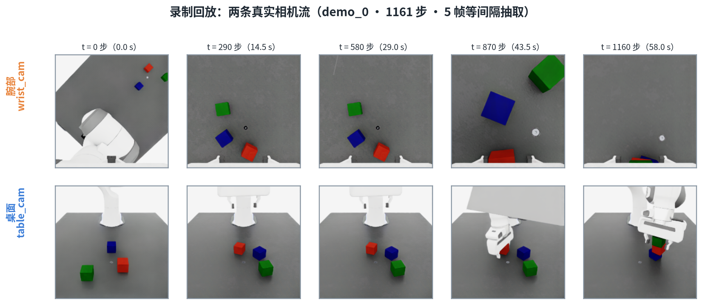
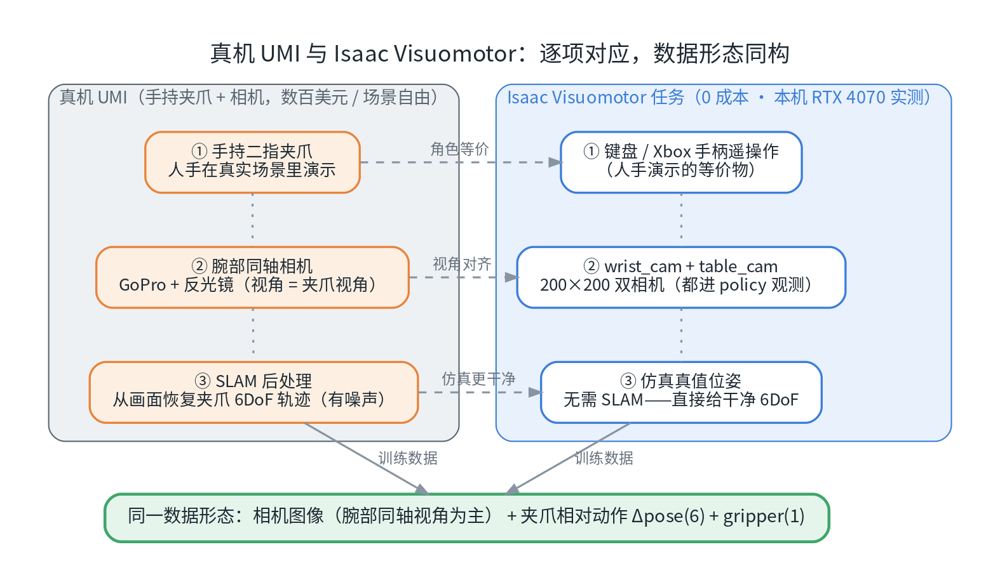
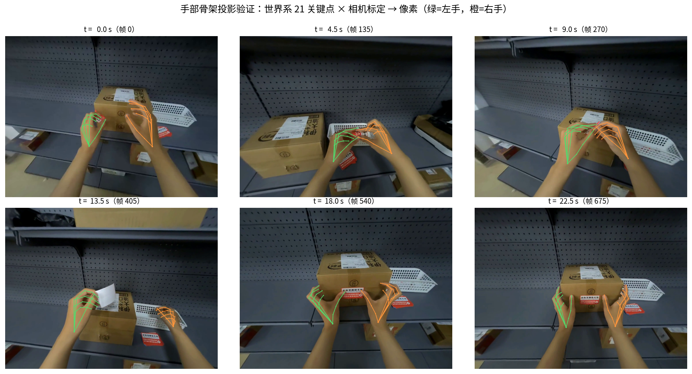
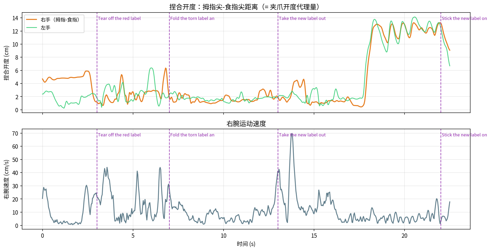
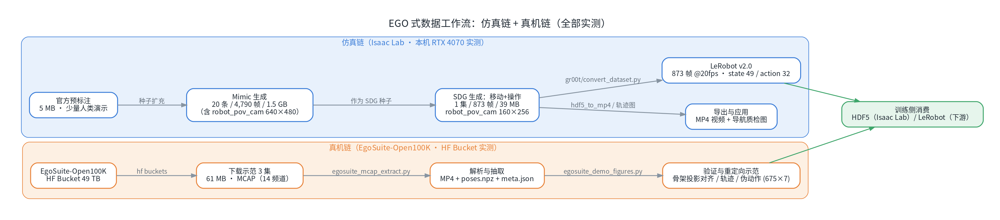
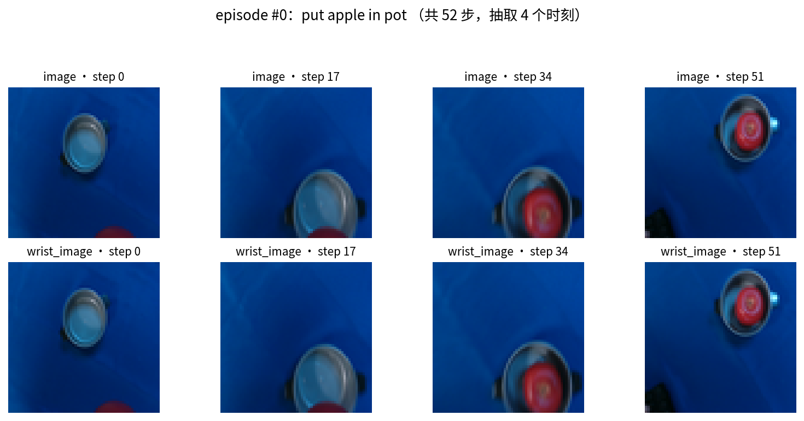

# IsaacDataCollection · Isaac Sim 仿真数据采集实践

**简体中文** ｜ [English](README_EN.md)

> 一套围绕 **NVIDIA Isaac Sim / Isaac Lab** 的机器人数据采集学习与实践资料库：技术博客、系统文档与配套脚本，全部基于实机实测（单卡 RTX 4070 Laptop 8GB）。

`Isaac Sim 6.1` · `Isaac Lab 3.0` · `Python` · `BSD-3-Clause`

---

## 项目简介

机器人学习的竞赛正在从"拼模型"转向"拼数据"。本项目完整记录了在 **Isaac Sim 仿真环境**里采集训练数据的一条实践路线：

- **五类数据采集方式全景**：遥操作、动捕、UMI、EGO、仿真生成（Mimic / SkillGen / RL / SDG），以及与真机采集的逐项对比；
- **可复现的实操手册**：从零开始用键盘/Xbox 手柄遥操作 Franka 机械臂完成"三块积木叠塔"，录制 HDF5 演示数据集；
- **UMI 式视觉工作流**：腕部 + 桌面双相机数据的"采集 → 视频导出 → 体检 → 增广 → 视觉 BC"全链路实测（第五篇）；
- **EGO 式第一人称数据**：仿真侧 G1 人形 Mimic 增广（20 条 / 4,790 帧）+ 移动操作 SDG（873 帧机器视角）→ LeRobot 格式转换；真机侧实测 EgoSuite-Open100K（HF Bucket 49 TB 级：MCAP 解析 → 手部骨架投影验证 → 伪动作构建，第六篇）；
- **动捕重定向实战**：LAFAN1 公开动捕（77 条 BVH）→ GMR IK 重定向到 Unitree G1 → CSV/npz 训练格式全链路实测，并给出 GVHMR「视频 → SMPL-X」流程与模型注册门槛（动捕专篇 §2/§3）；
- **数据闭环**：种子演示 → Mimic 自动增广 → 行为克隆（BC）训练 → 成功率评估，每一步都有实测数字；
- **格式深挖**：HDF5 数据集结构、时间对齐关系、四元数顺序、处理配方与常见坑（96 字节截断、合并修补等）；LeRobot v2/v3 格式详解与 `lerobot/pusht` 公开集实操（第七篇）。
- **动捕全链路与 RLDS**：LAFAN1 公开动捕经 GMR 重定向到 Unitree G1（实测 45 帧/秒）→ pkl/CSV/npz 训练格式，GVHMR 视频流程与模型注册门槛（第八篇）；RLDS/OXE 格式详解 + 86MB 公开集下载/解析实操 + VS Code TFRecord 查看插件（第九篇）；
- **规划式生成与域随机化**：SkillGen 解析（cuRobo 过渡规划 / 手工标注契约 / 硬件门槛）+ DR 三层机制——含视觉随机化七设置抓拍实测（第十篇）。

所有内容都经过实机验证：键盘 3 条演示（2780 步）、UMI 式双相机链路跑通（5 条演示 / 2,599 帧 / 双 200×200 相机）、Mimic 把 30 条种子放大到 **300 条演示（23.7 万帧）**、BC 策略评估成功率 **1/20 → 5/20**、G1 移动操作生成链路（Mimic 20 条 → SDG 873 帧 → LeRobot v2.0 转换）、EgoSuite-Open100K 真机集处理（3 集 / 61 MB）、真实动捕数据可视化、动捕重定向（LAFAN1 两条动作 → G1 全流程，含 pkl/CSV/npz 转换实测）、RLDS 公开数据集下载与解析（86MB 样本全流程实测）、视觉 DR 七设置抓拍实测（21 轮）等，原始数据与过程记录均可追溯。

## 效果预览

<p align="center">
  
  
</p>
<p align="center">
  
  
</p>
<p align="center">
  
  
</p>
<p align="center">
  
  
</p>
<p align="center">
  
  
</p>
<p align="center">
  
  
</p>
<p align="center">
  
  
</p>

> 全部配图位于 `docs/images/isaac-sim-01 ~ 10/`，与系列各篇一一对应。

## 系列技术博客（推荐阅读）

| 序号 | 文章 | 主题 |
| --- | --- | --- |
| （一） | [Isaac Sim 仿真模拟采集数据方法综述](docs/isaac-sim-01-data-collection-survey.md) | 五类采集方式的原理、数据格式与上手路径 |
| （二） | [遥操作实操手册：Franka 摞方块（键盘 / Xbox360 / 鼠标）](docs/isaac-sim-02-teleoperation-hands-on.md) | 热身、录制、质检到 Mimic→BC 全闭环 |
| （三） | [Isaac Sim 仿真遥操采集与真机采集对比](docs/isaac-sim-03-sim-vs-real-comparison.md) | 两条数据路线放在一起逐项对照（18 维） |
| （四） | [HDF5 格式详解：结构、可视化与数据处理实战](docs/isaac-sim-04-hdf5-format-guide.md) | 数据集结构、时间对齐、处理配方与坑 |
| （五） | [UMI 式数据工作流：仿真采集 → 数据处理 → 训练使用](docs/isaac-sim-05-umi-workflow.md) | 真机 UMI 的仿真对应物与全链路实测（双相机 + 视觉 BC） |
| （六） | [EGO 式数据工作流：仿真采集 → 公开数据集处理 → 重定向示范](docs/isaac-sim-06-ego-workflow.md) | G1 第一人称 SDG + EgoSuite-Open100K 实测（骨架投影 / 伪动作） |
| （七） | [LeRobot 数据格式详解：结构、下载与实操](docs/isaac-sim-07-lerobot-format-guide.md) | 格式深挖 + pusht 公开集下载实操 + VS Code 查看插件 |
| （八） | [动捕数据完整工作流：从公开动捕 / 单目视频到机器人训练数据](docs/isaac-sim-08-mocap-workflow.md) | GMR 重定向实测（LAFAN1→G1）+ GVHMR 视频流程 + AMP 消费闭环 |
| （九） | [RLDS 数据格式详解：结构、下载与实操](docs/isaac-sim-09-rlds-format-guide.md) | OXE 格式深挖 + 86MB 公开集下载/解析实操 + VS Code TFRecord 插件 |
| （十） | [SkillGen 与域随机化解析：Isaac Lab 规划式数据生成进阶](docs/isaac-sim-10-skillgen-dr-guide.md) | 规划式生成原理（cuRobo 过渡规划）+ 手工标注契约 + 硬件门槛 + DR 三层机制与实测 |

## 配套脚本

| 脚本 | 用途 |
| --- | --- |
| `scripts/teleop_dataset_stats.py` | 数据集统计与质量体检（步数/抖动/夹爪开合，无需启动 Isaac） |
| `scripts/hdf5_plot_demo.py` | 单条演示曲线可视化（动作/关节/末端轨迹） |
| `scripts/isaaclab_teleop_launch.py` | 手柄/鼠标录制启动器（注册 `-Teleop` 任务变体，不修改上游仓库） |
| `scripts/isaaclab_teleop_extras.py` | 遥操作扩展（鼠标设备、手柄重置键等） |
| `scripts/glfw_gamepad_mapping_patch.py` | Xbox 蓝牙手柄（fw0509）GLFW 映射修补 |
| `scripts/isaac_gamepad_mapping_dump.py` | 手柄键位映射导出（无头 Kit） |
| `scripts/rlds_download.py` | RLDS/OXE 数据集并行下载助手（GCS 公共桶直连，大文件分片并行） |
| `scripts/rlds_demo.py` | RLDS 数据集读取/解码/可视化示范（结构摘要 + 双相机帧拼图 + 动作曲线） |
| `scripts/simulation_data_dr_demo.py` | 视觉域随机化（DR）演示：七种评估设置逐一重置抓拍 + 灯光参数直读清单（启动 Isaac） |
| `scripts/egosuite_download.sh` | EgoSuite-Open100K 的 HF Bucket 下载助手（list / task / get / sync） |
| `scripts/egosuite_mcap_inspect.py` / `egosuite_mcap_extract.py` | EgoSuite MCAP 结构检查与数据抽取（公共模块 `egosuite_common.py`） |

## 目录结构

```
IsaacDataCollection/
├── README.md                 # 中文说明（本文件）
├── README_EN.md              # English README
├── LICENSE                   # BSD-3-Clause
├── docs/
│   ├── isaac-sim-01~10-*.md  # 系列技术博客（十篇）
│   └── images/               # 各篇配图（isaac-sim-01 ~ 10）
├── datasets/                 # 示例数据集（dataset_gamepad.hdf5：30 条手柄遥操演示）
└── scripts/                  # 配套工具脚本
```

## 快速开始

前置：一台装有 Isaac Sim / Isaac Lab 的机器（工具脚本本身只需要 Python + `h5py`/`numpy`/`matplotlib`）。

```bash
# 1) 数据集质检（把 HDF5 换成你的数据集路径）
python scripts/teleop_dataset_stats.py ~/code/isaac/IsaacDataCollection/datasets/dataset_gamepad.hdf5

# 2) 单条演示曲线可视化
python scripts/hdf5_plot_demo.py ~/code/isaac/IsaacDataCollection/datasets/dataset_gamepad.hdf5 --demo demo_1

# 3) RLDS 读取/可视化脚本的参数说明（完整用法见第九篇）
python scripts/rlds_demo.py --help
```

> 遥操作录制、Mimic 增广与训练评估的完整命令，见系列博客（二）、（四）与（五）~（七）；RLDS 下载/读取与 DR 抓拍脚本的用法见（九）、（十）。

## 实测环境

- 硬件：RTX 4070 Laptop（8GB）× 1
- 软件：Isaac Sim 6.1 · Isaac Lab 3.0 · Python 3.12
- 任务：`IsaacContrib-Stack-Cube-Franka-IK-Rel`（三积木叠塔，蓝→红→绿）；以及 `IsaacContrib-Stack-Cube-Franka-IK-Rel-Visuomotor`（腕部/桌面双相机视觉版）；`Isaac-Locomanipulation-G1-Abs-Mimic-v0`（第六篇 G1 Mimic 增广）与 `Isaac-G1-SteeringWheel-Locomanipulation`（第六篇 G1 第一人称移动操作 SDG）

## 许可与致谢

本项目（文档与代码）采用 [BSD-3-Clause](LICENSE) 许可。

感谢 NVIDIA [Isaac Sim](https://developer.nvidia.com/isaac-sim) / [Isaac Lab](https://isaac-sim.github.io/IsaacLab/) 与 [robomimic](https://robomimic.github.io/) 生态；文中引用的 ALOHA、UMI、GELLO、Open-TeleVision 等项目的版权归各自作者所有。
