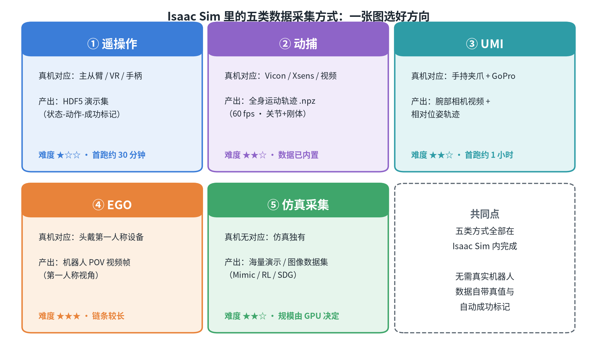
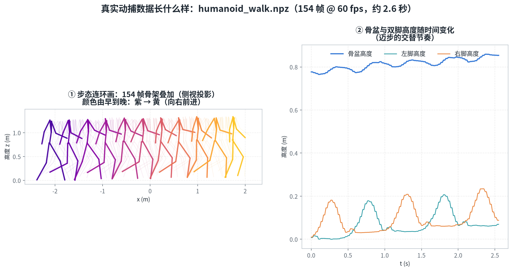
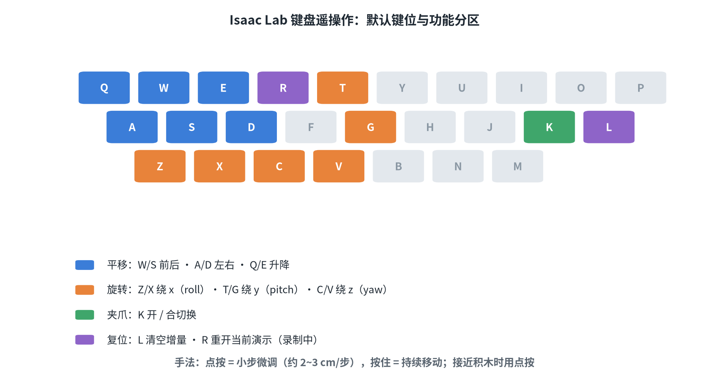
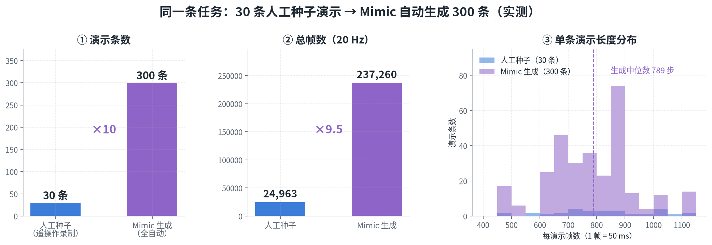

# IsaacDataCollection · Isaac Sim 仿真数据采集实践

**简体中文** ｜ [English](README_EN.md)

> 一套围绕 **NVIDIA Isaac Sim / Isaac Lab** 的机器人数据采集学习与实践资料库：技术博客、系统文档与配套脚本，全部基于实机实测（单卡 RTX 4070 Laptop 8GB）。

`Isaac Sim 6.1` · `Isaac Lab 3.0` · `Python` · `BSD-3-Clause`

---

## 项目简介

机器人学习的竞赛正在从"拼模型"转向"拼数据"。本项目完整记录了在 **Isaac Sim 仿真环境**里采集训练数据的一条实践路线：

- **五类数据采集方式全景**：遥操作、动捕、UMI、EGO、仿真生成（Mimic / RL / SDG），以及与真机采集的逐项对比；
- **可复现的实操手册**：从零开始用键盘/Xbox 手柄遥操作 Franka 机械臂完成"三块积木叠塔"，录制 HDF5 演示数据集；
- **数据闭环**：种子演示 → Mimic 自动增广 → 行为克隆（BC）训练 → 成功率评估，每一步都有实测数字；
- **格式深挖**：HDF5 数据集结构、时间对齐关系、四元数顺序、处理配方与常见坑（96 字节截断、合并修补等）。

所有内容都经过实机验证：键盘 3 条演示（2780 步）、Mimic 把 30 条种子放大到 **300 条演示（23.7 万帧）**、BC 策略评估成功率 **1/20 → 5/20**、真实动捕数据可视化等，原始数据与过程记录均可追溯。

## 效果预览

<p align="center">
  
  
</p>
<p align="center">
  
  
</p>

> 全部配图由仓库内脚本自动生成（`scripts/isaac_sim_0X_figures.py`），可复现、可修改。

## 系列技术博客（推荐阅读）

| 序号 | 文章 | 主题 |
| --- | --- | --- |
| （一） | [Isaac Sim 仿真模拟采集数据方法综述](docs/isaac-sim-01-data-collection-survey.md) | 五类采集方式的原理、数据格式与上手路径 |
| （二） | [遥操作实操手册：Franka 摞方块（键盘 / Xbox360 / 鼠标）](docs/isaac-sim-02-teleoperation-hands-on.md) | 热身、录制、质检到 Mimic→BC 全闭环 |
| （三） | [Isaac Sim 仿真遥操采集与真机采集对比](docs/isaac-sim-03-sim-vs-real-comparison.md) | 两条数据路线放在一起逐项对照（18 维） |
| （四） | [HDF5 格式详解：结构、可视化与数据处理实战](docs/isaac-sim-04-hdf5-format-guide.md) | 数据集结构、时间对齐、处理配方与坑 |

## 详细文档

| 文档 | 内容 |
| --- | --- |
| [robot-data-collection-in-isaac-survey](docs/robot-data-collection-in-isaac-survey.md) | 数据采集综述：真机方法 → Isaac 仿真实践手册（五类方式 × 本机方案） |
| [teleoperation-hands-on-franka-stack-cube](docs/teleoperation-hands-on-franka-stack-cube.md) | 遥操作实操手册（原始详细版，含三设备与故障排查） |
| [mimic-pipeline-round2-guide](docs/mimic-pipeline-round2-guide.md) | Mimic 第二轮全流程：30 种子 → 300 生成 → 训练 6000ep → 评估 |
| [hdf5-format-guide](docs/hdf5-format-guide.md) | HDF5 格式详解（原始详细版，字段级） |
| [umi-in-isaac-workflow](docs/umi-in-isaac-workflow.md) | UMI 式腕部视觉数据在 Isaac 中的采集方案 |
| [ego-in-isaac-workflow](docs/ego-in-isaac-workflow.md) | EGO 第一人称数据（G1 POV 相机 + 移动操作 SDG） |
| [mocap-in-isaac-workflow](docs/mocap-in-isaac-workflow.md) | 动捕数据（AMP / 运动跟踪）使用与可视化 |
| [simulation-data-in-isaac-workflow](docs/simulation-data-in-isaac-workflow.md) | 仿真优先生成（Mimic / RL / SDG）全流程 |
| [real-robot-teleop-and-sim-comparison](docs/real-robot-teleop-and-sim-comparison.md) | 真机遥操作设备与数据的详细对照（原始版） |

## 配套脚本

| 脚本 | 用途 |
| --- | --- |
| `scripts/teleop_dataset_stats.py` | 数据集统计与质量体检（步数/抖动/夹爪开合，无需启动 Isaac） |
| `scripts/hdf5_plot_demo.py` | 单条演示曲线可视化（动作/关节/末端轨迹） |
| `scripts/merge_teleop_datasets.py` | 多批数据集合并（逐条复制 + 重编号，已验证零丢失） |
| `scripts/bc_eval_diagnose.py` | BC 策略回放诊断（接近距离/叠放高度逐段打印） |
| `scripts/isaaclab_teleop_launch.py` | 手柄录制启动器（注册 `-Teleop` 任务变体，不修改上游仓库） |
| `scripts/isaaclab_teleop_extras.py` | 遥操作扩展（鼠标设备、手柄重置键等） |
| `scripts/isaac_sim_01~04_figures.py` | 系列博客全部配图的生成脚本（matplotlib + graphviz） |

## 目录结构

```
IsaacDataCollection/
├── README.md                 # 中文说明（本文件）
├── README_EN.md              # English README
├── LICENSE                   # BSD-3-Clause
├── docs/
│   ├── isaac-sim-01~04-*.md  # 系列技术博客（四篇）
│   ├── *.md                  # 详细文档（综述、实操、Mimic、HDF5 等）
│   └── images/               # 博客配图（isaac-sim-01 ~ 04）
└── scripts/                  # 配套工具脚本
```

## 快速开始

前置：一台装有 Isaac Sim / Isaac Lab 的机器（脚本本身只需要 Python + `h5py`/`numpy`/`matplotlib`；配图脚本另需 `graphviz`）。

```bash
# 1) 数据集质检（把 HDF5 换成你的数据集路径）
python scripts/teleop_dataset_stats.py ./datasets/dataset_keyboard.hdf5

# 2) 单条演示曲线可视化
python scripts/hdf5_plot_demo.py ./datasets/dataset_keyboard.hdf5 --demo demo_1

# 3) 重新生成某篇博客的全部配图
python scripts/isaac_sim_01_figures.py            # 全部
python scripts/isaac_sim_01_figures.py --only fig4  # 只生成指定图
```

> 遥操作录制、Mimic 增广与训练评估的完整命令，见系列博客（二）与（四）。

## 实测环境

- 硬件：RTX 4070 Laptop（8GB）× 1
- 软件：Isaac Sim 6.1 · Isaac Lab 3.0 · Python 3.12
- 任务：`IsaacContrib-Stack-Cube-Franka-IK-Rel`（三积木叠塔，蓝→红→绿）

## 许可与致谢

本项目（文档与代码）采用 [BSD-3-Clause](LICENSE) 许可。

感谢 NVIDIA [Isaac Sim](https://developer.nvidia.com/isaac-sim) / [Isaac Lab](https://isaac-sim.github.io/IsaacLab/) 与 [robomimic](https://robomimic.github.io/) 生态；文中引用的 ALOHA、UMI、GELLO、Open-TeleVision 等项目的版权归各自作者所有。
