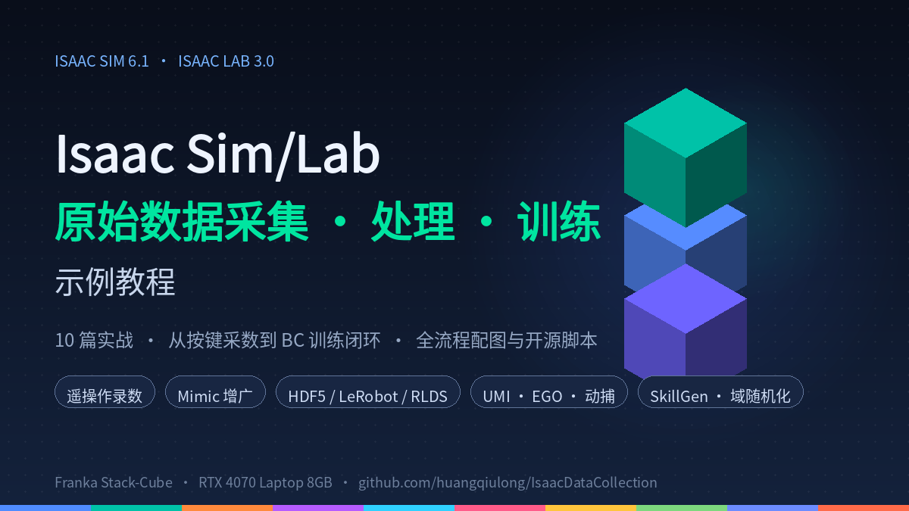

# 专栏：Isaac Sim/Lab 原始数据采集、处理、训练示例教程

| 项目 | 内容 |
| --- | --- |
| **专栏名** | Isaac Sim/Lab 原始数据采集，处理，训练示例教程 |
| **专栏封面** | `docs/images/column/cover.png`（1200×675） |
| **文章数** | 10 篇 |
| **技术栈** | Isaac Sim 6.1 · Isaac Lab 3.0 · Franka Stack-Cube · RTX 4070 Laptop 8GB |
| **开源仓库** | https://github.com/huangqiulong/IsaacDataCollection |

## 专栏简介（长版 · 约 200 字）

机器人学习的第一步往往不是模型，而是数据。本专栏基于 Isaac Sim 6.1 + Isaac Lab 3.0 的真实环境（单卡 RTX 4070 Laptop 8GB），用 10 篇循序渐进的实战文章，走通「原始数据采集 → 数据格式与处理 → 训练使用」的完整链路：从键盘 / 手柄 / 鼠标遥操作录制演示、Mimic 演示增广到行为克隆训练闭环；从 HDF5、LeRobot、RLDS 三大数据格式的逐字段拆解，到 UMI、EGO、动捕三类公开数据集的仿真复刻工作流；最后深入 SkillGen 规划式数据生成与域随机化。所有文章均配实测图表、可直接复用的脚本，代码与配图已全部开源。

## 专栏简介（短版 · 约 80 字）

基于 Isaac Sim 6.1 + Isaac Lab 3.0 的 10 篇实战教程：遥操作采数 → Mimic 增广 → BC 训练闭环，HDF5 / LeRobot / RLDS 格式详解，UMI / EGO / 动捕工作流，SkillGen 与域随机化。全流程配图、脚本开源、8GB 显卡实测。

## 文章列表与封面

| # | 文章 | 主题 | 封面（192×168） |
| --- | --- | --- | --- |
| 01 | [Isaac Sim 仿真模拟采集数据方法综述（一）](./isaac-sim-01-data-collection-survey.md) | 五类采集方式全景 | `images/covers/isaac-sim-01.png` |
| 02 | [遥操作实操手册：Franka 摞方块（二）](./isaac-sim-02-teleoperation-hands-on.md) | 三设备遥操作 + 录制闭环 | `images/covers/isaac-sim-02.png` |
| 03 | [Isaac Sim 仿真遥操采集与真机采集对比（三）](./isaac-sim-03-sim-vs-real-comparison.md) | 仿真 vs 真机逐项对照 | `images/covers/isaac-sim-03.png` |
| 04 | [HDF5 格式详解（四）](./isaac-sim-04-hdf5-format-guide.md) | 结构 / 可视化 / 处理实战 | `images/covers/isaac-sim-04.png` |
| 05 | [UMI 式数据工作流（五）](./isaac-sim-05-umi-workflow.md) | 腕部视觉数据仿真复刻 | `images/covers/isaac-sim-05.png` |
| 06 | [EGO 式数据工作流（六）](./isaac-sim-06-ego-workflow.md) | 第一人称数据与重定向 | `images/covers/isaac-sim-06.png` |
| 07 | [LeRobot 数据格式详解（七）](./isaac-sim-07-lerobot-format-guide.md) | 目录结构 / 下载 / 实操 | `images/covers/isaac-sim-07.png` |
| 08 | [动捕数据完整工作流（八）](./isaac-sim-08-mocap-workflow.md) | 公开动捕 / 视频 → 机器人数据 | `images/covers/isaac-sim-08.png` |
| 09 | [RLDS 数据格式详解（九）](./isaac-sim-09-rlds-format-guide.md) | 三层结构 / 下载 / 实操 | `images/covers/isaac-sim-09.png` |
| 10 | [SkillGen 与域随机化解析（十）](./isaac-sim-10-skillgen-dr-guide.md) | 规划式数据生成进阶 | `images/covers/isaac-sim-10.png` |

## 封面规格与生成

- **专栏封面**：1200×675，`docs/images/column/cover.png`
  - 深色科技风背景 + 等距立方体堆叠（Stack-Cube 意象）+ 专栏标题/副标题 + 5 个特性标签 + 底部 10 段色条（对应 10 篇文章）
- **文章封面**：**192×168**（用户指定尺寸），`docs/images/covers/isaac-sim-01.png` ~ `isaac-sim-10.png`
  - 每篇一个主题色、左上序号、右上等距立方体、主题词、底部色条；圆角 14px
- **重新生成**：`python3 ops/scripts/column_covers.py`（可用 `--only column` / `--only covers` 单独生成）

| 序号 | 主题色 | 主题词 |
| --- | --- | --- |
| 01 | 蓝 | 五类采集法 |
| 02 | 青绿 | 遥操作实操 |
| 03 | 橙 | 仿真 vs 真机 |
| 04 | 紫 | HDF5 格式 |
| 05 | 亮青 | UMI 工作流 |
| 06 | 粉 | EGO 工作流 |
| 07 | 黄 | LeRobot 格式 |
| 08 | 绿 | 动捕工作流 |
| 09 | 靛 | RLDS 格式 |
| 10 | 橙红 | SkillGen·DR |

## 发布说明

- 平台专栏/合集创建时：名称用上表「专栏名」，简介可直接用上面的长版或短版
- 封面图上传：专栏封面传 `cover.png`；每篇文章发布时封面传对应 `images/covers/isaac-sim-0X.png`（192×168）
- 正文用 `docs/oss/` 下的外链版（图片走腾讯云 COS），或按本文档所在仓库的相对路径版本
