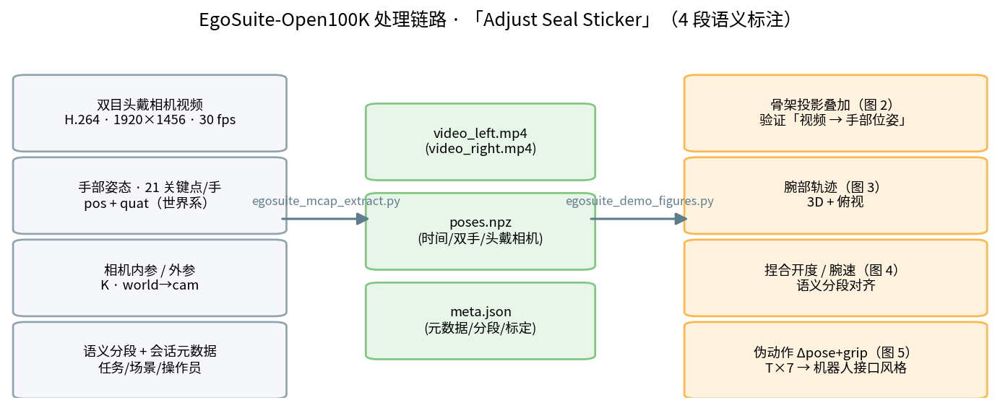
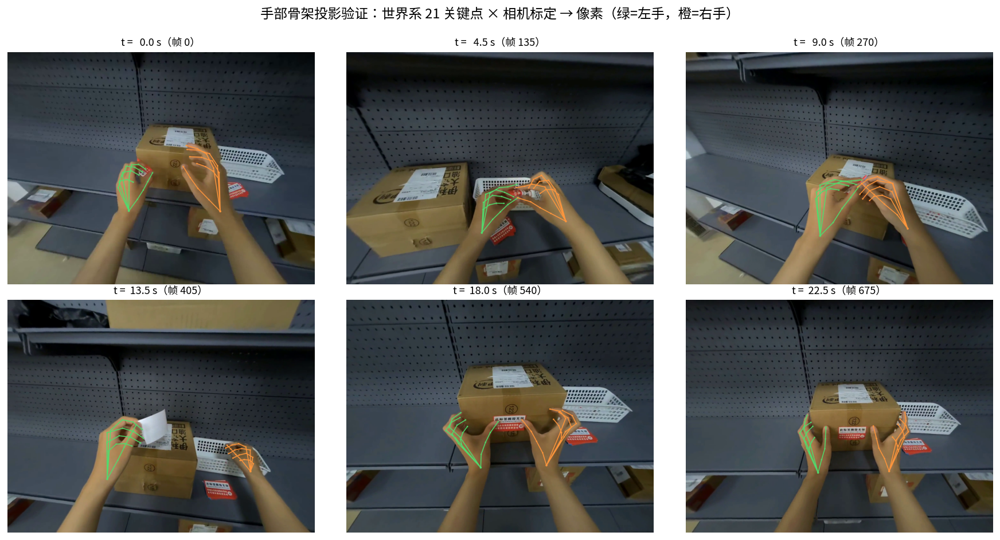
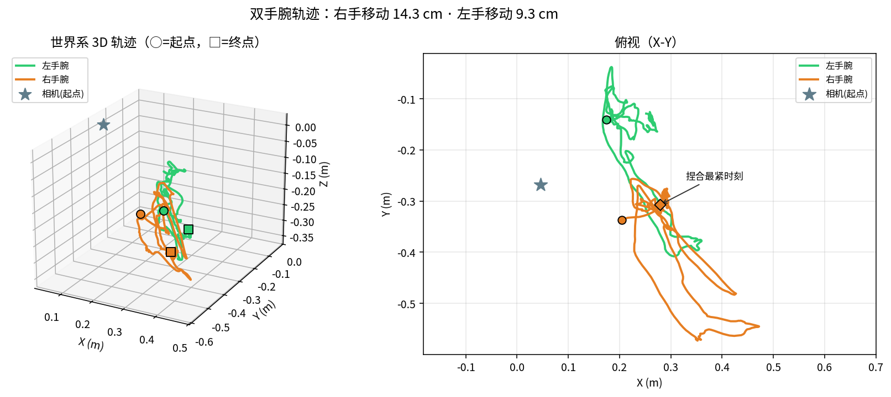
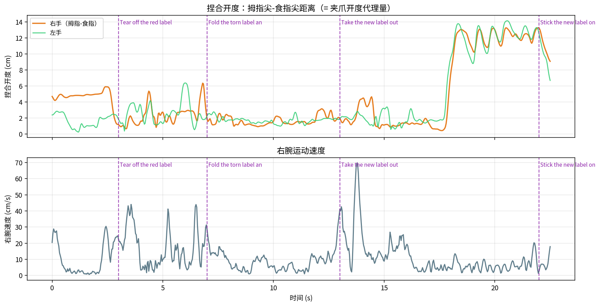
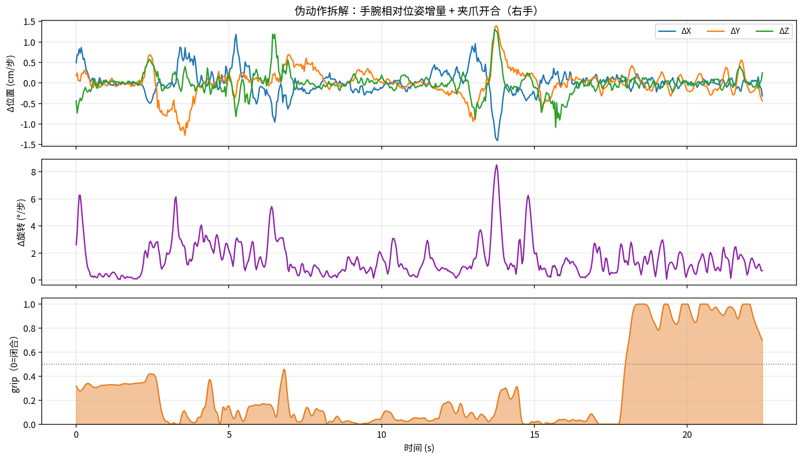

# EgoSuite-Open100K 上手与处理示范：从 HF Bucket 到"伪动作"构建

> **本文定位**：把光轮智能（Lightwheel）**EgoSuite-Open100K** 数据集（HF Bucket 分发）
> 从下载、结构解析到"手部姿态 → 机器人风格动作"的完整处理链路跑通一遍。
> 全部命令与数字来自本机实测（2026-10-14），配图由仓库脚本自动生成。
>
> **配套脚本**（本仓库 `scripts/`）：
>
> - `egosuite_download.sh` —— HF Bucket 下载助手（list / task / get / sync）
> - `egosuite_mcap_inspect.py` —— MCAP 结构检查
> - `egosuite_mcap_extract.py` —— 视频 / 姿态 / 元数据抽取
> - `egosuite_demo_figures.py` —— 可视化 + 伪动作构建
> - `egosuite_common.py` —— 公共工具（Protobuf 动态解码、投影几何等）
>
> **相关文档**：[ego-in-isaac-workflow.md](./ego-in-isaac-workflow.md)（真机 EGO 链路原理，§1.2 详解"视频→手部姿态→重定向"）

---

## 0. 一分钟速览

| 问题 | 答案 |
| --- | --- |
| 数据集是什么 | Lightwheel 2026-08 发布的**10 万小时级**第一人称人类行为数据集（首批公开 1 万小时）；手部姿态 + 全身姿态 + 事件级语义标注；LeRobot v3 与 MCAP 双格式 |
| 数据在哪里 | **Hugging Face Bucket**：`hf://buckets/LightwheelAI/EgoStandard`（实测 49.26 TB / 327,656 文件；git 仓库只是数据卡入口） |
| 怎么访问 | HF 页面申请（人工审批）→ `hf auth login` → `hf buckets` 系列命令（**需要 ≥1.6 的 huggingface_hub**） |
| 单集长什么样 | 1 个 MCAP 文件（10~500 MB）：14 个频道 = 双目 H.264 视频 + 双手 21 关节姿态 + 头/眼位姿 + 内参外参 + 语义分段 + 会话元数据 |
| 实测下载 | `Adjust Seal Sticker`（物流封签调整）任务 3 个小样本：**7.4 / 12.6 / 22.5 s** |
| 处理示范 | 结构检查 → H.264 重组导出 MP4 → 手部姿态 npz → **骨架投影叠加验证** → 轨迹/开合可视化 → **伪动作（Δpose+夹爪）构建** |
| 最大的两个坑 | ① Bucket 需要 socks 代理 + `socksio`（PySocks 不够）；② PyAV 对 raw-h264 的 demux 包 `dts` 全为 `None`，**不能流拷贝封装**，需解码转码 |

---

## 1. 数据集速览

EgoSuite-Open100K 是面向 Physical AI 的开源第一人称人类数据；EgoStandard 是其"头戴视角"主线（90,000 小时规划）。关键规格：

| 维度 | 内容 |
| --- | --- |
| 采集设备 | 头戴双目相机 1920×1456 @30fps（+ 深度相机 320×240 @5fps，见元数据） |
| 标注 | 手部姿态（每手 21 关节 pos+quat）、全身姿态（body 子集）、事件级语义分段 |
| 场景 | 全球采集：物流、零售、家政、办公等（`logistics_x_courier_station_0009` 等环境 ID） |
| 格式 | **MCAP**（Bucket 中的原始形态，内嵌 Protobuf schema）/ **LeRobot v3**（EgoDemo 仓库中的训练就绪形态） |
| 特殊之处 | 部分采集明确要求**操作员约束手部动作近似机器人夹爪运动学**（元数据 `paradigm: robot_gripper_mimic`）——天然适合人→机器人迁移 |

> **为什么值得跑一遍**：它把上一份 ego 文档（§1.2）里"真机链路最难的三步"直接做完了——
> 相机轨迹（设备 SLAM）、手部姿态估计（21 关节）都在数据里，我们只需要做"语义对齐 + 简化重定向"。

---

## 2. 获取访问与下载

### 2.1 访问流程

1. 登录 Hugging Face，在数据集页面申请访问（人工审批，EgoStandard / EgoDemo 各一处）：

   - `https://huggingface.co/datasets/LightwheelAI/EgoStandard`（Bucket 数据的入口）
   - `https://huggingface.co/datasets/LightwheelAI/EgoDemo`（50 小时全子集样本）

2. 审批通过后在本机登录（token 只存在本机，不要外传）：

   ```bash
   hf auth login   # 粘贴 https://huggingface.co/settings/tokens 创建的 read token
   ```

3. 下载工具就绪（本机实测要点）：

   ```bash
   pip install -U huggingface_hub   # ≥1.6 才有 hf buckets 命令
   uv pip install socksio           # ⚠️ httpx 走 socks 代理必需（PySocks 不够）
   ```

   - **hf-mirror 不支持 Bucket**，必须走官方站 + 本地 socks 代理：
     `env -u HF_ENDPOINT HTTPS_PROXY=socks5h://127.0.0.1:2080 ./egosuite_download.sh ...`
   - `egosuite_download.sh` 已封装好上述环境变量，可直接用。

### 2.2 浏览与下载（本次实测）

```bash
# 顶层目录（EgoStand / EgoStandard / EgoStandard-body）
bash scripts/egosuite_download.sh list

# 查看某任务的全部集与大小
bash scripts/egosuite_download.sh task "Adjust Seal Sticker"

# 下载 3 个小体积演示集（10~32 MB）
bash scripts/egosuite_download.sh get "EgoStandard/mcap/Adjust Seal Sticker/0e589be9-a4a7-4d67-a57d-0c2fe6e1286d.mcap" <目标目录>
```

实测下载清单（存放于外置盘 `.../egosuite/downloads/EgoStandard/mcap/Adjust Seal Sticker/`）：

| 文件（UUID） | 大小 | 时长 | 视频帧数 |
| --- | ---: | ---: | ---: |
| `0e589be9-…86d.mcap`（主演示） | 32.1 MB | 22.5 s | 676 |
| `09071527-…79d.mcap` | 19.2 MB | 12.6 s | 316 |
| `0af29495-…a6f.mcap` | 10.1 MB | 7.4 s | 223 |

> `Adjust Seal Sticker` 任务共 **244 集**（单任务 ≈ 1 小时），文件 10~512 MB；
> Bucket 总量 49.26 TB / 327,656 文件（2026-10 快照，`_task_filelist.txt` 留有清单）。
> 下载完成后**大小与远端清单一致**（Bucket 无 SHA-256；git 版数据在 manifests 中提供校验和）。

---

## 3. 结构解析（`egosuite_mcap_inspect.py`）

```bash
python scripts/egosuite_mcap_inspect.py <file.mcap>
```

单个 MCAP = 一集完整演示，内含 **14 个频道**（Protobuf 内嵌 schema，无需 .proto 文件即可解码）：

| 频道 | 消息类型 | 说明 |
| --- | --- | --- |
| `/sensor/camera/head_left/video` | `foxglove.CompressedVideo` | 左目 H.264 流（每帧一条消息） |
| `/sensor/camera/head_right/video` | `foxglove.CompressedVideo` | 右目 H.264 流 |
| `/sensor/camera/head_left/intrinsic` | `foxglove.CameraCalibration` | 内参 K（fx=fy=788.8，cx=960，cy=728） |
| `/sensor/camera/head_left/extrinsic` | `foxglove.FrameTransforms` | `world → head_left_camera` 外参 |
| `/pose/left_hand` `/pose/right_hand` | `pose.*HandFrame` | **21 关节 pos+quat（世界系）** |
| `/pose/head` `/pose/headcam` `/pose/right_eye_cam` | `pose.*Frame` | 头部与相机位姿（`headcam` ≡ 左目外参） |
| `/annotation/semantic_segments` | `annotation.SemanticSegment` | **事件级语义分段**（子任务 + 结束时刻） |
| `/annotation/bad_frame/pose/hand` | `annotation.BadFrameHand` | 手部姿态质量标注（逐帧 is_bad） |
| `/session/metadata` | `session.SessionMetadata` | 设备/任务/场景/操作员/采集方法 |

元数据亮点（主演示集实测）：

- `task_name`: **Adjust Seal Sticker**；环境 `logistics_x_courier_station_0009`（物流驿站包装间）；
- 操作员采集范式：**`robot_gripper_mimic`**——"以近似机器人夹爪运动学的方式刻意约束手部动作"；
- 事件级语义分段（共 4 段，图 4 中标注）：

  | 结束时刻 | 子任务 |
  | ---: | --- |
  | 3.0 s | Tear off the red label from the cardboard box |
  | 7.0 s | Fold the torn label and put it in the white basket |
  | 13.0 s | Take the new label out of the basket and tear it open |
  | 22.0 s | Stick the new label on the cardboard box and smooth it |

---

## 4. 数据抽取（`egosuite_mcap_extract.py`）

```bash
python scripts/egosuite_mcap_extract.py \
  --mcap <file.mcap> --out <输出目录> [--cams left,right] [--keep-h264]
```

三类产物（以主演示集为例）：

| 产物 | 内容 | 实测 |
| --- | --- | --- |
| `video_left.mp4` / `video_right.mp4` | 双目视频（H.264 重组 → MP4） | 各 676 帧 @30fps / 22.5 s / ~11 MB |
| `poses.npz` | 时间戳 + 双手 `(676,21,3)` pos + `(676,21,4)` quat（wxyz）+ 头/相机位姿 | 时间以首帧为 0 |
| `meta.json` | 会话元数据 / 内参外参 / 语义分段 / bad 帧统计 | 4 段语义 / bad 0/676 |

**踩坑记录（视频导出）**：

- MCAP 里的 H.264 是**裸流分片**（每个视频消息一段 Annex-B NAL）；重组后可直接解码；
- ⚠️ 但 PyAV 的 raw-h264 **demux 包 `dts` 全为 `None`**，无法直接 `mux` 流拷贝（会被时间戳校验拦下，得到 0 包）；
- **正确做法**：解码 + `libx264` 转码封装（30 fps、几百帧，耗时忽略不计），或 cv2 兜底重编码（需 FFMPEG 版 opencv）；
- 报告显示 `[视频] video_left.mp4: 676 帧 @ 30.00 fps` 即成功。

---

## 5. 可视化验证（`egosuite_demo_figures.py`）

```bash
python scripts/egosuite_demo_figures.py --data <抽取输出目录>
```



*图 1：从 MCAP 到可视化/伪动作的处理链路（对应本仓库三个脚本）。*

### 5.1 骨架投影叠加 —— "视频 → 手部姿态"的闭环验证

数据集给的是**世界系**手部姿态，而视频是**相机视角**。用元数据里的内参与 `headcam` 位姿
把 21 个关键点投影回画面（世界 → 相机 → 像素），骨架应与画面中的手**逐指对齐**：



*图 2：把世界系手部骨架投影到第一人称画面（绿=左手，橙=右手）——6 帧全程逐指对齐，验证姿态与标定一致性。*

投影公式（`egosuite_common.project_world_points` 的实现）：

```
X_cam = R_cw · X_world + t_cw        （R_cw = R^T，t_cw = -R^T·t，R/t 来自 /pose/headcam）
[u, v, 1]^T ~ K · X_cam              （K 为相机内参）
```

### 5.2 腕部轨迹与捏合开度



*图 3：双手腕世界系轨迹（3D + 俯视）——右手完成主要操作（移动 14.3 cm），左手主要负责扶箱。*



*图 4：拇指-食指距离（夹爪开度代理量）与腕速；紫色虚线为 4 段语义子任务的结束时刻——曲线节奏与"撕签/折叠/取签/贴签"完全对应。*

---

## 6. "伪动作"构建：把姿态变成机器人风格动作



*图 5：右手伪动作——Δ位置（cm/步）、Δ旋转（°/步）、grip 归一化开合（0=闭合）。*

`pseudo_actions_right.npz` 字段（左手同构）：

| 键 | 形状 | 含义 |
| --- | --- | --- |
| `actions` | (T−1, 7) | **[Δx,Δy,Δz, Δωx,Δωy,Δωz, grip]** —— 与 Isaac 遥操作数据同构的动作空间 |
| `pos_delta_m` / `rotvec_rad` | (T−1,3) | 腕部位移增量（m）/ 旋转增量（轴角向量） |
| `grip` | (T−1,) | 5%~95% 分位归一化的夹爪开合（0=闭合，1=张开） |
| `aperture_cm` | (T,) | 原始捏合距离（cm），阈值 `closed/open_threshold_cm` 一并保存 |

**与"真机 EGO 链路"（[ego 文档 §1.2](./ego-in-isaac-workflow.md)）的对应**：

| 真机链路环节 | 本数据集 / 本次示范 |
| --- | --- |
| A. 设备轨迹（SLAM） | ✅ 数据集直接给（`/pose/headcam` 逐帧位姿） |
| B. 手部姿态估计（视频→手） | ✅ 数据集直接给（21 关节真值，图 2 可验证） |
| C. 坐标变换 | ✅ 世界系统一坐标系 |
| D. 重定向（人手→机器人） | 🔶 **本次示范做了"简化版"**：手腕 6DoF + 捏合开度 → Δpose(6)+grip(1)（平行夹爪路线，未标定到具体机器人） |
| 观测对齐 | 采集范式 `robot_gripper_mimic` 已从源头约束动作风格；实际部署仍需视野对齐 |

> ⚠️ **局限**：`grip` 是捏合几何的代理量而非真实夹爪指令；腕部动作未做工作空间限幅与
> 机器人 IK 校验。要用于训练/真机，请在此基础上补齐（这正是 ego 文档 §1.2 环节 D 的完整内容）。

---

## 7. 复现清单

```bash
# 环境（lerobot conda env 实测可用）
uv pip install mcap lz4 zstandard protobuf socksio   # 其余依赖 numpy/matplotlib/opencv/av 已有

# 1) 下载（需已审批 + 已登录；代理走本机 2080 socks）
bash scripts/egosuite_download.sh list
bash scripts/egosuite_download.sh get "EgoStandard/mcap/Adjust Seal Sticker/<uuid>.mcap" <目录>

# 2) 结构检查
python scripts/egosuite_mcap_inspect.py <file.mcap>

# 3) 抽取
python scripts/egosuite_mcap_extract.py --mcap <file.mcap> --out <out_dir>

# 4) 可视化 + 伪动作
python scripts/egosuite_demo_figures.py --data <out_dir>
```

本次产物（外置盘，不随仓库分发）：`.../egosuite/processed/0e589be9/`；
配图：`docs/images/egosuite-demo/`。

**扩展方向**：

- **扩量**：整任务 244 集（`sync`），或 `EgoStandard-body`（+全身姿态）；
- **接训练**：EgoDemo 仓库的 LeRobot v3 形态可直接对接 LeRobot 数据加载器；MCAP 形态可参考本仓库脚本自建 Dataset；
- **接 Isaac**：伪动作 + 观测 → 训练人策略、或作为 VLA 预训练数据。
