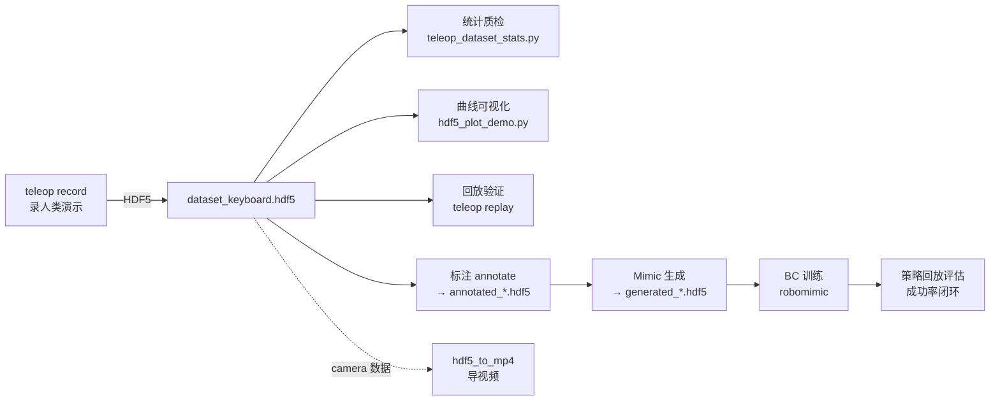

# HDF5 格式详解:结构、可视化与数据处理实战

> 面向 **Isaac Lab 遥操作 / 模仿学习数据集** 的完整指南。
> 本文所有文件结构、数值、工具行为均在本工作区**实测**(2026-10-11,样本:`IsaacDataCollection/datasets/dataset_keyboard.hdf5`,键盘遥操作 Stack-Cube 任务)。
>
> 相关文档:
> - [`teleoperation-hands-on-franka-stack-cube.md`](./teleoperation-hands-on-franka-stack-cube.md) — 遥操作录数实操手册(§6 数据处理、§7 质量评估)
> - [`robot-data-collection-in-isaac-survey.md`](./robot-data-collection-in-isaac-survey.md) — 数据采集方向综述(§2 遥操作)
> - 配套脚本:`../scripts/teleop_dataset_stats.py`(统计质检)、`../scripts/hdf5_plot_demo.py`(曲线可视化)

---

## 0. 一分钟速览

| 问题 | 答案 |
| --- | --- |
| HDF5 是什么 | 层级式二进制容器:**组(Group)** + **数据集(Dataset)** + **属性(Attribute)**,像"带元数据的文件系统" |
| 本工作区哪来的 | `teleop record` 录制输出(robomimic 兼容 schema);Mimic 生成的数据同格式 |
| 怎么打开 | Python `h5py`(本机已装 ✅)、VS Code **H5Web** 插件、HDFView / ViTables、`h5ls`/`h5dump` 命令行 |
| 怎么进一步处理 | 统计质检 → 曲线可视化 → 回放验证 → 标注 → Mimic 生成 → BC 训练(全链路见 §5) |
| 最大的两个坑 | ① 录制进程被中途杀掉 → 文件截断(96 字节、打不开);② 四元数顺序为 **XYZW**(旧数据集为 WXYZ) |

---

## 1. HDF5 是什么

**HDF5**(Hierarchical Data Format version 5)是 The HDF Group 维护的开放文件格式与库,1998 年发布至今,NASA、科学计算、机器学习(如 Keras `.h5` 模型、robomimic 机器人演示数据)都在使用。

核心设计目标:

1. **自描述**:文件自带完整类型与元数据信息,不依赖外部说明;
2. **层级命名空间**:像文件系统一样用"组"组织数据,任意深度嵌套;
3. **任意维数组**:一个"数据集"就是一整块 N 维数组,二进制存储高效紧凑;
4. **元数据(属性)**:文件/组/数据集上都可以挂"关于数据的数据"(单位、版本、JSON 配置等);
5. **单文件便携**:一个 `.hdf5` 文件自带全部数据,压缩/分块可调。

### 1.1 与常见格式对比

| 格式 | 数据模型 | 优势 | 短板 | 本工作区用在 |
| --- | --- | --- | --- | --- |
| **HDF5** | 组 + N 维数组 + 属性 | 自描述、单文件、任意维、分块压缩、跨语言 | 结构复杂;并发写受限 | ✅ 遥操作演示数据集(主线) |
| CSV / JSON | 文本表格 / 对象 | 人类可读、简单 | 大数组无结构、体积大 | `stats_keyboard.json` 等统计/配置 |
| NPZ | numpy 打包(zip) | Python 里两行搞定 | 无层级元数据、不能增量写 | 临时数组交换 |
| rosbag2 / MCAP | 带时间戳的消息流 | ROS 生态原生、多话题 | 读取需 ROS 工具链 | ROS 桥接数据(IsaacSim-ros_workspaces) |
| Parquet | 列式表格 | 大数据分析极快 | 不适合仿真状态树/大数组 | 暂未使用 |
| Zarr | 分块 N 维数组(目录式) | 云原生、并行读写 | 非单文件 | 暂未使用 |

### 1.2 为什么 Isaac Lab 选 HDF5

- 机器人演示数据天然是"**多条演示 × 多条时间步 × 多模态数组**"(动作、关节、相机……),HDF5 的层级 + 数组模型完全对口;
- **robomimic** 生态(模仿学习基线)以 HDF5 为事实标准——Isaac Lab 录制器直接输出 robomimic 兼容 schema,下游标注/Mimic/训练工具零转换;
- 分块 + gzip 压缩可在写入时低成本开启,几百 MB 的含相机数据集可压到一半以下。

---

## 2. 文件结构模型(通用部分)

### 2.1 逻辑模型:三种对象

```
file.hdf5
└── /                          ← 根组(每个文件都有)
    ├── groupA/                ← 组(Group):目录,可无限嵌套
    │   ├── dataset1           ← 数据集(Dataset):一整块 N 维数组
    │   │     @attr1 = 42      ← 属性(Attribute):挂在对象上的元数据
    │   └── subgroup/
    │         └── dataset2
    └── ...
```

- **组(Group)**:容器对象,类比"文件夹";用斜杠路径寻址,如 `/data/demo_0/obs/joint_pos`;
- **数据集(Dataset)**:真正存数据的对象,有数据、形状(shape)、类型(dtype);
- **属性(Attribute)**:小型元数据,只能挂在文件/组/数据集上(不能独立存在),适合存单位、版本号、JSON 配置等;**不要用来存大数组**。

### 2.2 数据集(Dataset)的关键要素

| 要素 | 说明 |
| --- | --- |
| 数据 + dtype | 整数 / 浮点 / 字符串 / 复合类型;h5py 读出来即 numpy 数组 |
| 形状 shape | 任意维;本数据集多为 `(T, D)`(T=时间步数) |
| 分块 chunking | 将数组切成固定大小块**按需读写**;开启压缩/切片读取的前提 |
| 压缩与滤波器 | `gzip` / `lzf` / `szip` 压缩,`shuffle`(打乱字节提升压缩率)、`fletcher32`(校验和)等,**逐数据集**独立配置 |
| 存储布局 | 连续(小数组)或分块(默认用于大数组/开压缩时) |

### 2.3 属性(Attribute)

- 挂在文件、组、数据集上均可;**本数据集大量使用**(如 `format_version`、`env_args`、`num_samples`、`success`);
- 值可以是标量、数组、字符串;
- 属性是小元数据(建议 ≲ 64 KB),大数据请用数据集。

### 2.4 链接(Link)

- **硬链接**:同一对象多个路径(同一文件内"别名");
- **软链接**:指向路径的引用;
- **外部链接**:指向**其它 HDF5 文件**中的对象——可以做出"跨文件虚拟数据集"。
- 实际用途:合并/引用多文件数据集、避免数据拷贝(本工作区暂未用到,了解即可)。

### 2.5 物理格式长什么样

HDF5 文件开头 8 字节是固定的**魔数**(文件签名):

```
00000000: 8948 4446 0d0a 1a0a ...    ← \x89 H D F \r \n \x1a \n
```

(实测:本工作区两个 `.hdf5` 文件头完全一致,可用 `xxd -l 32 xxx.hdf5` 查看。)

文件内部由 **superblock(超级块)** + **B-tree 索引** + 对象头/堆等结构组成;数据和元数据分散在文件中,通过索引定位:

- 元数据很小(几十字节起),但定位任何对象都是索引直接读取——**不需要扫描整个文件**;
- ⚠️ **文件完整性**:HDF5 在**正常关闭**时把缓存与元数据完整落盘;**进程被强杀 / 崩溃时,文件可能停在"写了一半"的状态**。此时 h5py 会报错:

  ```
  OSError: Unable to synchronously open file
  (truncated file: eof = 96, sblock->base_addr = 0, stored_eof = 2048)
  ```

  (实测案例见 §6 第 1 条。)

### 2.6 打开模式与并发

| 模式 | 含义 |
| --- | --- |
| `r` | 只读(最常用) |
| `r+` | 读写,文件必须存在 |
| `w` | 新建(同名**直接覆盖**!) |
| `a` | 存在则打开追加,不存在则新建 |

- **单写者**:同一时刻只允许一个进程写;多个读者可以并发读;
- 高级特性 SWMR(Single-Writer-Multiple-Reader)允许"写的同时读",但需专门开启(本工作区未用);
- 小提示:h5py 可用 `with h5py.File(...) as f:` 确保关闭;大文件写入后 `f.flush()` 可强制落盘。

### 2.7 版本概念:库版本 ≠ 数据版本

- **库版本**:安装的 HDF5 C 库(如 apt 的 1.10.7、conda 的 1.14.x);
- **数据格式版本**:文件里你自己定义的 schema 版本。本数据集的根属性 `format_version = 1` 是 **Isaac Lab 数据集语义版本**(四元数顺序,见 §3.6),与 HDF5 库版本无关。

---

## 3. 实战:Isaac Lab 遥操作数据集详解

### 3.1 数据从哪来(写入流程)

```
teleop record (--dataset_file ~/code/isaac/IsaacDataCollection/datasets/xxx.hdf5)
        │
        ▼
RecorderManager(每条成功演示触发一次导出)
        │
        ▼
Hdf5DatasetFileHandler               ← 源码:isaaclab/source/isaaclab/isaaclab/utils/datasets/hdf5_dataset_file_handler.py
  ① create():建文件,写 format_version、data 组、total=0、env_args
  ② write_episode():成功演示 → 建 demo_N 组,写 attrs 与全部数组(gzip 压缩)
  ③ close():正常关闭(务必走正常退出流程!)
```

要点:

- **只导出成功演示**(`success` 判定触发后才写入)——数据里看到 `success=True` 是本任务导出逻辑的"正常结果",不是"运气";
- 中途 `Ctrl+C` 走**正常收尾**(已成功的演示都已保存);
- 任务名示例:`IsaacContrib-Stack-Cube-Franka-IK-Rel`(三积木叠塔,蓝→红→绿)。

### 3.2 完整结构树(实测 `dataset_keyboard.hdf5`)

```
dataset_keyboard.hdf5
├── attrs: format_version = 1
└── data/
    ├── attrs: env_args = {"env_name": "IsaacContrib-Stack-Cube-Franka-IK-Rel",
    │                      "type": 2, "sim_args": {"dt": 0.01, "decimation": 5,
    │                      "render_interval": 2, "num_envs": 1}}
    ├── attrs: total = 2780                     ← 所有演示的总步数
    │
    ├── demo_0/
    │   ├── attrs: num_samples = 1301,success = True(seed 为可选,本文件未写)
    │   ├── actions                 (1301, 7)   float32
    │   ├── processed_actions       (1301, 8)   float32
    │   ├── obs/
    │   │   ├── actions             (1301, 7)   ← 注意:是"上一执行动作",见 §3.4
    │   │   ├── joint_pos           (1301, 9)
    │   │   ├── joint_vel           (1301, 9)
    │   │   ├── eef_pos             (1301, 3)
    │   │   ├── eef_quat            (1301, 4)
    │   │   ├── gripper_pos         (1301, 2)
    │   │   ├── cube_positions      (1301, 9)
    │   │   ├── cube_orientations   (1301, 12)
    │   │   └── object              (1301, 39)
    │   ├── initial_state/                      ← 本演示开始时刻的完整仿真状态(单帧)
    │   │   ├── articulation/robot/
    │   │   │   ├── joint_position  (1, 9)
    │   │   │   ├── joint_velocity  (1, 9)
    │   │   │   ├── root_pose       (1, 7)      ← [pos(3) + quat(4)]
    │   │   │   └── root_velocity   (1, 6)      ← [线速度 3 + 角速度 3]
    │   │   └── rigid_object/
    │   │       ├── cube_1/ {root_pose (1,7), root_velocity (1,6)}
    │   │       ├── cube_2/ {root_pose (1,7), root_velocity (1,6)}
    │   │       └── cube_3/ {root_pose (1,7), root_velocity (1,6)}
    │   └── states/                             ← 逐步完整仿真状态(物理真值)
    │       ├── articulation/robot/ {joint_position (T,9), joint_velocity (T,9),
    │       │                        root_pose (T,7), root_velocity (T,6)}
    │       └── rigid_object/cube_{1,2,3}/ {root_pose (T,7), root_velocity (T,6)}
    │
    ├── demo_1/  (同结构,731 步)
    └── demo_2/  (同结构,748 步)
```

### 3.3 字段语义表(实测 + 任务源码核对)

以本任务(Stack-Cube Franka IK-Rel)为例;观测项定义见
`isaaclab/source/isaaclab_tasks/isaaclab_tasks/contrib/stack/stack_env_cfg.py` 与
`.../stack/mdp/observations.py`(本文已逐一对过源码)。

| 路径 | 形状 | 含义 | 单位 / 备注 |
| --- | --- | --- | --- |
| `actions` | (T,7) | 每步下发的**相对增量动作**:`[Δx, Δy, Δz, Δrx, Δry, Δrz, 夹爪]` | m / rad;**夹爪 +1=张开、-1=闭合**(实测范围 ±1) |
| `processed_actions` | (T,8) | 经动作控制器处理后的**关节目标**(7 关节 + 夹爪) | 训练一般不用,回放/调试用 |
| `obs/actions` | (T,7) | **上一执行动作**(观测项 `mdp.last_action`) | ⚠️ 与顶层 `actions` **错开 1 步**,见 §3.4 |
| `obs/joint_pos` | (T,9) | 关节角(**相对默认构型的偏移**,`mdp.joint_pos_rel`) | rad;绝对角度见 `states` |
| `obs/joint_vel` | (T,9) | 关节速度 | rad/s |
| `obs/eef_pos` | (T,3) | 末端(ee_frame)世界系位置 | m |
| `obs/eef_quat` | (T,4) | 末端姿态四元数 | 顺序 **XYZW**(§3.6) |
| `obs/gripper_pos` | (T,2) | 夹爪两指关节位置 | rad(张开≈`[0.04, -0.04]`) |
| `obs/cube_positions` | (T,9) | 3 块积木世界系位置 | m |
| `obs/cube_orientations` | (T,12) | 3 块积木姿态四元数 | 顺序 **XYZW** |
| `obs/object` | (T,39) | 任务自定义拼接观测(见下) | 世界系 |
| `states/...` | (T,·) | 逐步完整仿真状态(物理真值) | 回放/调试/分析 |
| `initial_state/...` | (1,·) | 本演示的初始完整状态 | 重置/复现演示 |
| 根属性 | — | `format_version = 1` | 数据集 schema 版本 |
| `data` 属性 | — | `env_args`(JSON)、`total`(总步数) | robomimic 兼容字段 |
| 演示属性 | — | `num_samples`(步数)、`success`、`seed`(可选) | — |

**`obs/object`(39 维)的精确构成**(已对照源码并数值验证):

```
[cube_1 pos(3), cube_1 quat(4), cube_2 pos(3), cube_2 quat(4), cube_3 pos(3), cube_3 quat(4)]   = 21
+ [gripper→cube_1 向量(3), gripper→cube_2(3), gripper→cube_3(3)]                                  = 30
+ [cube_1→cube_2 向量(3), cube_2→cube_3(3), cube_1→cube_3(3)]                                     = 39
```

### 3.4 时间对齐关系(⚠️ 实测,做训练/分析必看)

对本数据集(20 Hz,dt=0.01×decimation 5)实测得到严格关系:

```
obs[0]  == initial_state(逐值相等)
states[t] == obs[t+1](逐值相等,已抽查多对象多个 t)

         obs[t] ──执行 actions[t]──▶ states[t] == obs[t+1]
```

- **`actions[t]`** 是"从观测 `obs[t]` 出发执行的那条命令",执行结果体现在 `states[t]`(即下一帧观测 `obs[t+1]`);
- **`obs/actions[t] = actions[t-1]`**(上一执行动作;`obs/actions[0]` 为全 0,因为还没执行过动作);
- **训练标签用顶层 `actions`**;`obs/actions` 只是观测组里的一个输入项,**不要**拿它当标签(否则动作标签整体错位一步)。

### 3.5 存储与压缩参数(实测)

| 项 | 实测值 |
| --- | --- |
| 压缩 | **每个数据集**独立 `gzip` 压缩,level = 2(`Hdf5DatasetFileHandler` 默认) |
| 分块 | 自动分块,例如 `chunks=(651,4)`、`(326,5)`、`(326,10)`(约 T/2 或 T/4 行) |
| 体积 | 逻辑数据 1.99 MB → 磁盘 1.35 MB(约 68%) |
| 精度 | 全部 `float32`(单精度,对仿真数据足够且省空间) |

> 含相机图像的数据集体积会大得多(图像通常不压缩或轻压缩);读取时注意不要一次把整条图像流读进内存(见 §6)。

### 3.6 四元数顺序:XYZW vs WXYZ(必看)

| 版本 | 顺序 | 说明 |
| --- | --- | --- |
| `format_version = 1`(当前) | **XYZW**(x, y, z, w) | 本数据集实测:机器人基座 `root_pose ≈ [0,0,0, 0,0,0,1]`(XYZW 下的单位四元数);积木/末端四元数最大分量在第 4 位 |
| `format_version = 0` / 缺失(旧) | WXYZ(w, x, y, z) | 旧录制数据集;Isaac Lab 加载器对 `root_pose` **自动转换**,也可用 `Hdf5DatasetFileHandler.convert_dataset_to_xyzw()` 整文件转换 |

- 自己写姿态运算(转旋转矩阵、插值、误差计算)时,**先确认顺序**;
- 用 Isaac Lab 的 `load_episode()` 加载时转换逻辑已内置,按返回值直接用即可。

### 3.7 与 robomimic / Mimic 的关系

- `env_args.type = 2` 等字段为 **robomimic 兼容**设计(对方 gym 环境类型枚举);
- **Mimic 生成的数据集与遥操作数据集同 schema**(同一个 `Hdf5DatasetFileHandler` 写出)——本文所有查看/处理手段对两者通用;
- 标注(`annotate`)与生成(`generate`)会在此基础上**追加子任务相关字段**,训练脚本(robomimic bc 等)按 obs/actions 消费。

---

## 4. 如何可视化查看

### 4.1 途径总览(含本机实测状态)

| 途径 | 适合 | 本机状态 |
| --- | --- | --- |
| Python + `h5py` | 编程查看一切;转 numpy/torch | ✅ venv 已装 `h5py 3.16.0` |
| `teleop_dataset_stats.py` | 数据集"体检报告"(数值) | ✅ 脚本就绪(见 §5.2) |
| `hdf5_plot_demo.py` | 一条演示的曲线图(动作/关节/末端轨迹) | ✅ 本目录配套新脚本(见 §4.3) |
| `h5ls` / `h5dump` / `h5stat` 命令行 | 快速列结构 / 导数据 | ❌ 未装 → `sudo apt install hdf5-tools` |
| VS Code 插件 **H5Web** 等 | 图形界面点着看(树 + 表格 + 曲线/热图/RGB) | ✅ 已装(2026-10-12),`*.hdf5` 默认打开方式 |
| HDFView / ViTables 桌面 GUI | 完整 GUI(切片、绘图、编辑) | ❌ 未装 → `sudo apt install hdfview vitables` |
| Isaac Sim 回放(`teleop replay`) | 在仿真里"看动作能不能复现" | ✅ 见 §4.7 |
| `hdf5_to_mp4.py` | 相机数据 → 视频 | ⚠️ venv 无 `cv2`;用 `~/isaacsim/python.sh` 跑(见 §4.8) |

> 命令行与 GUI 的 apt 安装需要 sudo 权限,请由你在终端执行。

### 4.2 Python / h5py(本机即用 ✅)

快速浏览(层级、属性、形状):

```bash
cd ~/code/isaac/isaaclab && source .venv/bin/activate
python - <<'PY'
import h5py
with h5py.File("/home/dillon/code/isaac/IsaacDataCollection/datasets/dataset_keyboard.hdf5", "r") as f:
    print("文件属性:", dict(f.attrs))                  # format_version
    data = f["data"]
    print("env_args:", data.attrs["env_args"])          # JSON 字符串
    print("演示列表:", list(data.keys()))               # demo_0, demo_1, ...

    def walk(name, obj):
        pad = "  " * name.count("/")
        if isinstance(obj, h5py.Dataset):
            print(f"{pad}- {name.split('/')[-1]:<20} {obj.shape} {obj.dtype}")
    f.visititems(walk)                                  # 递归打印全部数据集

    demo = data["demo_0"]
    print("demo_0 attrs:", dict(demo.attrs))            # num_samples / success
PY
```

读取数组 → numpy / torch:

```python
import h5py, numpy as np, torch
with h5py.File("/home/dillon/code/isaac/IsaacDataCollection/datasets/dataset_keyboard.hdf5", "r") as f:
    g = f["data/demo_0"]
    actions = g["actions"][:]                    # ndarray (T,7)
    joint   = g["obs/joint_pos"][:100]           # 只读前 100 步(切片读,不必全量)
    q       = g["states/articulation/robot/root_pose"][:, 3:7]   # 四元数部分

obs_t = {k: torch.tensor(g["obs"][k][:]) for k in g["obs"]}       # 组 → dict of tensor
```

### 4.3 配套脚本:`hdf5_plot_demo.py`(曲线可视化)

对指定演示画 4 张图:**动作曲线 / 关节角 / 末端位置 / 末端 XY 轨迹**:

```bash
python ~/code/isaac/IsaacDataCollection/scripts/hdf5_plot_demo.py ~/code/isaac/IsaacDataCollection/datasets/dataset_keyboard.hdf5
# 选演示、指定输出:
python ~/code/isaac/IsaacDataCollection/scripts/hdf5_plot_demo.py ~/code/isaac/IsaacDataCollection/datasets/dataset_keyboard.hdf5 \
    --demo demo_1 --out /tmp/demo_1.png
```

默认输出 `<数据集名>_<demo>.png`。适合快速判断"这条演示动了没、平不平滑、夹爪开合对不对"。

### 4.4 命令行工具(hdf5-tools,安装后可用)

```bash
sudo apt install hdf5-tools        # 提供 h5ls / h5dump / h5stat / h5diff / h5repack 等
```

| 命令 | 用途 |
| --- | --- |
| `h5ls -r dataset.hdf5` | 递归列出全部组与数据集(最常用的"树") |
| `h5dump -H dataset.hdf5` | 只看结构,不输出数据内容 |
| `h5dump -d /data/demo_0/actions dataset.hdf5` | 把某个数据集完整转储(文本) |
| `h5stat dataset.hdf5` | 存储统计(各对象占用、分块信息) |
| `h5diff a.hdf5 b.hdf5` | 对比两个文件差异(核对重录/合并结果很有用) |
| `h5repack` | 重打包(可整体升级压缩参数,如统一转 gzip) |

> Ubuntu 22.04 仓库候选版本:1.10.7(已确认可安装)。

### 4.5 VS Code 插件(✅ 已安装,图形界面最省事)

| 插件 | ID | 特点 | 状态 |
| --- | --- | --- | --- |
| **H5Web** | `h5web.vscode-h5web` | 树结构 + 数据表格 + 曲线/热图/RGB 图像 | ✅ 2026-10-12 已装 |
| HDF5 Preview | `lochbrunner.vscode-hdf5-viewer` | 轻量结构预览(备选) | ✅ 2026-10-12 已装 |
| Scientific Data Viewer | `eschalk0.scientific-data-viewer` | 同时支持 HDF5/NetCDF/Zarr 等科学格式 | 未装 |

**用法**:H5Web 已设为本工作区 `*.hdf5`/`*.h5` 的默认打开方式,**双击文件即进入 H5Web**;

1. 打开 `IsaacDataCollection/datasets/dataset_keyboard.hdf5` → 左侧树显示组/数据集层级;
2. 点选数据集(如 `data/demo_0/actions`)→ 顶部切换可视化:**Inspect**(表格)/ **Line**(曲线)/ **Heatmap**(热图)/ **Matrix**(矩阵)/ **RGB**(图像);
3. 数据集下方的 **Attributes** 区可查看 `num_samples`、`success` 等属性;
4. 想换用 HDF5 Preview:右键 → "打开方式…" 选择(两个插件都声明了 `*.hdf5` 默认打开方式,工作区已用 `.vscode/settings.json` 的 `workbench.editorAssociations` 固定为 H5Web)。

> 限制(h5wasm 引擎):>2 GB 文件需在查看器内手动选择打开;外部链接(External Link)不支持。

### 4.6 桌面 GUI(可选)

```bash
sudo apt install hdfview vitables    # 仓库已提供(hdfview 2.11 / vitables 3.0.2)
```

- **HDFView**(Java,官方):树浏览器 + 数据表格 + 二维切片绘图,功能最全;
- **ViTables**(Python/Qt):轻量快开;
- 两者都支持直接查看本数据集的组结构和数组切片。

### 4.7 在仿真里"看"(端到端验证)

用同一数据集回放,验证"动作序列在物理里可复现":

```bash
cd ~/code/isaac/isaaclab && source .venv/bin/activate
./isaaclab.sh teleop replay \
  --task IsaacContrib-Stack-Cube-Franka-IK-Rel \
  --visualizer kit --num_envs 1 \
  --reset_sim_buffer_each_episode \
  --dataset_file ~/code/isaac/IsaacDataCollection/datasets/dataset_keyboard.hdf5
```

(详见实操手册 §5;个别演示回放失败属正常边界情况。)

### 4.8 相机数据 → MP4(上机依赖说明)

若数据集含相机(`wrist_cam`、`table_cam` 等图像键),用上游工具导出视频:

```bash
~/isaacsim/python.sh scripts/tools/hdf5_to_mp4.py \
    --input_file ~/code/isaac/IsaacDataCollection/datasets/dataset_with_cam.hdf5 \
    --output_dir ~/code/isaac/IsaacDataCollection/datasets/videos \
    --input_keys wrist_cam table_cam --framerate 30
```

- 该脚本依赖 `cv2`(OpenCV):**isaaclab venv 未安装**,而 **Isaac Sim 自带 Python 可用**(实测 `cv2 4.14.0` + `h5py 3.16.0`),因此上面用 `~/isaacsim/python.sh` 运行;
- 反向工具 `mp4_to_hdf5.py`(把视觉增广后的 MP4 回填为数据集,参数 `--input_file/--videos_dir/--output_file`);
- 本任务(`IK-Rel`,state 模式)**无相机**,`obs` 里没有图像,直接跳过本节。

---

## 5. 如何进一步处理

### 5.1 h5py 读写基本功

```python
import h5py, numpy as np

# ① 写:新建文件 / 组 / 压缩数据集 / 属性
with h5py.File("/tmp/new_dataset.hdf5", "w") as f:
    f.attrs["format_version"] = 1
    d = f.create_group("data")
    d.attrs["env_args"] = '{"env_name": "demo", "type": 2}'
    demo = d.create_group("demo_0")
    demo.attrs["num_samples"] = 3
    demo.attrs["success"] = True
    demo.create_dataset("actions", data=np.zeros((3, 7), dtype=np.float32),
                        compression="gzip", compression_opts=2)   # 与录制器同款压缩

# ② 追加:r+ 模式新增演示(手动处理时注意 total 计数,见 §5.5)
with h5py.File("/tmp/new_dataset.hdf5", "r+") as f:
    g = f["data"].create_group("demo_1")
    g.create_dataset("actions", data=np.ones((2, 7), dtype=np.float32))
    g.attrs["num_samples"] = 2
    f["data"].attrs["total"] = 5    # 3 + 2

# ③ 切片/分块读取(大文件友好;gzip 数据集切片读只解压相关块)
with h5py.File("/home/dillon/code/isaac/IsaacDataCollection/datasets/dataset_keyboard.hdf5", "r") as f:
    chunk = f["data/demo_0/actions"][100:200]      # 只读 100~199 步
```

### 5.2 本仓库现成工具链

#### (1)统计质检:`teleop_dataset_stats.py`(推荐每次录完必跑)

```bash
cd ~/code/isaac/isaaclab && source .venv/bin/activate
python ~/code/isaac/IsaacDataCollection/scripts/teleop_dataset_stats.py \
    ~/code/isaac/IsaacDataCollection/datasets/dataset_keyboard.hdf5 --json ~/code/isaac/IsaacDataCollection/datasets/stats_keyboard.json
```

输出:每条演示的步数/成功标记/末端行程/动作抖动/夹爪开合统计 + 汇总 + **质量提示**(经验阈值)。
本数据集(2026-10-10 录制)实测结果:3 条演示全部 `success=True`,steps=1301/731/748,
`pos_move` 均值 15.9 m;提示 1 条:`demo_0: 1301 步, 疑似过长(可能未在失败时按 R 重开)`。

指标细节与"三级质量评估流程"见实操手册 §7。

#### (2)合并数据集:`merge_hdf5_datasets.py`

```bash
cd ~/code/isaac/isaaclab
python scripts/tools/merge_hdf5_datasets.py \
    --input_files a.hdf5 b.hdf5 c.hdf5 --output_file merged.hdf5
```

行为(已实测核对):按顺序把各文件 `data/demo_*` 逐条复制并**重新编号**(`demo_0, demo_1, ...`),
`env_args` 取第一个文件。**⚠️ 注意**:该工具**不写**根属性 `format_version`,也不汇总 `data.attrs.total`
(实测输出:根属性为空、`total` 缺失)。若下游要按新版流程使用,建议跑一次修补:

```python
import h5py
with h5py.File("merged.hdf5", "r+") as f:
    f.attrs["format_version"] = 1                                  # 与源数据保持一致(XYZW 语义)
    d = f["data"]
    d.attrs["total"] = sum(d[k].attrs["num_samples"] for k in d)   # 总步数
```

#### (3)视频导入/导出:`hdf5_to_mp4.py` / `mp4_to_hdf5.py`(见 §4.8)

#### (4)旧数据集转换:`convert_dataset_to_xyzw`

```bash
python - <<'PY'
from isaaclab.utils.datasets.hdf5_dataset_file_handler import HDF5DatasetFileHandler
out = HDF5DatasetFileHandler.convert_dataset_to_xyzw("legacy.hdf5")
print("转换完成:", out)     # legacy_xyzw.hdf5(WXYZ → XYZW,所有 root_pose)
PY
```

#### (5)回放验证:`teleop replay`(见 §4.7)

### 5.3 完整数据流水线(HDF5 贯穿始终)



各环节命令与判读标准见实操手册 §7(质量评估)与 §8(Mimic → BC 全流程)。

### 5.4 常见二次加工配方

```python
import h5py, numpy as np

# ① 只看"成功"演示
with h5py.File("/home/dillon/code/isaac/IsaacDataCollection/datasets/dataset_keyboard.hdf5", "r") as f:
    good = [k for k in f["data"] if f["data"][k].attrs.get("success")]

# ② 单条演示 → (obs, action) 序列(手动喂自定义训练脚本)
with h5py.File("/home/dillon/code/isaac/IsaacDataCollection/datasets/dataset_keyboard.hdf5", "r") as f:
    g = f["data/demo_0"]
    actions = g["actions"][:]                                  # 标签
    obs = {k: g["obs"][k][:] for k in g["obs"]}                # 输入(含 obs/actions)

# ③ 导出为 npz(给不方便用 h5py 的场景)
np.savez_compressed("/tmp/demo_0.npz", actions=actions, **obs)

# ④ 统计某一维度(例:末端 z 高度曲线)
with h5py.File("/home/dillon/code/isaac/IsaacDataCollection/datasets/dataset_keyboard.hdf5", "r") as f:
    z = f["data/demo_0/obs/eef_pos"][:, 2]
    print("z 范围:", float(z.min()), "~", float(z.max()))
```

### 5.5 处理大文件 / 含图像数据集的建议

- **别整组读**:`np.asarray(group)` / `visititems` 全量读只适合小数据;图像数据集请按 `[start:end]` 切片或逐块读;
- 只读元数据时用 `attrs` + `shape`(不触发数据解压);
- 需要遍历所有演示统计时,先 `attrs` 后按需读数组(参考 `teleop_dataset_stats.py` 的写法);
- 写入大文件时保持 `gzip` 压缩(录制器默认已开),不要用 `w` 模式反复重写已存在文件。

---

## 6. 常见坑与排错(均为实测)

| # | 现象 | 原因 | 处理 |
| --- | --- | --- | --- |
| 1 | 文件只有 **96 字节**,h5py 报 `truncated file: eof = 96, stored_eof = 2048` | **录制进程被强杀/崩溃**,HDF5 没完成"关闭即落盘"(本工作区曾出现:`dataset_keyboard_1.hdf5` 创建后无写入,该文件已清理) | 截断文件**无法恢复**;重录。录制中不要 `kill -9`;要退出用 `Ctrl+C` 走正常收尾 |
| 2 | 文件存在但没有任何 `demo_*` 组 | 没触发成功判定(例如叠放顺序错),**只有成功演示才会写入** | 按实操手册 §4 流程重录(顺序:蓝→红→绿) |
| 3 | 统计提示 `demo_0: 1301 步, 疑似过长` | 失败后没按 R 重开,混入了试错动作 | 质量筛查项;必要时删/重录该条(手册 §7.3) |
| 4 | `ModuleNotFoundError: No module named 'h5py'`(系统 python) | 没用对 Python 环境 | `cd ~/code/isaac/isaaclab && source .venv/bin/activate` |
| 5 | `obs/actions` 和 `actions` 对不上 | **正常现象**:前者是"上一执行动作"(滞后 1 步) | 训练标签用顶层 `actions`(§3.4) |
| 6 | 合并后的数据集行为不对(四元数被"再转换"、缺 total) | `merge_hdf5_datasets.py` 不写 `format_version` / `total`(§5.2) | 合并后跑修补片段 |
| 7 | 读含图像数据集把内存撑爆 | 一次性读入整条图像流 | 切片/分块读(§5.5) |
| 8 | 同名 `--dataset_file` 再录一次,旧数据没了 | 录制器 `w` 模式**直接覆盖** | 每次换新文件名(手册 §9) |
| 9 | 用 `h5ls` / `h5dump` 提示找不到命令 | `hdf5-tools` 未安装 | `sudo apt install hdf5-tools`(§4.4) |
| 10 | 自己算姿态时结果诡异 | 四元数顺序混淆(XYZW vs WXYZ) | 确认 `format_version`(§3.6);旧数据集先转换 |

---

## 7. 参考资料

**官方 / 上游**

- HDF5 官网与文档:<https://www.hdfgroup.org/> · <https://support.hdfgroup.org/documentation/hdf5/latest/>
- h5py 文档:<https://docs.h5py.org/en/stable/>
- HDF5 文件格式规范:搜索 "HDF5 File Format Specification Version 3.0"(The HDF Group)
- robomimic 数据集格式:<https://robomimic.github.io/docs/datasets/overview.html>

**本仓库**

- 数据集写入/读取实现:`isaaclab/source/isaaclab/isaaclab/utils/datasets/hdf5_dataset_file_handler.py`
- 任务观测定义:`isaaclab/source/isaaclab_tasks/isaaclab_tasks/contrib/stack/`(`stack_env_cfg.py`、`mdp/observations.py`)
- 工具脚本:`isaaclab/scripts/tools/merge_hdf5_datasets.py`、`hdf5_to_mp4.py`、`mp4_to_hdf5.py`
- 统计质检:`IsaacDataCollection/scripts/teleop_dataset_stats.py`
- 曲线可视化:`IsaacDataCollection/scripts/hdf5_plot_demo.py`
- 上游 Mimic 全流程文档:`isaaclab/docs/source/features/imitation-learning/teleop_imitation.rst`

---

*文档:2026-10-11 · isaac 工作区 · 全部结论基于实测(`dataset_keyboard.hdf5`,3 条演示)+ 源码核对;配套脚本位于 `IsaacDataCollection/scripts/`。*
