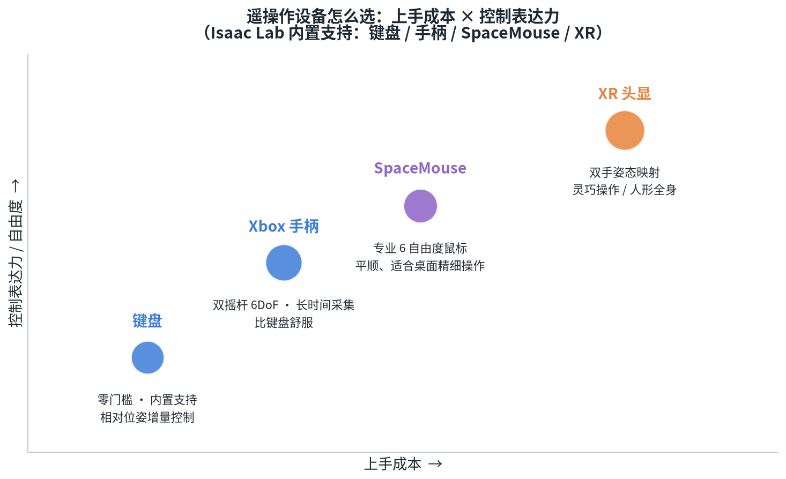
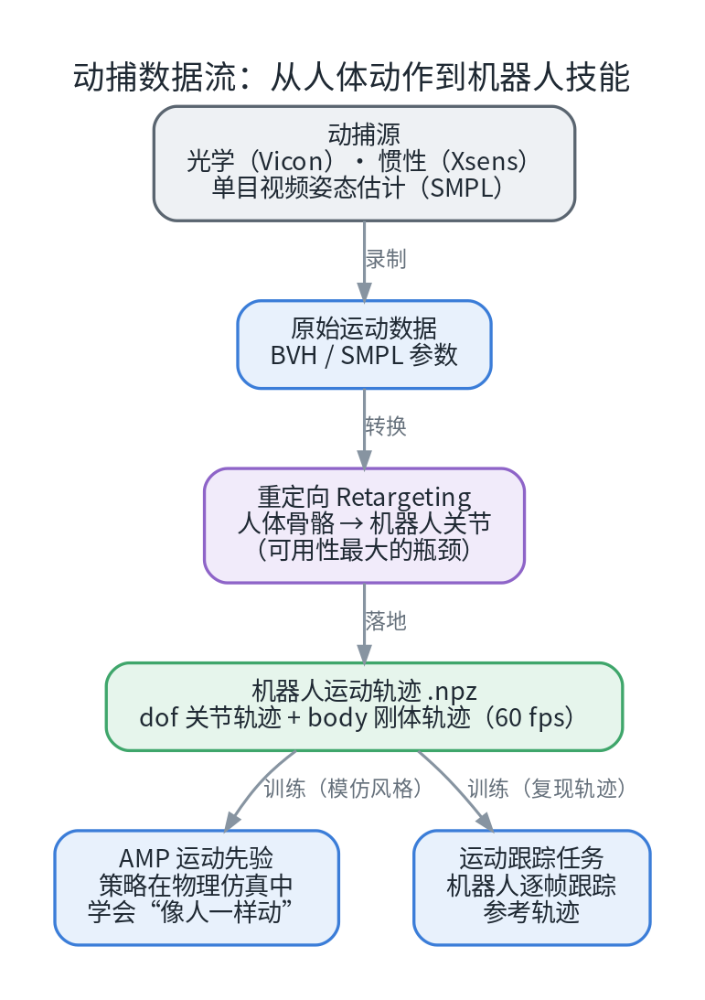
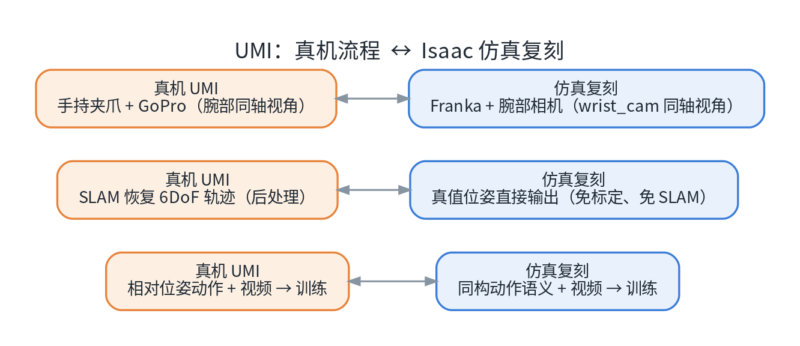
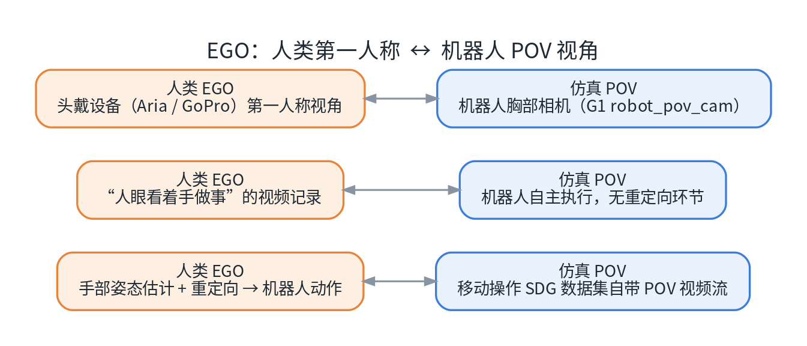
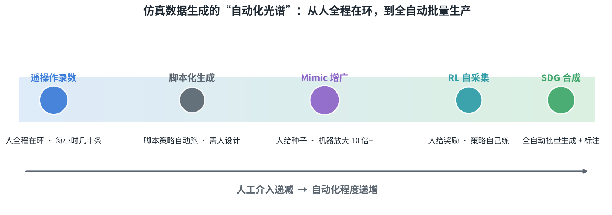
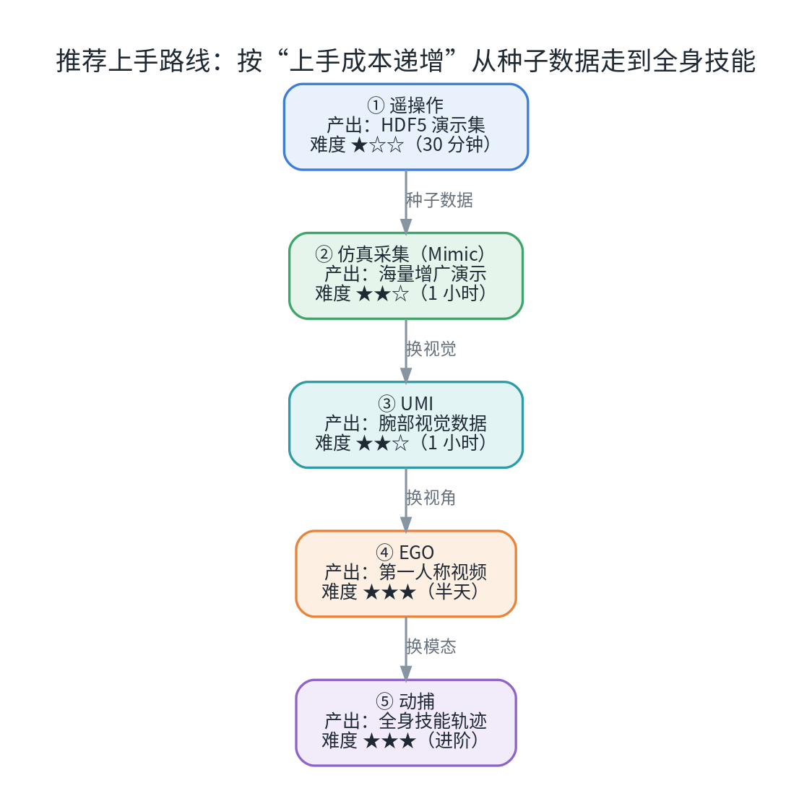

# Isaac Sim 仿真模拟采集数据方法综述（一）

这是「Isaac Sim 仿真模拟采集数据方法综述」系列的**第一篇**。本篇把 **五类数据采集方式**逐一拆开：每一类**真机怎么做、数据长什么样、在 Isaac Sim 里如何复刻、怎么上手跑通**。读完你应该能判断：自己的任务应该从哪条"数据产线"开始。

## 0. 先看全景：五类方式，五种数据


*图 1：五类采集方式速览。全部在 Isaac Sim 内完成，不需要真实机器人，数据自带真值与成功标记。*

| # | 类型 | 真机代表 | 仿真产出 | 上手难度 |
| --- | --- | --- | --- | --- |
| 1 | **遥操作** | 主从臂（ALOHA）/ VR / 手柄 | HDF5 演示集（状态-动作-成功标记） | ★☆☆ |
| 2 | **动捕** | Vicon / Xsens / 视频姿态估计 | 全身运动轨迹 .npz | ★★☆ |
| 3 | **UMI** | 手持夹爪 + GoPro | 腕部相机视频 + 相对位姿 | ★★☆ |
| 4 | **EGO** | 头戴第一人称设备 | 机器人 POV 视频帧 | ★★★ |
| 5 | **仿真采集** | （无真机对应） | 海量演示 / 图像数据集 | ★★☆ |

五类方式的本质差别在于"**数据从哪里来**"：前四类都在复刻真机世界的某种采集形态（人操控、人运动、人手演示、人眼视角），第五类是仿真独有的——场景建好之后，数据由机器自动"长"出来。

## 1. 开始之前：三件准备工作

**① 环境**。按官方文档安装 Isaac Sim 与 Isaac Lab（见文末链接）。一个人可用的桌面环境：NVIDIA RTX 显卡（8 GB 显存起步，显卡越好，能开的环境数越多）、预留 30 GB 以上磁盘空间。

**② 命令约定**。本文使用 Isaac Lab 官方命令 `./isaaclab.sh <子命令>`；所有演示数据集默认写入 `./datasets/` 目录（先 `mkdir -p datasets`）。下载版 Isaac Sim 的环境里，子命令形式需要先激活虚拟环境：

```bash
cd isaaclab && source .venv/bin/activate && mkdir -p datasets

# 环境自检：列出全部可用任务（正常应输出上百个任务）
./isaaclab.sh list_envs
```

**③ 一个心理预期**。接下来的所有操作都会"看起来像在玩游戏"——但产出的是结构化、可训练、带真值的工业级数据集。这正是仿真采集最迷人的地方。

## 2. 方式一：遥操作（Teleoperation）

### 2.1 原理与数据

人在环：用键盘 / 手柄 / SpaceMouse / XR 头显实时操控仿真中的机器人完成任务；系统逐帧记录"观测 → 动作"序列，任务成功判定通过后，整条演示自动入库。

产出格式是 **HDF5**（robomimic 兼容），每条演示一个 `demo_N`：

```python
# 数据集内部结构（h5py 查看）
data/demo_N/
    ├── actions        # (T, 7) 末端增量(6) + 夹爪(1)
    ├── obs/           # joint_pos / joint_vel / eef_pos / eef_quat /
    │                  # gripper_pos / cube_positions / ...（含物体位姿真值）
    ├── initial_state  # 可选：该条起始状态快照（用于精确回放）
    └── attrs: success # 成功标记（自动写入）
```

### 2.2 设备怎么选

Isaac Lab 内置支持四类遥操作设备。选型可以看这张"上手成本 × 控制表达力"矩阵：



*图 2：四种设备的定位——键盘最快上手，手柄适合长时间采集，SpaceMouse 平顺适合桌面精细操作，XR 头显表达力最强但链条最长（需要 CloudXR 环境）。*

### 2.3 三步上手

```bash
# ① 热身：只操作、不录制（先用 10 分钟熟悉手感）
./isaaclab.sh teleop run \
  --task IsaacContrib-Stack-Cube-Franka-IK-Rel \
  --visualizer kit --num_envs 1 --teleop_device keyboard

# ② 录制：成功一条保存一条，攒够 10 条为止
./isaaclab.sh teleop record \
  --task IsaacContrib-Stack-Cube-Franka-IK-Rel \
  --visualizer kit --teleop_device keyboard \
  --num_demos 10 --dataset_file ./datasets/dataset.hdf5

# ③ 回放：从数据集读出动作逐帧重放，校验成功判据与轨迹复现
./isaaclab.sh teleop replay \
  --task IsaacContrib-Stack-Cube-Franka-IK-Rel \
  --visualizer kit --num_envs 1 \
  --dataset_file ./datasets/dataset.hdf5
```

键盘的默认键位（相对位姿增量控制）：

| 键 | 作用 | 键 | 作用 |
| --- | --- | --- | --- |
| `W / S` | 末端前后（x） | `Z / X` | 绕 x 旋转 roll |
| `A / D` | 末端左右（y） | `T / G` | 绕 y 旋转 pitch |
| `Q / E` | 末端上下（z） | `C / V` | 绕 z 旋转 yaw |
| `K` | 开 / 合夹爪 | `L` | 复位（清空当前增量） |

**手法要点**：点按 = 小步微调（约 2~3 cm/步），按住 = 持续快速移动。接近目标物时要用点按，这个节奏感决定了数据质量。一条完整演示通常在十几秒到一分钟之间——新手前几条会慢一些，熟练后节奏会接近真人操作。

录完先快速看一眼数据质量：

```python
import h5py

f = h5py.File("./datasets/dataset.hdf5", "r")
for k in f["data"]:                                  # 逐条演示检查
    demo = f["data"][k]
    print(k, demo["actions"].shape[0], "步",
          "success =", bool(demo.attrs["success"]))
```

### 2.4 注意点

- **只保存成功演示**：失败尝试不会入库，"成功"由任务判定器自动产生——这是仿真遥操作相比真机采集最省心的地方；
- **动作语义是"末端相对位姿增量 + 夹爪"**：这个语义与 UMI 数据、Mimic 生成、下游行为克隆训练全链路对齐，非常通用；
- 录制时**不要**加会剥离相机配置的参数（如 `--disable_external_cameras`），否则视觉版任务录不到图像。

## 3. 方式二：动捕（Motion Capture）

### 3.1 原理与数据流

真机世界里，动捕用**光学（Vicon）或惯性（Xsens）设备**记录人体运动骨架，也可能来自**单目视频姿态估计**（SMPL 系方法）；随后通过**重定向（Retargeting）**把人体骨骼映射到机器人关节空间，作为机器人动作的"参考轨迹"。



*图 3：从人体动作到机器人技能。重定向是整条链路里"可用性最大的瓶颈"——人体骨骼比例和机器人不同，轨迹还要满足物理可行性。*

### 3.2 数据格式

Isaac Lab 仓库内置了三段**已重定向好**的动捕数据（走路 / 跑步 / 舞蹈），存为 `.npz`，字段如下：

| 键 | 形状 | 含义 |
| --- | --- | --- |
| `fps` | 标量 | 采样帧率（内置数据为 60 fps） |
| `dof_names` / `body_names` | (D,) / (B,) | 关节名 / 刚体名 |
| `dof_positions` / `dof_velocities` | (N, D) | 关节位置 / 速度序列 |
| `body_positions` / `body_rotations` | (N, B, 3) / (N, B, 4) | 刚体位姿（旋转为四元数） |
| `body_linear_velocities` / `body_angular_velocities` | (N, B, 3) | 刚体速度 |

### 3.3 上手：先看数据，再看机器人学动作

```bash
# ① 可视化动捕数据本身（纯 CPU，不启动仿真；需要 matplotlib）
cd source/isaaclab_tasks/isaaclab_tasks/contrib/humanoid_amp/motions
python motion_viewer.py --file humanoid_dance.npz    # 另有 walk / run 两段

# ② 查看字段（对照上表）
python -c "
import numpy as np
d = np.load('humanoid_dance.npz', allow_pickle=True)
for k in d.files: print(f'{k:28s}', d[k].shape)
"
```

最后让仿真人形真的"学会"跳舞（AMP：对抗式运动先验；回到 isaaclab 仓库根目录执行，8GB 显存建议 512 环境）：

```bash
./isaaclab.sh train --task IsaacContrib-Humanoid-AMP-Dance-Direct --num_envs 512
```

### 3.4 真实数据长什么样

以"走路"这段数据为例：154 帧、60 fps、约 2.6 秒。把每一帧骨架画出来，就得到一张"步态连环画"——这正是动捕数据的本质：**全身刚体的时序轨迹**。


*图 4：左：154 帧骨架叠加（颜色由早到晚：紫 → 黄）；右：骨盆与双脚高度曲线——迈步的交替节奏一目了然。图中数据来自 Isaac Lab 内置的 humanoid_walk.npz，由笔者可视化。*

### 3.5 注意点

- 动捕数据的用途是**运动先验**（而不是直接训练数据）：AMP 用一个"判别器"区分策略动作与动捕动作，策略靠"骗过判别器"学会人类风格；运动跟踪任务则让机器人逐帧复现参考轨迹；
- 内置数据已经是"重定向后的成品"；如果只有视频，需要外部工具先做"视频 → SMPL → 重定向"，Isaac 负责消费结果而非生产；
- 拿到任何外部动捕数据，先检查**物理可行性**（穿地、失衡），再进训练。

## 4. 方式三：UMI（手持夹爪示范）

### 4.1 原理：不用机器人的遥操作

**UMI（Universal Manipulation Interface）**的核心思想非常巧妙：操作者**手持一个带相机的平行夹爪**（GoPro + 镜面方案，数百美元级）在任意真实场景中演示任务，事后用 **SLAM 恢复夹爪的 6DoF 轨迹**，形成训练数据。它的三大卖点是：数据免标定、策略跨机器人、采集效率高（论文实测 111 条/小时，约为 SpaceMouse 遥操作的 3 倍）。

### 4.2 仿真如何复刻：腕部视角 + 相对动作

UMI 数据的本质是"**腕部同轴相机 + 末端相对位姿动作**"——这两点在仿真里都有直接对应：



*图 5：真机 UMI 与 Isaac 仿真复刻的三步对照。仿真省掉了 SLAM 后处理——位姿直接是真值。*

### 4.3 上手：录 3 条腕部视角演示并导出视频

```bash
# ① 录制（Visuomotor 任务已内置 wrist_cam 腕部相机 + table_cam 桌面相机）
./isaaclab.sh teleop record \
  --task IsaacContrib-Stack-Cube-Franka-IK-Rel-Visuomotor \
  --visualizer kit --teleop_device keyboard \
  --num_demos 3 --dataset_file ./datasets/dataset_umi_like.hdf5

# ② 把腕部相机画面导出为 MP4（就是"UMI 式数据"的视频流）
./isaaclab.sh -p scripts/tools/hdf5_to_mp4.py \
  --input_file ./datasets/dataset_umi_like.hdf5 \
  --output_dir ./datasets/umi_videos --input_keys wrist_cam
```

### 4.4 注意点

- 真机 UMI 的多样性来自"拿着夹爪到处走"（野外场景）；仿真的多样性来自**域随机化**（材质 / 光照 / 物位），两者互补；
- 仿真缺少"真实感噪声"（镜面反射、运动模糊），做视觉策略时要用域随机化补偿 Sim2Real 差距；
- 相机渲染较费显存，8 GB 级显卡上演示条数别贪大。

## 5. 方式四：EGO（第一人称视角）

### 5.1 原理：从"人眼视角"学操作

EGO 数据来自**头戴设备**（Project Aria、GoPro 等）录制的人类第一人称视频（EgoMimic、DexCap 等工作的路线），记录"人眼看着手做事"的过程；若要转成机器人动作，还需要手部姿态估计与重定向。

### 5.2 仿真如何复刻：机器人身上的相机

仿真里的"第一人称"就是**机器人自己身上的相机**：人形机器人 G1 自带胸部 `robot_pov_cam`（D435 相机位，160×256 分辨率，开高分辨率后 320×512）；移动操作 SDG 流水线生成的数据集里就带着这一路 POV 视频流。



*图 6：人类 EGO 与机器人 POV 的三点对照。仿真侧没有"重定向"环节——动作就是机器人自己执行的。*

### 5.3 上手：生成一段带 POV 相机的小规模数据

```bash
# ① 下载官方预标注数据集（约 5 MB）
wget -c -P ./datasets \
  "https://omniverse-content-production.s3-us-west-2.amazonaws.com/Assets/Isaac/6.1/Isaac/IsaacLab/Mimic/pick_place_datasets/dataset_annotated_g1_locomanip.hdf5"

# ② 小规模生成操作数据（20 条，8GB 显存用小并发）
./isaaclab.sh -p scripts/imitation_learning/isaaclab_mimic/generate_dataset.py \
  --device cpu --num_envs 8 --generation_num_trials 20 \
  --input_file ./datasets/dataset_annotated_g1_locomanip.hdf5 \
  --output_file ./datasets/generated_dataset_g1_locomanip.hdf5

# ③ 生成"移动 + 操作"数据（含 robot_pov_cam 第一人称帧）
./isaaclab.sh -p scripts/imitation_learning/locomanipulation_sdg/generate_data.py \
  --device cpu --num_runs 1 --lift_step 60 --navigate_step 130 \
  --kit_args="--enable isaacsim.replicator.experimental.mobility_gen" \
  --task="Isaac-G1-SteeringWheel-Locomanipulation" \
  --dataset ./datasets/generated_dataset_g1_locomanip.hdf5 \
  --output_file ./datasets/generated_dataset_sdg.hdf5 --sensor_camera_view

# ④ 导出第一人称视频（观看 robot_pov_cam_demo_0.mp4，即"机器人版 ego 数据"）
./isaaclab.sh -p scripts/tools/hdf5_to_mp4.py \
  --input_file ./datasets/generated_dataset_sdg.hdf5 \
  --output_dir ./datasets/ego_videos \
  --input_keys robot_pov_cam --video_width 512 --video_height 320
```

### 5.4 注意点

- 这是五类里**链条最长**的一条（下载 → 生成 → 导出），但每一步都有官方脚本，预算半天可以跑通；
- 仿真 POV 相机的安装位置/视野由机器人结构决定（胸部），与"人的意图视角"（头部）有差异；
- 官方在 HuggingFace 还提供预制数据集 `nvidia/g1_locomanip_dataset`，可跳过生成直接看数据形态。

## 6. 方式五：仿真采集（Simulation-first）

### 6.1 定位：仿真的"独门武器"

前四类方式都在"模拟真机的某种采集形态"；第五类只有仿真能做：**场景建好之后，数据几乎免费**——并行成百上千个环境、全状态真值、自动成功判定、无限随机化。它内部还可以细分为五种生成模式：

| 子模式 | 一句话 | 上手门槛 |
| --- | --- | --- |
| **① Mimic 演示增广**（主力） | 少量人类种子演示 → 自动生成海量新演示 | ★★☆ |
| ② SkillGen | Mimic + 运动规划（cuRobo）生成更丰富轨迹 | 显存要求高（单环境 9 GB+） |
| ③ RL 自采集 | 策略试错，rollout 轨迹即数据 | ★★☆ |
| ④ Replicator SDG | 批量生成带完美标注的视觉数据（分割/深度/位姿） | ★★☆ |
| ⑤ 脚本化生成 | 用状态机 / 脚本策略自动产出数据 | ★★☆ |

### 6.2 自动化光谱

从"人全程在环"到"全自动批量生产"，仿真数据生成的五种模式构成了一条连续的光谱——**你投入的人力越少，仿真替你承担的就越多**：



*图 7：自动化光谱。遥操作人全程在环；Mimic 只需人给种子；RL 只需人写奖励；SDG 则完全批量自动化。*

### 6.3 上手：Mimic 小规模全流程（约 30 分钟）

```bash
# ① 下载官方预录演示集（约 3 MB，也可改用自己录的）
wget -c -P ./datasets \
  "https://omniverse-content-production.s3-us-west-2.amazonaws.com/Assets/Isaac/6.1/Isaac/IsaacLab/Mimic/franka_stack_datasets/dataset.hdf5"

# ② 子任务自动标注
./isaaclab.sh -p scripts/imitation_learning/isaaclab_mimic/annotate_demos.py \
  --task Isaac-Stack-Cube-Franka-IK-Rel-Mimic-v0 --visualizer kit --auto \
  --input_file ./datasets/dataset.hdf5 --output_file ./datasets/annotated.hdf5

# ③ 规模化生成（先 10 条验证；8GB 显存建议 --num_envs 32~64，跑通后再放大）
./isaaclab.sh -p scripts/imitation_learning/isaaclab_mimic/generate_dataset.py \
  --visualizer kit --num_envs 32 --generation_num_trials 10 \
  --input_file ./datasets/annotated.hdf5 --output_file ./datasets/generated.hdf5

# ④ 行为克隆训练（纯离线监督学习，不跑仿真）
./isaaclab.sh -p scripts/imitation_learning/robomimic/train.py \
  --task IsaacContrib-Stack-Cube-Franka-IK-Rel --algo bc \
  --dataset ./datasets/generated.hdf5

# ⑤ 回放评估（checkpoint 路径见训练日志输出）
./isaaclab.sh -p scripts/imitation_learning/robomimic/play.py \
  --task IsaacContrib-Stack-Cube-Franka-IK-Rel --visualizer kit \
  --num_rollouts 20 --checkpoint <训练输出目录>/model_xxx.pth
```

一条实测参考：30 条人工种子演示，经 Mimic 一轮自动生成，可以放大出 **300 条完整演示（约 23.7 万帧）**，条数放大 10 倍——人力只花在最初的种子上。

### 6.4 注意点

- **成功率不是 100%**：生成器会跳过失败轨迹，"跑一轮"未必攒够目标条数，规划时留余量；
- **种子决定上限**："垃圾进垃圾出"——标注阶段就失败的种子要先剔除；
- **评估视野（horizon）要设够**：单条演示普遍 700~1100 步，评估时最大步数至少设到 2000，否则会误判策略"失败"；
- 生成时默认带物位随机化；做视觉策略还要叠加材质 / 光照的域随机化。

## 7. 怎么选：一张速查表 + 一条路线

**按"你想要的数据"选**：

| 你想要的数据 | 用哪种方式 | 备注 |
| --- | --- | --- |
| 状态 + 动作策略数据（最快） | 遥操作 或 Mimic 增广 | 半小时内出第一批 |
| 视觉策略（腕部视角） | UMI（Visuomotor 录制） | 与真机 UMI 同构 |
| 视觉策略（第一人称） | EGO（G1 POV + SDG） | 链条较长 |
| 感知数据（分割/深度/位姿） | Replicator SDG | 完美标注 |
| 人形运动技能（走跑舞） | 动捕 + AMP / 跟踪任务 | 数据已内置 |
| VLA 大模型微调数据 | Mimic / SDG 生成后转 LeRobot | 需要大显存训练 |

**按"上手成本"排一条学习路线**：



*图 8：推荐从遥操作（种子数据）起步，然后 Mimic 放大规模，再按需扩展 UMI / EGO / 动捕。*

## 8. 常见坑（八条实测提醒）

1. **环境混用会被拒**：下载版 Isaac Sim 必须配"基于其自带 Python 的虚拟环境"，混用其它解释器会直接报错；
2. **子命令先激活环境**：`./isaaclab.sh <子命令>`（teleop / train 等）需要先 `source .venv/bin/activate`，否则会找不到依赖；`-p` 直接跑脚本的形式不受影响；
3. **相机参数**：录制视觉数据时不要用 `--disable_external_cameras`，否则相机配置被剥离、录不到图像；
4. **显存**：8 GB 级显卡上，Mimic 生成用 `--num_envs 32~64`；SkillGen 等高显存玩法先跳过；
5. **GPU 独占**：一次只跑一个 Isaac 进程，跑之前先看 `nvidia-smi` 是否空闲；
6. **磁盘**：数据集与视频导出会持续吃空间，大文件下载前先确认余量；
7. **网络**：官方数据集存放在 S3 上，国内直连可能很慢（实测 10~40 KB/s），大文件建议挂代理或使用镜像；
8. **HDF5 随手查**：`h5py` 几行代码就能核对字段，导出视频统一用 `hdf5_to_mp4.py`。

## 9. 小结

- **五类方式 = 五条数据产线**：遥操作给种子，动捕给全身技能，UMI 给腕部视觉，EGO 给第一人称，仿真采集给"规模"；
- **上手有明确的最短路径**：遥操作 → Mimic →（按需）UMI / EGO / 动捕，每一站都能独立产出可训练的数据；
- **全程不需要真实机器人**：这五类方式都能在仿真内完成闭环，却产出了带真值、带成功标记、可直接训练的数据。

**系列导航（后续篇目）**：

- **（二）遥操作实操手册**：在 Isaac Lab 里完成一次完整的遥操作采数（键盘 / Xbox360 / 鼠标）——从热身、录制、质检到 Mimic→BC 全闭环；
- **（三）Isaac Sim 仿真遥操采集与真机采集对比**：两条数据路线放在一起逐项对照；
- **（四）HDF5 格式详解**：数据集结构、可视化与数据处理实战。

## 参考资料

- [Isaac Sim 官方页](https://developer.nvidia.com/isaac-sim) · [Isaac Lab 官方文档](https://isaac-sim.github.io/IsaacLab/)
- [UMI: Universal Manipulation Interface（RSS 2024）](https://umi-gripper.github.io/)
- [EgoMimic](https://egomimic.github.io/) · [Open-TeleVision](https://robot-tv.github.io/)
- [AMP: Adversarial Motion Priors（SIGGRAPH 2021）](https://xbpeng.github.io/projects/AMP/index.html)
- [LeRobot 数据集格式 v3](https://huggingface.co/docs/lerobot/en/lerobot-dataset-v3) · [robomimic 数据集规范](https://robomimic.github.io/docs/datasets/overview.html)

---

*本文实测数据来自 Isaac Sim 6.1 + Isaac Lab 3.0 环境（单卡 RTX 4070 Laptop 8GB）：动捕可视化、Mimic 生成规模等均为真实运行结果；UMI / EGO 效率数字引自对应论文。*
