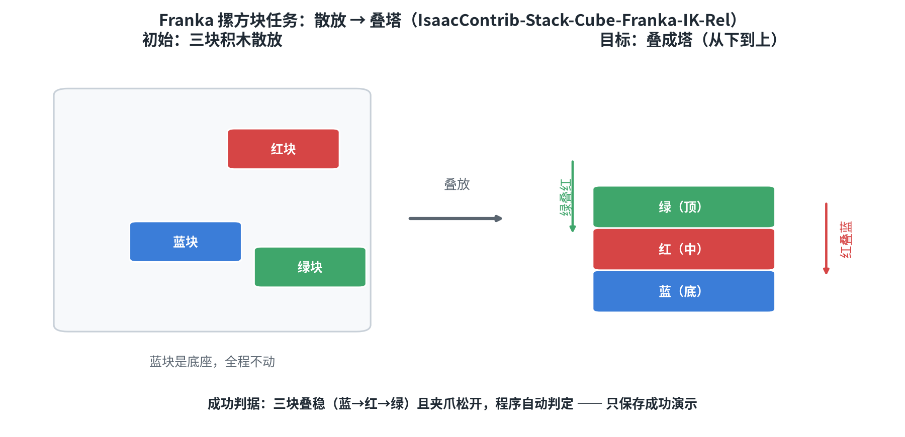
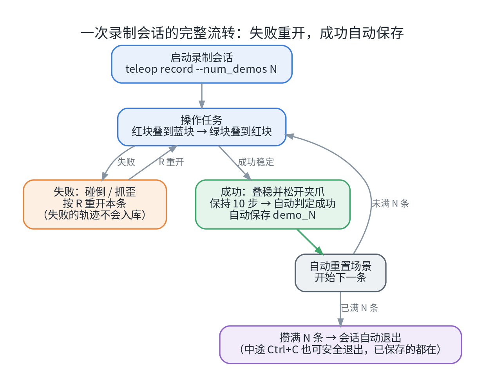
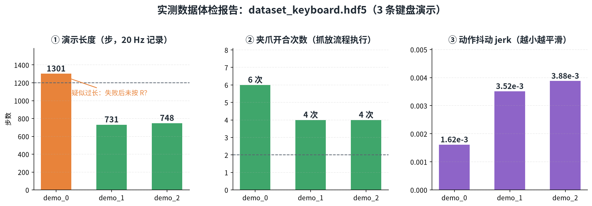
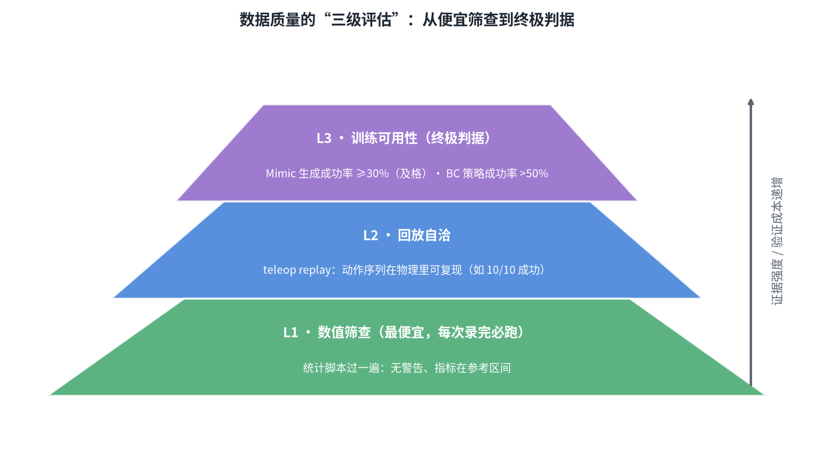
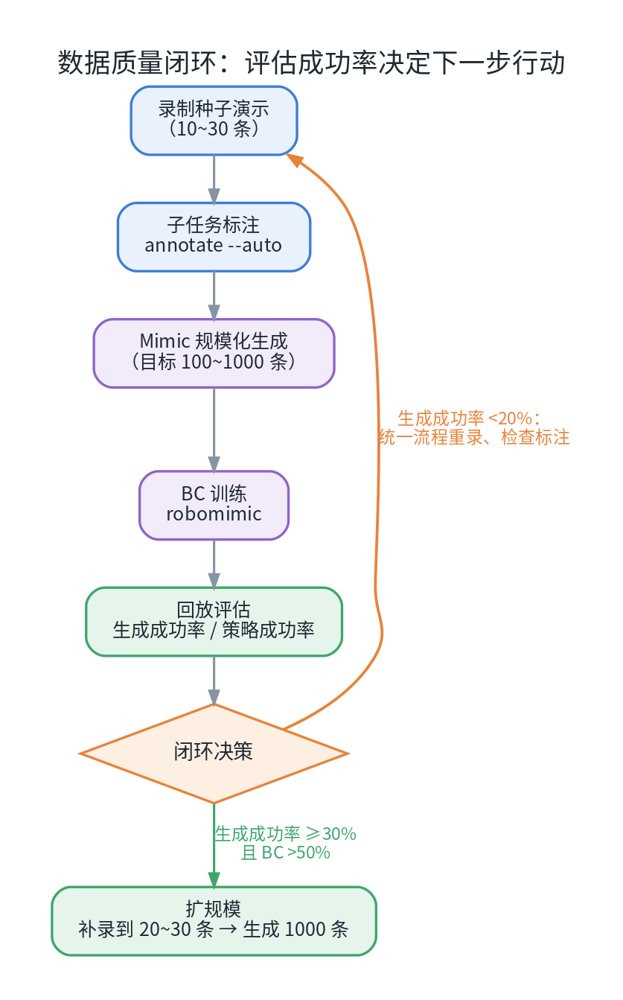

# 遥操作实操手册：Franka 摞方块（键盘 / Xbox360 / 鼠标）（二）

这是系列的**第二篇**。上一篇我们把五类数据采集方式过了一遍；这一篇把其中的"遥操作录数"这条产线**从头到尾走一遍**：在 Isaac Sim / Isaac Lab 里用三种输入设备遥操作 Franka 机械臂完成"三块积木叠塔"，录制数据集，并跑通「数据检查 → 质量评估 → Mimic 增广 → 行为克隆训练」的完整闭环。

## 0. 一分钟速览

| 问题 | 结论 |
| --- | --- |
| 练手任务 | `IsaacContrib-Stack-Cube-Franka-IK-Rel`（三块积木叠塔，蓝→红→绿） |
| 用哪些设备 | 键盘（内置，零门槛）、Xbox 手柄、鼠标（视角控制） |
| 数据产出 | HDF5 演示集（robomimic 兼容，只保存成功演示） |
| 一次练手要多久 | 约半天：录制 10 条 + 质检 + Mimic→BC 小规模闭环 |
| 最核心的一条纪律 | **失败立刻按 R 重开**，不要在失败的尝试里"救回来" |

## 1. 任务：为什么从"摞方块"开始

任务目标：桌面上有蓝、红、绿三块积木，把红块叠到蓝块上、绿块叠到红块上，叠成塔（从下到上：**蓝 → 红 → 绿**），随后松开夹爪并保持稳定——程序自动判定成功。



*图 1：任务示意。蓝块是底座（全程不动），红块和绿块从散放位置搬上塔。*

为什么它适合作为"遥操作第一课"：

| 理由 | 说明 |
| --- | --- |
| 动作语义通用 | 动作 = **末端相对位姿增量 + 夹爪开合**（微分 IK），与 UMI 数据、Mimic 生成、下游训练全链路对齐 |
| 成功判据明确 | 三块叠稳 + 夹爪松开即成功，**程序自动判定，只保存成功演示** |
| 单条演示短 | 熟练后 10~30 秒一条；新手 1~3 分钟一条 |
| 无相机，运行轻 | state 模式不渲染相机，8GB 显存轻松跑 |
| 下游原生支持 | 该任务是 Isaac Lab Mimic 的旗舰示例，标注、生成、BC 训练一键贯通 |

## 2. 开始之前：检查清单

- 按官方文档装好 Isaac Sim 与 Isaac Lab（见文末链接）；**必须有图形界面**（遥操作要在窗口里操作）；
- 下载版 Isaac Sim 的环境里，命令前先激活虚拟环境：`cd isaaclab && source .venv/bin/activate`；
- 跑之前看一眼 `nvidia-smi`：确认没有其它进程占着显卡（一次只跑一个 Isaac 进程）；
- 准备 5GB 以上磁盘余量（日志与数据集会持续增长）；
- 所有数据集统一放 `./datasets/` 目录（先 `mkdir -p datasets`）。

## 3. 设备：键盘、手柄与鼠标

### 3.1 键盘（内置，推荐先用它）

键盘是官方内置设备，零配置。键位按功能分为四组：


*图 2：默认键位。蓝 = 平移，橙 = 旋转，绿 = 夹爪，紫 = 复位/重开。*

| 键 | 作用 | 键 | 作用 |
| --- | --- | --- | --- |
| `W / S` | 末端前后（x） | `Z / X` | 绕 x 旋转（roll） |
| `A / D` | 末端左右（y） | `T / G` | 绕 y 旋转（pitch） |
| `Q / E` | 末端上下（z） | `C / V` | 绕 z 旋转（yaw） |
| `K` | 开 / 合夹爪 | `L` | 复位（清空当前增量） |

录制时还有一个关键按键：**`R` = 重开当前演示**（本章第 4 节详细讲）。

**手法要点**：点按 = 小步微调（约 2~3 cm/步），按住 = 持续快速移动。接近积木时用点按，对准中心再合爪——这个节奏感直接决定数据质量。

### 3.2 Xbox 手柄

Isaac Lab 内置了 Xbox 手柄设备类（按键映射接近游戏习惯：左摇杆平移、右摇杆偏航、D-Pad 调整姿态、X 键开合夹爪），但**官方录制脚本默认注册的设备只有键盘与 SpaceMouse**——若直接对 `teleop record` 指定手柄，会得到类似下面的报错：

```
--teleop_device=gamepad ... Built-in devices: keyboard, spacemouse.
```

要用手柄录制，需要在任务配置的 `teleop_devices` 里**注册一个 gamepad 条目**（常见做法是基于官方任务派生一个自定义任务变体，在配置里加上该设备）。注册后每次录制只换一条参数即可：

```bash
./isaaclab.sh teleop record \
  --task <你的自定义任务名> \
  --visualizer kit \
  --teleop_device gamepad \
  --num_demos 10 \
  --dataset_file ./datasets/dataset_gamepad.hdf5
```

> 小提示：手柄没反应时，先点一下 Isaac Sim 窗口让它获得焦点；Linux 下用 `ls /dev/input/js*` 确认设备节点存在。

### 3.3 鼠标（视角控制）

鼠标不直接驱动机器人，而是**控制观察视角**——"左手键盘操作、右手鼠标看角度"是日常实操最常用的组合：

- 环绕视角 = 右键拖拽；平移视角 = 中键拖拽；缩放 = 滚轮；聚焦选中物体 = `F`。

### 3.4 设备怎么选

| 设备 | 上手速度 | 精度 | 适合 |
| --- | --- | --- | --- |
| 键盘 | ★★★（立刻） | 中（离散步进） | 首练、快速小批录制 |
| Xbox 手柄 | ★★（需注册设备） | 中高（连续模拟量） | 流畅录制主力 |
| SpaceMouse | ★★（官方内置，Linux 需配置 udev 权限） | 高 | 桌面精细操作 |
| 鼠标 | ★★★（辅助） | — | 调视角，配合键盘使用 |

## 4. 录制：从热身到十条数据

### 4.1 热身（只操作、不保存）

```bash
./isaaclab.sh teleop run \
  --task IsaacContrib-Stack-Cube-Franka-IK-Rel \
  --visualizer kit --num_envs 1 \
  --teleop_device keyboard
```

先用 10 分钟熟悉手感：走一遍"接近红块 → 对准 → K 合爪 → 抬起 → 移到蓝块上方 → 放下 → K 开爪"，再叠绿块。**先慢后快**，熟练之前不要追求速度。

### 4.2 正式录制

```bash
./isaaclab.sh teleop record \
  --task IsaacContrib-Stack-Cube-Franka-IK-Rel \
  --visualizer kit \
  --teleop_device keyboard \
  --num_demos 10 \
  --dataset_file ./datasets/dataset_keyboard.hdf5
```

一次会话的完整流转如下——失败与成功各有明确通路，不需要你记额外规则：



*图 3：成功 → 自动保存并重置；失败 → 按 R 重开本条；攒满 N 条自动退出。*

逐条演练：

1. **启动**：等场景加载（几十秒），出现 Franka + 三块积木；
2. **第一条慢动作走一遍**：红块叠到蓝块上 → K 开爪 → 抓绿块叠到红块上 → K 开爪并移开机械臂，**稳定保持 2~3 秒** → 终端打印 `Success condition met! Recording completed.`，该条演示自动保存；
3. **自动进入下一条**：环境重置，积木随机换位；
4. **失败了就按 `R`**：积木碰倒/抓歪，按 R 重开本条——失败的尝试不会写进数据集；
5. **录满 10 条自动退出**；中途想停就 `Ctrl+C`（正常收尾，**已保存的演示都在**）。

> ⚠️ **叠放顺序必须正确**：成功判定要求 **蓝（底）→ 红（中）→ 绿（顶）**。顺序错了，任务永远不会判定成功——终端没有成功打印，数据集文件里也不会有演示。

### 4.3 录制纪律（决定数据质量）

- 失败立刻按 R，**不要在失败尝试里"救回来"**——救回来的轨迹动作杂乱，是典型的脏数据；
- 动作宁慢勿快、以点按为主；抓取前对准积木中心再合爪；
- 叠放顺序恒定：红叠蓝 → 绿叠红；
- 每录 5 条可以停下来用 replay 检查一遍（见下一节），再继续。

## 5. 数据检查与质量评估

### 5.1 第一层：回放验证

用刚录好的数据集回放——同一套物理下，动作序列应当能复现成功：

```bash
./isaaclab.sh teleop replay \
  --task IsaacContrib-Stack-Cube-Franka-IK-Rel \
  --visualizer kit --num_envs 1 \
  --reset_sim_buffer_each_episode \
  --dataset_file ./datasets/dataset_keyboard.hdf5
```

预期 10/10 条回放成功。个别失败属正常边界情况（该条录制时依赖了太多人类实时微调）——追求高质量时删掉重录即可。

### 5.2 第二层：数据"体检报告"

录制输出的 HDF5 里，每条演示都有丰富的数值指标可查。用 h5py 把关键指标过一遍：

```python
import h5py

with h5py.File("./datasets/dataset_keyboard.hdf5", "r") as f:
    for k in f["data"]:                      # 逐条演示
        d = f["data"][k]
        actions = d["actions"][:]
        grip = actions[:, 6]
        toggles = int(((grip[1:] > 0) != (grip[:-1] > 0)).sum())  # 夹爪切换次数
        print(k, "步数:", len(actions), "夹爪切换:", toggles,
              "success:", bool(d.attrs["success"]))
```

指标怎么读（本任务的经验参考值）：

| 指标 | 含义 | 健康参考 | 异常信号 |
| --- | --- | --- | --- |
| `steps` | 单条演示步数 | 60~600（新手偏上限） | >1200 过长：失败未重开，混入试错 |
| `grip_toggles` | 夹爪开合次数 | ≥2（抓一次、放一次） | =0：根本没执行抓放流程 |
| `jerk` | 相邻步动作变化均值 | 越小越平滑 | 某条远大于其他：抖动明显，考虑重录 |
| `pos_move` | 末端行程累加 | 0.1~1.5 m | 接近 0：动作没发出去 |
| `success` | 成功标记 | 全 True | 出现 False = 异常 |

以实测的 3 条键盘演示为例，体检结果如下：



*图 4：三条真实演示的体检：demo_0 长达 1301 步（疑似失败后未按 R，混入试错）；夹爪切换与抖动指标正常。*

这张图也直观说明了"录制纪律"的价值：**一条超长的演示，几乎总是"有故事"的**——多半是失败后没有重开。

### 5.3 三级质量评估

从便宜到终极，数据质量有三道验证闸门：



*图 5：L1 数值筛查（秒级）→ L2 回放自洽（分钟级）→ L3 训练可用性（终极判据）。*

- **L1 数值筛查**：上面的体检脚本，录完必跑；
- **L2 回放自洽**：`teleop replay`，看动作序列在物理里能否复现（如 10/10）；
- **L3 训练可用性**（终极）：把数据喂给下游——Mimic 生成成功率 ≥30% 算及格，BC 策略成功率 >50% 说明"数据真的能学到东西"。

## 6. 下游闭环：Mimic 增广 → BC 训练 → 成功率

用你录制的小数据集，可以立刻走完一条"数据→策略"的完整回路，全部小规模参数适配 8GB 显存：



*图 6：评估成功率决定下一步：低了回炉重录，达标就扩规模。*

### Step 1：子任务标注（约 2~5 分钟）

```bash
./isaaclab.sh -p scripts/imitation_learning/isaaclab_mimic/annotate_demos.py \
  --task Isaac-Stack-Cube-Franka-IK-Rel-Mimic-v0 \
  --visualizer kit --auto \
  --input_file ./datasets/dataset_keyboard.hdf5 \
  --output_file ./datasets/annotated_kbd.hdf5
```

- **成功标志**：终端打印 `Exported 9 (out of 10) annotated episodes.`（数字随数据变化）；
- 机制：标注过程会把每条演示**逐帧回放一遍**并收集子任务信号——因此它同时是一次回放验证：终判据没达成、或某个子任务信号从未触发的演示会被跳过；
- `--auto` 依赖演示遵循标准流程——这正是第 4 节强调"叠放顺序一致"的原因。

### Step 2：规模化生成（先小后大）

```bash
# 小规模验证
./isaaclab.sh -p scripts/imitation_learning/isaaclab_mimic/generate_dataset.py \
  --visualizer kit --num_envs 16 --generation_num_trials 10 \
  --input_file ./datasets/annotated_kbd.hdf5 \
  --output_file ./datasets/generated_kbd_small.hdf5

# 跑通后放大（8GB 显存建议 --num_envs 32~64）
./isaaclab.sh -p scripts/imitation_learning/isaaclab_mimic/generate_dataset.py \
  --num_envs 32 --generation_num_trials 100 \
  --input_file ./datasets/annotated_kbd.hdf5 \
  --output_file ./datasets/generated_kbd_100.hdf5
```

- **生成成功率是本任务最直接的数据质量信号**（官方参考：state 模式约 40%；种子和标注质量好可以更高）；
- 失败轨迹自动丢弃，只导出成功演示；
- 注意 `--generation_num_trials` 的语义：默认是**"目标成功条数"**（失败自动重试直到攒够），不是"尝试次数"；
- 一条实测参考：9 条种子演示、`--num_envs 16`、目标 10 条——10/10 成功，约 17 分钟。另有一次更大规模的实测：30 条种子 → 标注 29 条 → 自动生成 300 条完整演示（约 23.7 万帧）。

### Step 3：行为克隆训练（约 10~30 分钟）

```bash
./isaaclab.sh -p scripts/imitation_learning/robomimic/train.py \
  --task IsaacContrib-Stack-Cube-Franka-IK-Rel \
  --algo bc \
  --dataset ./datasets/generated_kbd_100.hdf5
```

训练日志与 checkpoint 在 `logs/robomimic/...`（终端会打印路径）。先用小数据集跑 20~50 epoch 验证链路即可。

### Step 4：策略回放评估

```bash
./isaaclab.sh -p scripts/imitation_learning/robomimic/play.py \
  --task IsaacContrib-Stack-Cube-Franka-IK-Rel \
  --visualizer kit --num_rollouts 20 \
  --checkpoint <训练输出目录>/models/model_xxx.pth
```

终端输出 20 次回放的成功率。可以多试几个 checkpoint（不同训练阶段差异可能很大）。

### Step 5：闭环决策

| 观察 | 判断 | 行动 |
| --- | --- | --- |
| 生成成功率 ≥30%，BC 成功率 >50% | 数据链路有效 ✅ | 扩规模：补录到 20~30 条 → 生成 1000 条 → 完整训练 |
| 生成成功率 <20% | 种子演示结构混乱 | 回第 4 节统一流程重录；检查标注边界 |
| BC 成功率 <20% | 数据量不足或覆盖单一 | 补采多样化演示（换方位、换路径）；增加生成条数 |

> 数据管理建议：原始 / 标注 / 生成文件分名存放（`dataset_*` / `annotated_*` / `generated_*`），每次重录换新文件名——**录制器打开同名文件会直接覆盖**。

## 7. 常见坑（实测提醒）

| 现象 | 原因 | 解决 |
| --- | --- | --- |
| 报错 `Downloaded Isaac Sim packages cannot be combined with a Python virtual environment` | 虚拟环境不是基于 Isaac Sim 自带 Python 建的 | 按官方安装文档重建环境 |
| 手柄指定后报错 `Built-in devices: keyboard, spacemouse` | 官方录制脚本未注册 gamepad | 在任务配置里注册 gamepad 条目（见 3.2） |
| 键盘/手柄按了没反应 | 焦点在终端 | 点击 Isaac 窗口再操作 |
| 退出后演示条数少于 `--num_demos` | 只导出成功演示；或中途 Ctrl+C | 属正常行为，继续录制即可 |
| 同名数据集被覆盖 | 录制器 `w` 模式打开同名文件 | 每次换新文件名 |
| `Success condition met` 后按 R 没反应 | 成功触发后的短暂保护窗口 | 等自动重置（终端有提示） |
| 生成阶段显存不足（OOM） | `--num_envs` 太大 | 降到 16~32（8GB 级显卡） |
| replay 失败个别条 | 该条依赖人类实时修正 | 重录该条（放慢、规划好路径） |

## 8. 预计耗时与小结

| 阶段 | 首次耗时参考 |
| --- | --- |
| 热身熟悉设备 | 30~60 分钟 |
| 录制 10 条 | 30~60 分钟（新手单条 1~3 分钟） |
| 回放 + 体检 | 15 分钟 |
| 标注 + 小规模生成 | 10~20 分钟 |
| BC 训练 + 回放评估 | 20~40 分钟 |
| **合计** | **约半天** |

小结三句话：

- **录数据 = 一种可以练习的手艺**：手势节奏、失败重开、顺序一致，三条纪律决定数据上限；
- **检查有梯度**：数值体检（秒级）→ 回放（分钟级）→ 训练闭环（终极），每一步都便宜且有效；
- **小数据也能闭环**：10 条种子就足以跑通"录制 → 增广 → 训练 → 评估"全流程，之后的一切只是规模问题。

**系列导航**：

- **（一）数据采集方法总览**：五类采集方式（遥操作、动捕、UMI、EGO、仿真生成）的原理、数据格式与上手路径；
- **（三）Isaac Sim 仿真遥操采集与真机采集对比**：两条数据路线放在一起逐项对照；
- **（四）HDF5 格式详解**：数据集结构、可视化与数据处理实战。

## 参考资料

- [Isaac Sim 官方页](https://developer.nvidia.com/isaac-sim) · [Isaac Lab 官方文档](https://isaac-sim.github.io/IsaacLab/)
- [Isaac Lab 模仿学习与遥操作文档（teleop_imitation）](https://isaac-sim.github.io/IsaacLab/main/source/features/imitation-learning.html)
- [robomimic 数据集规范](https://robomimic.github.io/docs/datasets/overview.html)

---

*本文实测数据来自 Isaac Sim 6.1 + Isaac Lab 3.0 环境（单卡 RTX 4070 Laptop 8GB）：键盘/手柄录制、回放、Mimic 生成等均为真实运行结果。*
