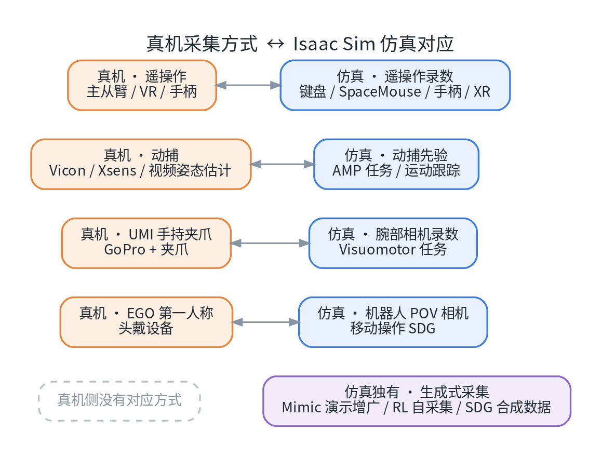
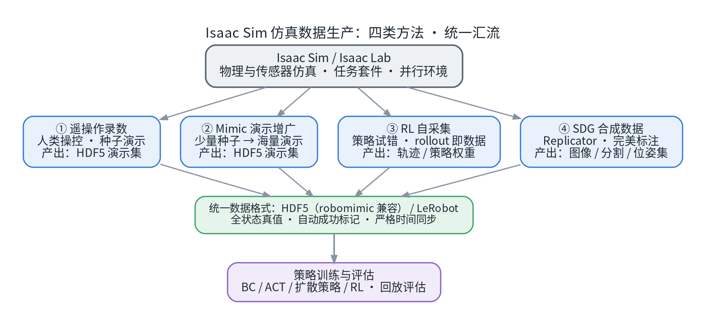
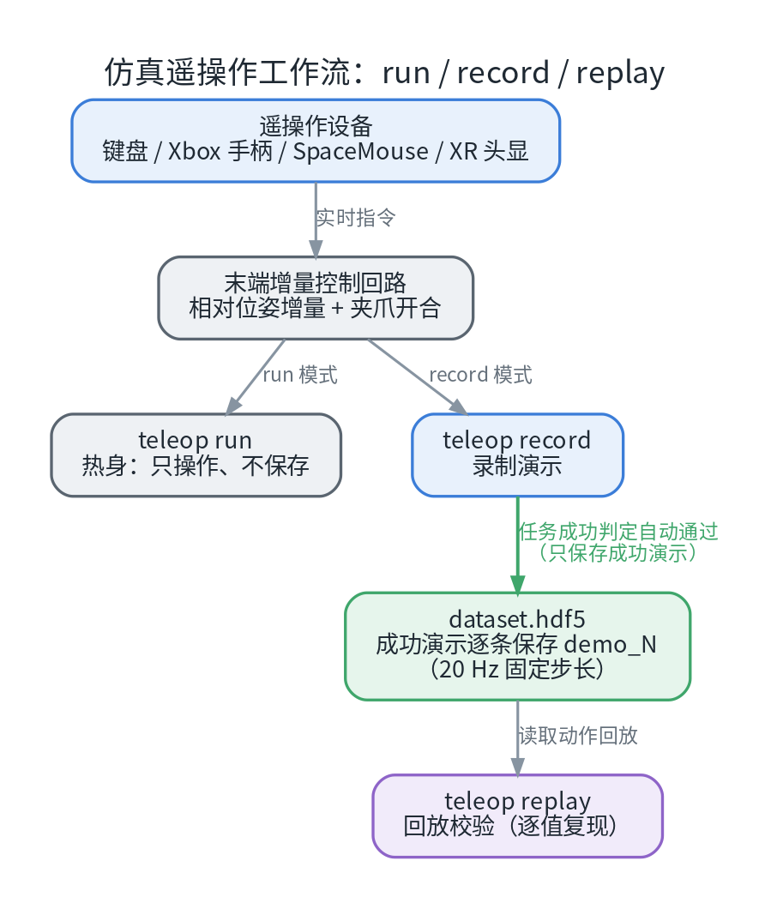
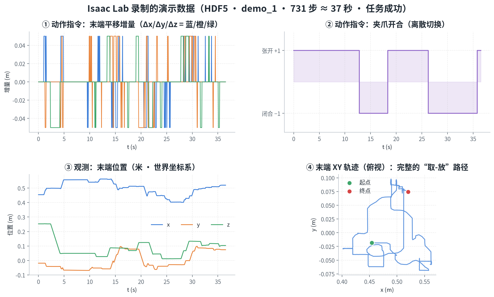
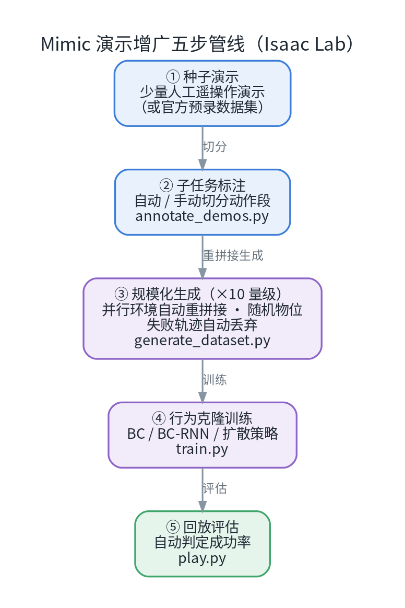
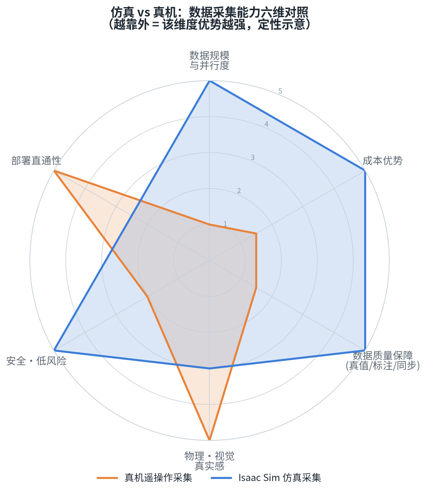
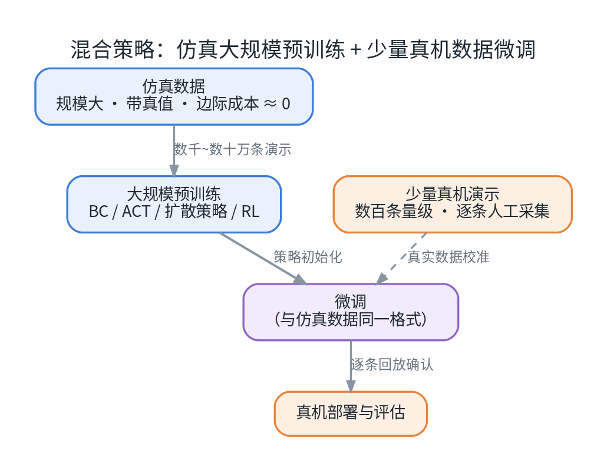

# Isaac Sim 仿真遥操采集与真机采集对比（三）

机器人学习的竞赛，正在从"拼模型"转向"拼数据"。真机演示数据是模仿学习（Imitation Learning）的金标准，但"慢、贵、难规模化"三个现实问题始终存在；于是，**用仿真大规模生产数据**，正在成为越来越多团队的标准动作。

这是「Isaac Sim 仿真模拟采集数据方法综述」系列的**第三篇**，主题是**仿真遥操采集与真机采集的逐项对比**。在 Isaac Sim / Isaac Lab 里，有哪些采集数据的途径？各自产出什么？与真机采集相比，强弱项分别在哪里？本篇用一张张图、一张张表，和第一手实测数据，把这些问题一次讲清。

> **适合读者**：具身智能 / 机器人学习方向的学生与工程师；正在为模仿学习、强化学习、VLA 模型准备数据的团队。

> **配套资源**：本系列的全部文章、配套脚本与图表源码已开源：[github.com/huangqiulong/IsaacDataCollection](https://github.com/huangqiulong/IsaacDataCollection)

## 0. 一分钟速览

| 问题 | 一句话结论 |
| --- | --- |
| 仿真数据到底强在哪 | **全状态真值、自动成功判定、严格时间同步、边际成本 ≈ 0**——这四点是真机数据给不了的 |
| 仿真采集有哪些方法 | ① 遥操作录数 ② Mimic 演示增广 ③ RL 自采集 ④ SDG 合成数据（本篇第 3 节展开） |
| 最快上手路径 | 键盘遥操作录几条演示（半小时级）→ Mimic 把少量种子放大成几百条（机器数小时） |
| 什么时候必须回到真机 | 部署前微调、真实接触任务、最终评估——仿真负责"规模"，真机负责"保真" |

## 1. 从真机数据说起：为什么要把采集搬进仿真

### 1.1 真机遥操作：金标准与三个瓶颈

**真机遥操作**是所有机器人数据采集方式的"原点"：人类操作者通过控制器（主从臂、VR 头显、游戏手柄、力反馈主手……）实时操纵一台真实机器人完成任务，系统同步记录机器人的观测与动作，把"人类技能"转换为"机器人可学习的数据"。ALOHA、Mobile ALOHA、UMI 等里程碑工作，全部建立在真机遥操作演示之上。

它的不可替代性来自"真实"本身：

- 真实的接触摩擦、相机噪声、光照与场景，**不存在 Sim2Real 差距**；
- 数据与部署环境同构，训练完可以直接上机验证；
- 柔顺接触、可变形物体、精细插拔等任务，今天仍难以在仿真中高保真复现。

但它的瓶颈同样现实：

1. **慢**：一人一机逐条采，熟练操作员也快不过人手本身的节奏；
2. **贵**：硬件数千到数万美元，加人力持续投入，失败演示还要人工处理；
3. **场景固定**：采集环境就是部署环境，换一个场景往往要重采。

### 1.2 仿真采集的定位：不是替代，是放大器

仿真路线换了一个思路：**让"采集"发生在虚拟世界里**。物理引擎负责动力学与接触，渲染器负责视觉，任务脚本自动判定成败——数据可以并行成百上千份地"长"出来，而且每条都自带真值。

关键在于：**真机采集的每一种方式，在仿真里几乎都有对应物**；仿真还额外拥有真机做不到的"生成式"方法。



*图 1：真机侧的四类采集方式（遥操作、动捕、UMI 手持夹具、EGO 第一人称）在 Isaac Sim 中都有对应的仿真实现；底部的"生成式采集"（Mimic / RL / SDG）则是仿真独有的能力。*

## 2. Isaac Sim / Isaac Lab：数据生成的"工厂"

先快速对齐两个名词：

- **Isaac Sim**：NVIDIA 基于 Omniverse 构建的机器人仿真平台。核心能力是物理仿真（PhysX）、RTX 高质量渲染、传感器仿真（相机 / 深度 / LiDAR / IMU）、ROS 2 桥接，以及合成数据生成（Replicator）。
- **Isaac Lab**：构建在 Isaac Sim 之上的机器人学习框架。它把"仿真"包装成了做学习研究的完整工具链：官方任务套件（120+ 任务）、GPU 并行环境（单卡可跑数十到数千个环境实例）、遥操作栈、Mimic 数据增广、主流 RL 库集成（rsl_rl / rl_games / skrl / sb3 等）。

对"数据采集"这件事来说，这套栈的价值可以概括为四点：

1. **并行**：一个任务可以同时开几十上百个实例，数据的"生产车间"规模由 GPU 决定；
2. **真值**：每个物体的位置、姿态、速度都在引擎内部，不需要估计、不需要标定；
3. **自动判定**：任务成功与否由程序判定，成功才落盘——天然的数据质量闸门；
4. **可复现**：固定随机种子后，同一段演示可以逐值回放，调试与消融实验的成本极低。

## 3. 方法全景：四类仿真数据生成方法

在 Isaac Sim / Isaac Lab 里"造数据"，主流有四种方法，可以理解为一条从"人"到"机器"的接力：



*图 2：四类方法最终汇流到同一种数据格式（HDF5 / LeRobot），共用同一条训练与评估管线。*

**① 遥操作录数（Teleoperation）**：人在环，用键盘 / 手柄 / SpaceMouse / XR 头显实时操控仿真中的机器人完成任务，成功后自动保存整条"观测-动作"序列。这是所有后续方法的**种子数据**来源，也是上手成本最低的入口——半小时内就能录出第一批演示。

**② Mimic 演示增广（Data Augmentation）**：机器学习领域"数据增广"思想在机器人演示上的重演。把少量人类演示切分成子任务段，在**随机化的新场景**中自动重组、重新执行，把"几条种子"放大成"几百条独立演示"，全部由仿真自动完成。

**③ RL 自采集（Self-Collection）**：强化学习策略在仿真里反复试错，rollout 轨迹本身就是数据。适合有明确奖励函数、不需要人类示范的任务（比如运动控制、全身协调）。

**④ SDG 合成数据（Synthetic Data Generation）**：用 Omniverse Replicator 批量生成带完美标注的视觉数据——RGB、深度、分割掩码、物体位姿。它主要服务感知模块与视觉策略，与演示数据是互补关系。

后续两节，我们把最常用、也最容易上手的前两类展开讲透，并给出实测数据。

## 4. 方法①实战：在仿真里"遥操作录数"

### 4.1 工作流：run → record → replay

Isaac Lab 的遥操作栈是一条标准化的流水线，三个子命令各司其职：



*图 3：三个子命令构成"热身 → 录制 → 回放"的单向流转；录制端只在任务成功时保存演示。*

1. **`teleop run`（热身）**：只操作、不保存。新手先用 10 分钟熟悉手感，尤其是"点按 = 小步微调、按住 = 持续移动"的节奏——接近目标物时要用点按，这是手感的关键；
2. **`teleop record`（录制）**：正常操作，任务成功判定通过后，本条演示（观测 + 动作序列）自动写入数据集文件；中途失败的尝试不会入库；
3. **`teleop replay`（回放）**：从数据集读出动作逐帧重放，校验"成功判据"和轨迹复现是否正常。

### 4.2 设备：从零外设到 VR

| 设备 | 特点 | 适用场景 |
| --- | --- | --- |
| 键盘 | 零门槛，内置支持，相对位姿增量控制 | 入门首选、快速验证 |
| Xbox 手柄 | 双摇杆 6DoF + 按键，体验接近游戏 | 长时间采集更舒服 |
| SpaceMouse | 专业 6 自由度鼠标，操控平顺 | 桌面精密操作 |
| XR 头显 | 双手姿态映射，沉浸式 | 双手灵巧操作、人形全身遥操 |

键盘的默认键位（以 Isaac Lab 的 Franka 叠方块任务为例）：

| 键 | 作用 | 键 | 作用 |
| --- | --- | --- | --- |
| `W / S` | 末端前后（x） | `Z / X` | 绕 x 旋转 roll |
| `A / D` | 末端左右（y） | `T / G` | 绕 y 旋转 pitch |
| `Q / E` | 末端上下（z） | `C / V` | 绕 z 旋转 yaw |
| `K` | 开 / 合夹爪 | `L` | 复位（清空当前增量） |

要点：动作空间是**末端相对位姿增量 + 夹爪开合**（通过微分 IK 转为关节目标）。这个动作语义非常通用——UMI 数据、Mimic 生成、下游 BC 训练全链路都对齐在它上面。

### 4.3 实测：录出来的数据长什么样

笔者在一个标准任务（Franka 机械臂把三块积木叠成塔）上录了 3 条演示，共 2780 步，数据集文件约 1.3 MB，20 Hz 固定步长（每步 50 ms）。把其中一条（731 步 ≈ 37 秒）画出来看：



*图 4：一条实测演示的四个切面：① 末端平移增量（键盘是离散步进，每步 ≤ 5 cm）；② 夹爪开合节奏；③ 末端位置曲线；④ 末端 XY 俯视轨迹——完整的"取-放"路径清晰可见。*

几个值得注意的细节：

- **动作是离散的**：键盘/手柄给出的指令天然是"台阶状"的，这正是该类遥操作数据的真实分布特征；
- **轨迹是平滑的**：位置曲线没有跳变，说明在控制回路与录制之间没有丢帧；
- **成功标记是真的**：这条数据里的 `success=True` 是任务判定器自动写入的，不是人工标注。

用几行 `h5py` 代码就能检查数据集的内部结构：

```python
import h5py

f = h5py.File("dataset.hdf5", "r")
print(list(f["data"].keys()))      # ['demo_0', 'demo_1', 'demo_2', ...]
demo = f["data"]["demo_0"]
print(demo["actions"].shape)       # (731, 7)  末端增量(6) + 夹爪(1)
print(list(demo["obs"].keys()))
# joint_pos / joint_vel / eef_pos / eef_quat / gripper_pos / cube_positions / ...
```

每个 `demo_N` 里包含 `actions`（动作）、`obs/*`（各类观测，包括物体位姿真值）、以及可选的 `initial_state` / `states`（完整物理状态真值，用于精确回放和重置）。真机数据里，"物体位姿真值"这一项是拿不到的——这是后文对比的一个伏笔。

## 5. 方法②实战：Mimic 演示增广，把 30 条放大成 300 条

手录演示的瓶颈在"人"：录 10 条可能还行，录 1000 条就是苦役。**Mimic 的思路是把人解放出来**——人只负责录少量高质量"种子"，剩下的交给机器。

### 5.1 原理：切段、重拼接、重新执行



*图 5：Mimic 五步管线。核心在③——把种子演示按子任务切段后，在随机物位的新场景里自动重拼接、重新执行。*

用"叠方块"任务来理解：

1. **种子演示**：人录 30 条完整演示（抓红块 → 放到蓝块上 → 抓绿块 → 放到红块上）；
2. **子任务标注**：把每条演示切分成"接近 / 抓取 / 搬运 / 放置"等动作段，标注可以自动完成，也可以手动打边界；
3. **规模化生成**：在仿真里开几十个并行环境，每次随机放置积木位置，从标注库中自动挑选动作段"重新拼装"一条新演示。执行失败的轨迹被自动丢弃——**只有成功完成的轨迹才会变成数据**；
4. **训练与评估**：用生成的数据集训练行为克隆（BC）策略，再在仿真中回放评估成功率。

### 5.2 实测：30 条种子 → 300 条生成

笔者的实测数据：30 条人工种子演示（约 2.5 万帧），经过一轮机器生成，得到 **300 条完整演示、共 237,260 帧**——演示条数放大 ×10，总时长放大 ×9.5：


*图 6：30 条人工种子演示经 Mimic 自动生成后的规模对比（实测）。右侧分布图显示生成演示的时长分布与人类种子高度重合——自动生成并没有改变任务本身的节奏。*

一个很能说明问题的对比：在同一套 BC 训练与评估流程下，**用 10 条种子、生成 100 条数据时，策略评估成功率是 1/20；把种子扩到 30 条、生成放大到 300 条后，成功率提升到 5/20**。种子数量与生成规模，直接决定了策略能力的上限。

### 5.3 实战注意（踩坑提示）

- **成功率不是 100%**：生成环节会跳过失败轨迹，所以"跑一次生成"未必攒够目标条数，规划时留出余量；
- **显存决定并行度**：8 GB 级消费卡上把并行环境数控制在 32~64 比较稳；显存更大的卡可以成倍放开；
- **种子决定上限**："垃圾进垃圾出"在这里同样成立——标注阶段就失败的种子要先剔除，不要让不合格的种子进入生成环节；
- **评估视野要设够**：这类任务的单条演示普遍在 700~1100 步，评估时的最大步数（horizon）至少设到 2000，否则会误判策略"失败"。

## 6. 正面对比：真机采集 vs 仿真采集

到这里，两条路线都摸清了。现在把真机遥操作与仿真采集放在同一张表上，逐项对比。

### 6.1 总览：18 个维度的逐项对照

| # | 维度 | 真机遥操作 | 仿真（Isaac Lab） |
| --- | --- | --- | --- |
| 1 | 操作设备 | 主从臂 / VR / 主手 / 手柄（需采购与维护） | 键盘 / SpaceMouse / 手柄 / XR（现有外设即可） |
| 2 | 机器人本体 | 真机（FR3 / UR / ALOHA……），有磨损 | 数字资产（USD），零损耗 |
| 3 | 成本结构 | 硬件数千~数万美元 + 人力 | 一次性工作站 + 电费，边际成本≈0 |
| 4 | 数据格式 | rosbag → 需转换到 HDF5 / LeRobot | 直出 HDF5（robomimic 兼容） |
| 5 | 动作空间 | 设备相关（关节目标 / EE 增量 / 速度） | 任务定义（IK 相对增量 + 夹爪），与训练对齐 |
| 6 | 观测 | 传感器真实读数（编码器 + 相机） | 传感器仿真（关节 / 末端 / 物体位姿，可选相机） |
| 7 | **全状态真值** | ❌ 无，需状态估计 | ✅ `states/` + `initial_state` 完整物理真值 |
| 8 | **成功标记** | 人工 / 脚本判定，质量参差 | 自动判定，只导出成功演示 |
| 9 | 频率与步长 | 控制 100~1000 Hz、相机 30~60 Hz，需同步 | 固定步长（如 20 Hz），天然同步 |
| 10 | 时间对齐 | 需插值 / 重采样 / 延迟匹配 | 严格对齐（`actions[t]` ↔ `obs[t]`） |
| 11 | 可复现性 | 近似（动力学、标定、温漂扰动） | 精确（逐值一致，可重置重放） |
| 12 | 规模 | 一台机、人工逐条 | 并行 16~4096 环境；可自动生成 |
| 13 | 多样性来源 | 真实场景长尾（"野外"） | 域随机化（物位 / 材质 / 光照 / 物理参数） |
| 14 | 视觉保真 | 真实相机（全局快门、真实噪声） | 渲染（需域随机化补偿 Sim2Real） |
| 15 | 风险 | 碰撞、夹坏、急停、人机安全 | 无物理风险，失败可无限重来 |
| 16 | 人力 | 需操作员（疲劳、一致性波动） | 一次脚本，机器自跑 |
| 17 | 失败数据处理 | 手动剔除 / 人工标注 | 脚本自动跳过（生成器只留成功轨迹） |
| 18 | 适用阶段 | 部署前微调、真实接触、最终评估 | 大规模预训练、快速迭代、增广、早期评估 |

如果只记一条：**仿真数据多出来的是"真值、自动标注、严格同步、规模"；真机数据多出来的是"真实物理与真实场景"。**

### 6.2 六维能力对照

把上面的维度收拢成六个方向，两边的"能力形状"一目了然：



*图 7：同一任务下两种采集方式的定性对照（越靠外 = 该维度优势越强）。仿真强在规模、成本、数据质量保障；真机强在真实感与部署直通性。*

### 6.3 五个最容易吃亏的差异点

**① 真值状态 vs 传感器读数。** 仿真的 `states/` 让"精确回放、重置、分层分析"零成本；真机只有读数与估计值，物体位姿要靠视觉 + 标定推断——这是真机数据难以做"Mimic 式增广"的根本原因之一。反过来，真机的接触物理就是真实物理，仿真里最贵的"物理保真"在真机里免费。

**② 成功标记的质量。** 仿真的 `success` 由判定器自动产生，且只导出成功演示；真机靠人按标注键或事后脚本，失败样本混入就是噪声。**工程建议：录制界面必须有一键"作废本条"，失败立刻标记剔除。**

**③ 时间同步。** 仿真是"离散步"世界：第 t 步的一切都是确定的，动作与观测天然对齐；真机是"连续时间 + 多时钟"世界：控制回路 1 kHz、相机 30 Hz、录制器 50 Hz，必须显式同步，还要处理 10~100 ms 的通信延迟（UMI 论文专门设计了"推理时延迟匹配"来补偿）。不做对齐，策略会学到"抖"。

**④ 成本与规模的数量级。** 同样一条演示：仿真侧的成本≈机器时间；真机侧是"硬件折旧 + 操作员时间"。

| 采集方式 | 效率（实测 / 公开数据） | 说明 |
| --- | --- | --- |
| 仿真键盘遥操作 | 3 条演示 ≈ 139 秒仿真时长 | 人力 = 操作时间，数据≈免费 |
| 仿真 Mimic 生成 | 30 种子 → 300 条（机器跑数小时） | 人力 ≈ 0，规模由 GPU 决定 |
| UMI 手持夹具（真机） | 111 条 / 小时 | 约为 SpaceMouse 的 3 倍 |
| SpaceMouse 遥操作（真机） | 35 条 / 小时 | UMI 论文对照实验 |
| 人类手工示范（参照） | 231 条 / 小时 | 数据的"人类上限" |

**⑤ 多样性来自两端。** 仿真多样性 = 程序化随机化（只覆盖写进去的东西，属"分布内"）；真机多样性 = 真实世界的长尾（UMI 的爆发力正在于此：任何家庭、餐厅都是新场景，属"分布外"）。两者互补而非互替。

### 6.4 真机侧速览：设备与安全

要走向真机，先把"标尺"立起来。真机遥操作的设备族谱其实是六类：同构主从臂（ALOHA / GELLO）、通用输入（手柄 / 键盘 / SpaceMouse）、VR 头显（Open-TeleVision 类）、力反馈主手、手持夹具（UMI）、手动示教（freedrive）。选型可以跟着任务走：

| 你的目标 | 推荐组合 | 理由 |
| --- | --- | --- |
| Franka 工作站上的精细操作 | Franka FR3 + GELLO（零件 < $300） | 运动学复刻主臂、成本低、官方支持 ROS 2 |
| 学术标准双臂平台 | ALOHA 2 套装 | 生态成熟，每任务约 50 条演示即可出效果 |
| 最低预算入门 | SO-101 + LeRobot | 数百美元 + 一条命令完成采集与归档 |
| 野外视觉策略 | UMI | 免标定、跨机器人、效率最高 |
| 双手灵巧 / 人形 | VR（Open-TeleVision 类） | 手部动作映射，沉浸感知 |
| 精细接触 / 力觉研究 | 力反馈主手 | 唯一能"传递力"的方案 |

真机流程比仿真多出两件麻烦事：**标定**（零位偏移、关节符号、手眼标定）与**安全**（急停、限速、看门狗）。安全清单建议贴在工位上：急停伸手可及、工作空间软限位、首周速度 ≤ 10%、主手断连自动停机、异常事件与数据标注关联。

## 7. 数据格式：两条路线如何"汇流"

仿真与真机看似两套世界，但**数据层面是可以汇合的**——这是"混合训练"的前提。

- **真机原始层**：ROS 2 bag（rosbag2 / MCAP），逐话题、带时间戳的完整数据流；
- **真机成品层**：转换脚本把 bag 整理成 HDF5（robomimic schema，与仿真同构）或 LeRobot 数据集（Parquet + MP4 + 元数据）；
- **仿真侧**：录制即成品，直出 HDF5，字段与 robomimic 完全兼容。

以"叠方块"任务为例，两边对齐后的字段语义如下：

| 语义 | 仿真（Isaac Lab HDF5） | 真机（建议：FR3 + GELLO → 统一 HDF5） |
| --- | --- | --- |
| 动作 | `actions (T,7)`：EE 增量 Δxyz + Δrpy + 夹爪 | 由主臂关节目标经 FK 差分换算为同语义 `(T,7)` |
| 关节观测 | `obs/joint_pos`（相对默认构型） | 关节编码器读数（绝对）→ 减默认构型 |
| 末端观测 | `obs/eef_pos` / `obs/eef_quat` | 标定后由 FK 计算（含噪声） |
| 夹爪观测 | `obs/gripper_pos` | 夹爪编码器读数 |
| 物体状态 | `obs/cube_positions`（真值） | ⚠️ 无真值，需视觉估计（或仅作观测） |
| 状态真值 | `states/` 全量物理真值 | ⚠️ 无；仅关节/速度读数 |
| 成功标记 | 自动判定，只导出成功 | 人工标注键 + 事后确认 |
| 记录频率 | 20 Hz 固定 | 录制 50 Hz（从 1 kHz 控制回路降采样） |

汇流之后，**同一套质检、统计、训练、评估工具链可以通吃两种数据**。真正的对齐工作只有两处：**动作空间**（关节目标 vs EE 增量，用 FK/IK 互转）与**观测键名及含义**（绝对值 vs 相对值，必须换算）。

## 8. 混合策略：仿真预训练 + 真机微调

既然格式能汇流，策略训练自然也可以"两条腿走路"：



*图 8：推荐路线——仿真侧用大规模数据预训练，真机侧只需少量演示做微调与评估。*

这条路线已经被反复验证：Mobile ALOHA 的工作表明，**在已有数据上"共训"少量新任务演示，即可把成功率显著拉高**（论文报告成功率提升最高可达 90%）。更普遍的范式是：

> **仿真负责"规模与多样性"（便宜、可控、带真值），真机负责"保真与发布"（真实、面向部署）。**

如果要从零搭建这条流水线，推荐按以下顺序准备：① 选一台与仿真资产对应的真机（如 Franka FR3）与主臂（如 GELLO）；② 打通机器人控制接口（FR3 → franka_ros2 / FCI；UR → RTDE），配置急停与限速；③ 录制栈（rosbag2 或 LeRobot 直采）与相机同步；④ 写 bag → HDF5 转换脚本，动作空间对齐到与仿真相同；⑤ 转换后跑质检，再回放验证；⑥ 少量真机演示微调 BC / ACT 策略，上机评估。

## 9. 小结与系列导航

- **仿真采集的四点底牌**：全状态真值、自动成功判定、严格时间同步、边际成本≈0；
- **四类方法各有分工**：遥操作录种子 → Mimic 放大规模 → RL 补自动化任务 → SDG 供视觉数据；
- **与真机的关系是互补**：仿真管"规模与迭代"，真机管"保真与发布"，格式汇流后可以混合训练。

**系列导航**：

- **（一）数据采集方法总览**：五类采集方式（遥操作、动捕、UMI、EGO、仿真生成）的原理、数据格式与上手路径；
- **（二）遥操作实操手册**：在 Isaac Lab 里完成一次完整的遥操作采数（键盘 / Xbox360 / 鼠标）；
- **（四）HDF5 格式详解**：数据集结构、可视化与数据处理实战。

**项目仓库（开源）**：[github.com/huangqiulong/IsaacDataCollection](https://github.com/huangqiulong/IsaacDataCollection) —— 全部文章、配套脚本与图表源码。

## 参考资料

- [Isaac Sim 官方页](https://developer.nvidia.com/isaac-sim) · [Isaac Lab 官方文档](https://isaac-sim.github.io/IsaacLab/)
- [GELLO 项目页](https://wuphilipp.github.io/gello_site/) · [GELLO 代码（MIT）](https://github.com/wuphilipp/gello_software)
- [ALOHA 2](https://aloha-2.github.io/) · [Mobile ALOHA（CoRL 2024）](https://mobile-aloha.github.io/)
- [UMI: Universal Manipulation Interface（RSS 2024）](https://umi-gripper.github.io/)
- [Open-TeleVision](https://robot-tv.github.io/)
- [LeRobot 数据集格式 v3](https://huggingface.co/docs/lerobot/en/lerobot-dataset-v3)
- [robomimic 数据集规范](https://robomimic.github.io/docs/datasets/overview.html)

---

*本文实测数据来自 Isaac Sim 6.1 + Isaac Lab 3.0 环境（单卡 RTX 4070 Laptop 8GB）：键盘遥操作数据集、Mimic 生成数据集均为真实运行结果；公开效率数字引自 UMI / Mobile ALOHA 论文。*
