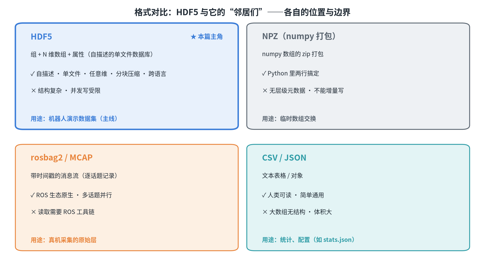
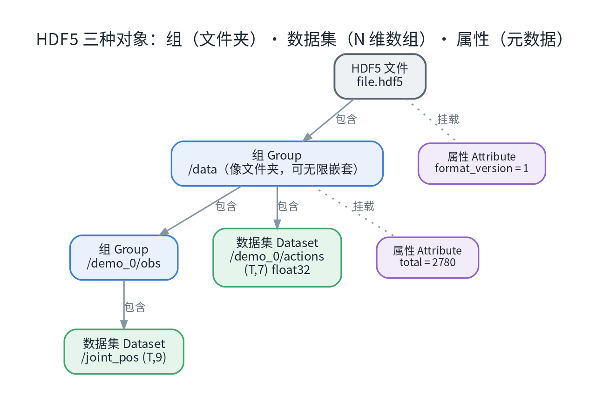
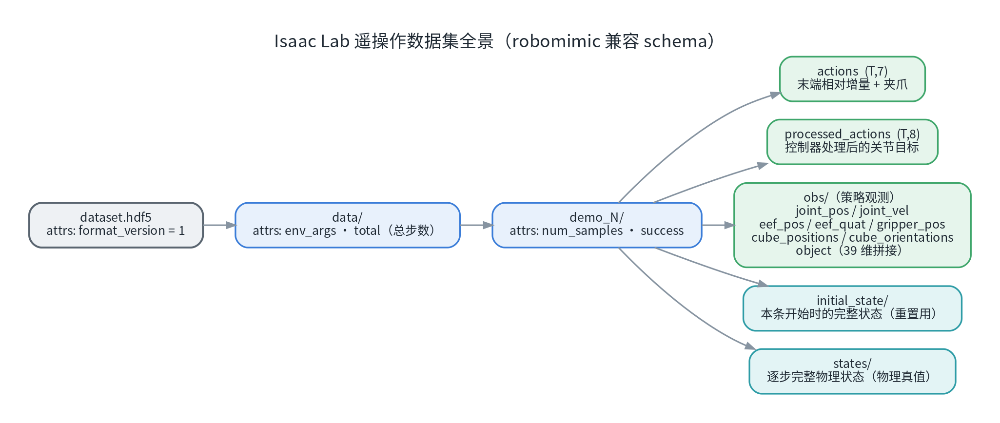
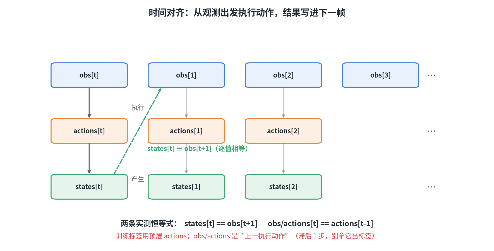
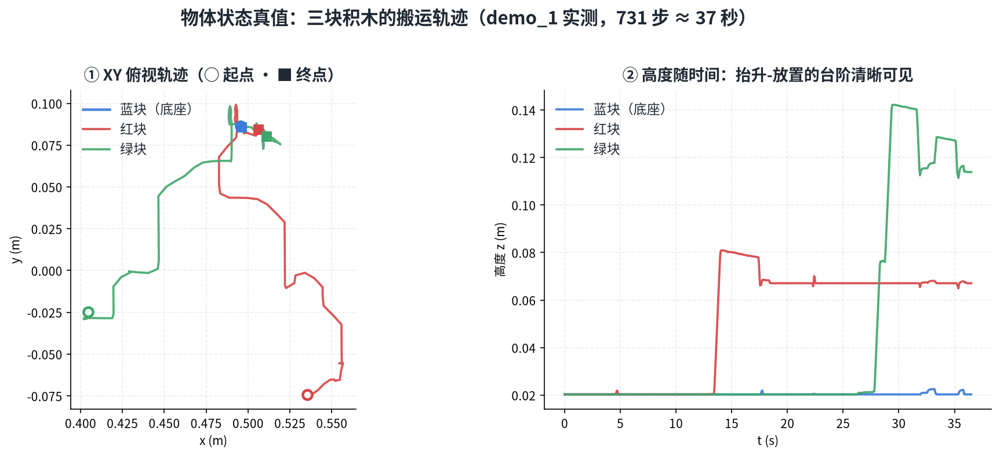
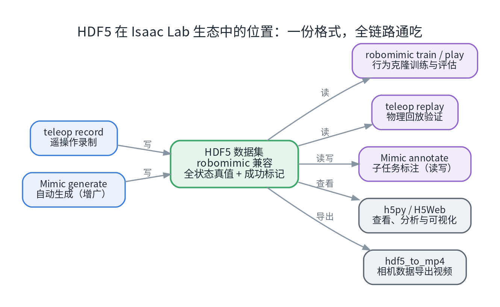

# HDF5 格式详解:结构、可视化与数据处理实战（四）

这是系列的**第四篇**。前三篇里反复出现一个文件格式——HDF5：遥操作录出来的数据是它，Mimic 生成的数据还是它，训练脚本吃的也是它。这一篇把它讲透：**文件结构长什么样、每个字段是什么含义、怎么打开、怎么处理、有哪些坑**。所有结论都基于实测样本（键盘遥操作 Stack-Cube 数据集，3 条演示）并对照源码核对。

## 0. 一分钟速览

| 问题 | 答案 |
| --- | --- |
| HDF5 是什么 | 层级式二进制容器：**组（Group）+ 数据集（Dataset）+ 属性（Attribute）**，像"带元数据的文件系统" |
| 数据从哪来 | `teleop record` 录制输出（robomimic 兼容 schema）；Mimic 生成的数据同格式 |
| 怎么打开 | Python `h5py`、VS Code 的 H5Web 插件、HDFView / `h5ls` 命令行 |
| 怎么进一步处理 | 统计质检 → 曲线可视化 → 回放验证 → 标注 → Mimic 生成 → BC 训练 |
| 最大的两个坑 | ① 录制进程被中途杀掉 → 文件截断（96 字节、打不开）；② 四元数顺序为 **XYZW**（旧数据集为 WXYZ） |

## 1. HDF5 是什么

**HDF5**（Hierarchical Data Format version 5）是 The HDF Group 维护的开放文件格式与库，NASA、科学计算与机器学习生态（Keras 模型、robomimic 机器人演示数据）都在使用。核心设计目标：

1. **自描述**：文件自带完整类型与元数据，不依赖外部说明；
2. **层级命名空间**：像文件系统一样用"组"组织数据，任意深度嵌套；
3. **任意维数组**：一个"数据集"就是一整块 N 维数组，二进制存储高效紧凑；
4. **元数据（属性）**：文件 / 组 / 数据集上都能挂"关于数据的数据"（单位、版本、JSON 配置）；
5. **单文件便携**：一个 `.hdf5` 文件自带全部数据，压缩与分块策略可调。

### 1.1 与常见格式对比



*图 1：HDF5 与"邻居们"的定位对比——各有自己的位置与边界。*

| 格式 | 数据模型 | 优势 | 短板 | 典型用途 |
| --- | --- | --- | --- | --- |
| **HDF5** | 组 + N 维数组 + 属性 | 自描述、单文件、任意维、分块压缩、跨语言 | 结构复杂；并发写受限 | 机器人演示数据集（主线） |
| CSV / JSON | 文本表格 / 对象 | 人类可读、简单通用 | 大数组无结构、体积大 | 统计与配置（如 stats.json） |
| NPZ | numpy 打包（zip） | Python 里两行搞定 | 无层级元数据、不能增量写 | 临时数组交换 |
| rosbag2 / MCAP | 带时间戳的消息流 | ROS 生态原生、多话题 | 读取需 ROS 工具链 | 真机采集的原始层 |
| Parquet | 列式表格 | 大数据分析极快 | 不适合仿真状态树 / 大数组 | 数据分析场景 |
| Zarr | 分块 N 维数组（目录式） | 云原生、并行读写 | 非单文件 | 云端大数据集 |

### 1.2 为什么 Isaac Lab 选 HDF5

- 机器人演示数据天然是"**多条演示 × 多条时间步 × 多模态数组**"（动作、关节、相机……），HDF5 的层级 + 数组模型完全对口；
- **robomimic** 生态（模仿学习基线）以 HDF5 为事实标准——Isaac Lab 录制器直接输出 robomimic 兼容 schema，下游标注 / Mimic / 训练工具零转换；
- 分块 + gzip 压缩可以在写入时低成本开启：实测一份 3 条演示的数据集，逻辑数据 1.99 MB → 磁盘 1.35 MB（约 68%）。

## 2. 文件结构模型（通用部分）

### 2.1 三种对象：组、数据集、属性



*图 2：组像文件夹（可嵌套），数据集存 N 维数组，属性是挂在对象上的小型元数据。*

- **组（Group）**：容器对象，用斜杠路径寻址，如 `/data/demo_0/obs/joint_pos`；
- **数据集（Dataset）**：真正存数据的对象，有数据、形状（shape）、类型（dtype）；支持**分块（chunking）**——把数组切成固定大小的块按需读写，这是压缩与切片读取的前提；
- **属性（Attribute）**：小型元数据（建议 ≲ 64 KB），只能挂在文件 / 组 / 数据集上，适合存单位、版本号、JSON 配置，**不要用来存大数组**。

### 2.2 文件完整性与打开模式

HDF5 文件开头 8 字节是固定签名（魔数），可以用 `xxd -l 32 xxx.hdf5` 查看。文件内部由超级块 + B-tree 索引组成，定位任何对象不需要扫描整个文件。

⚠️ **文件完整性是最大的坑**：HDF5 在**正常关闭**时才把缓存与元数据完整落盘；**进程被强杀 / 崩溃**时，文件可能停在"写了一半"的状态：

```
OSError: Unable to synchronously open file
(truncated file: eof = 96, sblock->base_addr = 0, stored_eof = 2048)
```

一旦出现这种截断（典型症状：文件只有 **96 字节**），**无法恢复**，只能重录。所以：录制中不要 `kill -9`；要退出用 `Ctrl+C` 走正常收尾。

打开模式常用的四种：

| 模式 | 含义 |
| --- | --- |
| `r` | 只读（最常用） |
| `r+` | 读写，文件必须存在 |
| `w` | 新建（**同名直接覆盖！**） |
| `a` | 存在则打开追加，不存在则新建 |

并发上：**单写者、多读者**（同一时刻只允许一个进程写；SWMR 模式允许边写边读，需要专门开启）。

## 3. 实战：Isaac Lab 遥操作数据集

### 3.1 数据从哪来

```
teleop record（--dataset_file ./datasets/xxx.hdf5）
    ↓
RecorderManager：每条成功演示触发一次导出
    ↓
Hdf5DatasetFileHandler：建文件 → 逐条写 demo_N（gzip 压缩）→ 正常关闭
```

两个要点：**只导出成功演示**（`success` 判定通过才写入）；任务成功判定、录制起止都由框架自动管理。

### 3.2 全景结构图



*图 3：一条演示（demo_N）的完整内部结构——动作、观测、初始状态与逐步物理真值。*

展开成文本树（实测样本，3 条演示）：

```
dataset_keyboard.hdf5
├── attrs: format_version = 1
└── data/                          attrs: env_args（JSON）· total（总步数）
    ├── demo_0/                    attrs: num_samples（步数）· success
    │   ├── actions               (T, 7)   末端增量 + 夹爪
    │   ├── processed_actions     (T, 8)   控制器处理后的关节目标
    │   ├── obs/                          策略观测
    │   │   ├── joint_pos         (T, 9)
    │   │   ├── joint_vel         (T, 9)
    │   │   ├── eef_pos           (T, 3)   末端位置
    │   │   ├── eef_quat          (T, 4)   末端姿态（XYZW）
    │   │   ├── gripper_pos       (T, 2)
    │   │   ├── cube_positions    (T, 9)   3 块积木位置（真值）
    │   │   ├── cube_orientations (T, 12)  3 块积木姿态（真值）
    │   │   └── object            (T, 39)  任务自定义拼接观测
    │   ├── initial_state/                本条开始时的完整状态（重置用）
    │   └── states/                       逐步完整物理状态（物理真值）
    ├── demo_1/  ...
    └── demo_2/  ...
```

### 3.3 字段语义表

| 路径 | 形状 | 含义 | 备注 |
| --- | --- | --- | --- |
| `actions` | (T,7) | 每步下发的**相对增量动作**：Δx, Δy, Δz, Δrx, Δry, Δrz, 夹爪 | 夹爪 +1=张开、−1=闭合 |
| `processed_actions` | (T,8) | 经控制器处理后的**关节目标** | 训练一般不用，调试用 |
| `obs/actions` | (T,7) | **上一执行动作** | ⚠️ 与顶层 `actions` 错开 1 步（见 3.4） |
| `obs/joint_pos` | (T,9) | 关节角（**相对默认构型的偏移**） | 绝对角度在 `states` 里 |
| `obs/eef_pos` / `eef_quat` | (T,3) / (T,4) | 末端位置 / 姿态 | 姿态顺序 **XYZW** |
| `obs/gripper_pos` | (T,2) | 夹爪两指关节位置 | 张开 ≈ [0.04, −0.04] |
| `obs/cube_positions` / `cube_orientations` | (T,9) / (T,12) | 3 块积木位置 / 姿态（真值） | 真机数据做不到这一点 |
| `obs/object` | (T,39) | 任务自定义拼接观测 | 3 块积木的位姿 + 相对向量 |
| `states/` / `initial_state/` | (T,·) / (1,·) | 逐步 / 初始的完整物理状态 | 回放、重置、分析 |

### 3.4 时间对齐关系（做训练/分析必看）

实测得到两条严格恒等式——理解它们，才不会把动作标签用错：



*图 4：从 obs[t] 出发执行 actions[t]，执行结果写进 states[t]，即下一帧观测 obs[t+1]。*

1. **`actions[t]` 是从观测 `obs[t]` 出发执行的那条命令**，执行结果体现在 `states[t]`（即 `obs[t+1]`）；
2. **`states[t] == obs[t+1]`**（逐值相等，已抽查多个对象多个时刻）；
3. **`obs/actions[t] == actions[t-1]`**（"上一执行动作"，滞后 1 步；`obs/actions[0]` 为全 0）。

**训练标签用顶层 `actions`**；`obs/actions` 只是观测组里的一个输入项，拿它当标签会导致动作整体错位一步。

### 3.5 物体状态真值长什么样

`obs/cube_positions` 里存着每块积木的世界系位置真值。把一条完整演示画出来，就是一张"搬运路线图"：



*图 5：实测演示（731 步 ≈ 37 秒）中三块积木的轨迹：蓝块（底座）纹丝不动；红块、绿块被依次搬上塔，高度曲线的"抬升-放置"台阶清晰可见。*

这种"物体级真值"正是仿真数据最值钱的地方——真机采集里，物体位姿要靠视觉 + 标定去估计，而这里直接躺在文件里。

### 3.6 存储与压缩参数（实测）

| 项 | 实测值 |
| --- | --- |
| 压缩 | **每个数据集**独立 gzip，level = 2 |
| 分块 | 自动分块（约 T/2 或 T/4 行，如 chunks=(651,4)） |
| 体积 | 逻辑 1.99 MB → 磁盘 1.35 MB（约 68%） |
| 精度 | 全部 float32（对仿真数据足够且省空间） |

含相机图像的数据集会大得多：图像通常不压缩或轻压缩，读取时注意不要一次把整条图像流读进内存（用切片读，见第 5 节）。

### 3.7 四元数顺序：XYZW vs WXYZ（必看）

| 版本 | 顺序 | 说明 |
| --- | --- | --- |
| `format_version = 1`（当前） | **XYZW**（x, y, z, w） | 实测：单位四元数呈现为 `[0,0,0,1]` |
| `format_version = 0` / 缺失（旧） | WXYZ（w, x, y, z） | 旧录制数据集；加载器对部分字段自动转换，也可用 `Hdf5DatasetFileHandler.convert_dataset_to_xyzw()` 整文件转换 |

自己写姿态运算（转旋转矩阵、插值、误差计算）之前，**先确认顺序**。

### 3.8 与 robomimic / Mimic 的关系

- `env_args` 等字段为 **robomimic 兼容**设计；
- **Mimic 生成的数据集与遥操作数据集同 schema**（同一个文件处理器写出）——本文所有查看/处理手段对两者通用；
- 标注（annotate）与生成（generate）会在此基础上**追加子任务相关字段**；训练脚本按 `obs` / `actions` 消费。

## 4. 如何可视化查看

| 途径 | 适合场景 | 说明 |
| --- | --- | --- |
| Python + `h5py` | 编程查看一切；转 numpy / torch | 首选，环境里 `pip install h5py` 即用 |
| VS Code 插件 **H5Web** | 图形界面点着看（树 + 表格 + 曲线/热图/RGB） | 装好后把 `*.hdf5` 关联到它即可双击打开 |
| 命令行 `h5ls` / `h5dump` / `h5stat` | 快速列结构 / 导数据 / 存储统计 | `sudo apt install hdf5-tools` |
| 桌面 GUI（HDFView / ViTables） | 完整 GUI（切片、绘图） | `sudo apt install hdfview vitables` |
| 仿真里回放（`teleop replay`） | 端到端验证"动作能不能复现" | 见第二篇 §5 |
| `hdf5_to_mp4.py` | 相机数据导出视频 | 依赖 OpenCV，用 Isaac Sim 自带 Python 跑 |

用 `h5py` 快速浏览（层级、属性、形状）：

```python
import h5py

with h5py.File("datasets/dataset_keyboard.hdf5", "r") as f:
    print("文件属性:", dict(f.attrs))                  # format_version
    data = f["data"]
    print("env_args:", data.attrs["env_args"])          # JSON 字符串
    print("演示列表:", list(data.keys()))               # demo_0, demo_1, ...

    def walk(name, obj):                                # 递归打印全部数据集
        pad = "  " * name.count("/")
        if isinstance(obj, h5py.Dataset):
            print(f"{pad}- {name.split('/')[-1]:<20} {obj.shape} {obj.dtype}")
    f.visititems(walk)
```

读取时用**切片**而不是整组读——`g["obs/joint_pos"][:100]` 只解压相关分块，大数据集友好：

```python
with h5py.File("datasets/dataset_keyboard.hdf5", "r") as f:
    g = f["data/demo_0"]
    actions = g["actions"][:]                    # (T,7) ndarray
    joint = g["obs/joint_pos"][:100]             # 只读前 100 步
```

## 5. 如何进一步处理

### 5.1 HDF5 在数据链路中的位置



*图 6：一份格式，全链路通吃——从录制、增广，到训练、评估、可视化。*

### 5.2 h5py 读写基本功

```python
import h5py, numpy as np

# ① 写：新建文件 / 组 / 压缩数据集 / 属性（与录制器同款压缩参数）
with h5py.File("/tmp/new_dataset.hdf5", "w") as f:
    f.attrs["format_version"] = 1
    d = f.create_group("data")
    d.attrs["env_args"] = '{"env_name": "demo", "type": 2}'
    demo = d.create_group("demo_0")
    demo.attrs["num_samples"] = 3
    demo.attrs["success"] = True
    demo.create_dataset("actions", data=np.zeros((3, 7), dtype=np.float32),
                        compression="gzip", compression_opts=2)

# ② 追加：r+ 模式新增演示（注意同步维护 total 计数）
with h5py.File("/tmp/new_dataset.hdf5", "r+") as f:
    g = f["data"].create_group("demo_1")
    g.create_dataset("actions", data=np.ones((2, 7), dtype=np.float32))
    g.attrs["num_samples"] = 2
    f["data"].attrs["total"] = 5
```

### 5.3 合并数据集（官方工具 + 一个必须修补的坑）

官方提供合并脚本 `merge_hdf5_datasets.py`（在 Isaac Lab 仓库 `scripts/tools/` 下）：

```bash
python scripts/tools/merge_hdf5_datasets.py \
    --input_files a.hdf5 b.hdf5 c.hdf5 --output_file merged.hdf5
```

行为：按顺序把各文件的 `data/demo_*` 逐条复制并**重新编号**；`env_args` 取第一个文件。

⚠️ **实测发现的坑**：该工具**不写**根属性 `format_version`，也不汇总 `data.attrs.total`。合并后建议跑一次修补：

```python
import h5py
with h5py.File("merged.hdf5", "r+") as f:
    f.attrs["format_version"] = 1                                  # 与源数据保持一致（XYZW 语义）
    d = f["data"]
    d.attrs["total"] = sum(d[k].attrs["num_samples"] for k in d)   # 汇总总步数
```

核对两个文件的差异可以用 `h5diff a.hdf5 b.hdf5`。

### 5.4 常见二次加工配方

```python
import h5py, numpy as np

# ① 只筛"成功"演示
with h5py.File("datasets/dataset_keyboard.hdf5", "r") as f:
    good = [k for k in f["data"] if f["data"][k].attrs.get("success")]

# ② 单条演示 → (obs, action) 序列（喂自定义训练脚本）
with h5py.File("datasets/dataset_keyboard.hdf5", "r") as f:
    g = f["data/demo_0"]
    actions = g["actions"][:]                       # 标签
    obs = {k: g["obs"][k][:] for k in g["obs"]}     # 输入

# ③ 导出为 npz（给不方便用 h5py 的场景）
np.savez_compressed("/tmp/demo_0.npz", actions=actions, **obs)
```

### 5.5 处理大数据集的建议

- **别整组读**：图像数据集请按 `[start:end]` 切片读或逐块读；
- 只读元数据时用 `attrs` + `shape`（不触发数据解压）；
- 遍历所有演示统计时，先 `attrs` 后按需读数组；
- 写大文件保持 gzip 压缩（录制器默认已开），**不要用 `w` 模式反复重写已存在文件**。

## 6. 常见坑与排错（实测）

| # | 现象 | 原因 | 处理 |
| --- | --- | --- | --- |
| 1 | 文件只有 **96 字节**，报 `truncated file: eof = 96` | 录制进程被强杀/崩溃，HDF5 未完成"关闭即落盘" | 截断文件**无法恢复**；重录。退出用 `Ctrl+C`，不要 `kill -9` |
| 2 | 文件存在但没有任何 `demo_*` | 没触发成功判定（如叠放顺序错）——只有成功演示才写入 | 按标准流程重录 |
| 3 | 统计提示某条"步数异常长" | 失败后没重开，混入试错动作 | 删/重录该条（见第二篇的录制纪律） |
| 4 | `ModuleNotFoundError: No module named 'h5py'` | 用错了 Python 环境 | 激活正确的环境（Isaac Lab 的环境里已带 h5py） |
| 5 | `obs/actions` 和 `actions` 对不上 | **正常现象**：前者是"上一执行动作" | 训练标签用顶层 `actions` |
| 6 | 合并后的数据集行为不对（缺 `total` 等） | 合并脚本不写 `format_version` / `total` | 合并后跑修补片段（§5.3） |
| 7 | 读含图像数据集把内存撑爆 | 一次性读入整条图像流 | 切片/分块读 |
| 8 | 同名 `--dataset_file` 再录一次，旧数据没了 | `w` 模式**直接覆盖** | 每次换新文件名 |
| 9 | `h5ls` / `h5dump` 提示找不到命令 | 未安装 hdf5-tools | `sudo apt install hdf5-tools` |
| 10 | 自己算姿态结果诡异 | 四元数顺序混淆（XYZW vs WXYZ） | 确认 `format_version`；旧数据集先转换 |

## 7. 小结与系列导航

三句话记住这篇：

- **结构**：文件 → 组 → 数据集 + 属性；`data/demo_N/{actions, obs/, states/, initial_state/}` 是标准骨架；
- **语义**：`actions` 是标签、`obs/*` 是输入、`states/*` 是真值；注意 `actions[t]` 与 `obs/actions` 的一步错位、以及 XYZW 四元数顺序；
- **实战**：h5py 切片读、H5Web 点着看、回放验证；合并脚本记得修补 `format_version` / `total`。

**系列导航**：

- **（一）数据采集方法总览**：五类采集方式（遥操作、动捕、UMI、EGO、仿真生成）的原理、数据格式与上手路径；
- **（二）遥操作实操手册**：在 Isaac Lab 里完成一次完整的遥操作采数（键盘 / Xbox360 / 鼠标）；
- **（三）Isaac Sim 仿真遥操采集与真机采集对比**：两条数据路线放在一起逐项对照。

## 参考资料

- [HDF5 官网与文档](https://www.hdfgroup.org/) · [h5py 文档](https://docs.h5py.org/en/stable/)
- [robomimic 数据集格式](https://robomimic.github.io/docs/datasets/overview.html)
- [Isaac Lab 官方文档](https://isaac-sim.github.io/IsaacLab/)（数据集读写实现见 `source/isaaclab/isaaclab/utils/datasets/hdf5_dataset_file_handler.py`）
- 上游工具脚本：`isaaclab/scripts/tools/` 下的 `merge_hdf5_datasets.py`、`hdf5_to_mp4.py`、`mp4_to_hdf5.py`

---

*本文全部结论基于实测（键盘遥操作 Stack-Cube 数据集，3 条演示）+ 源码核对；环境为 Isaac Sim 6.1 + Isaac Lab 3.0。*
