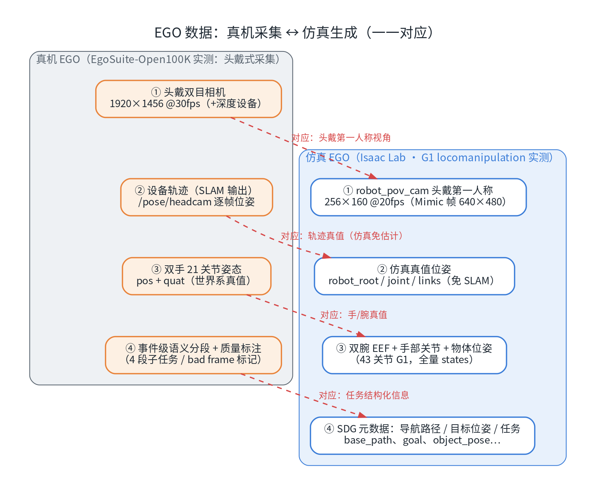
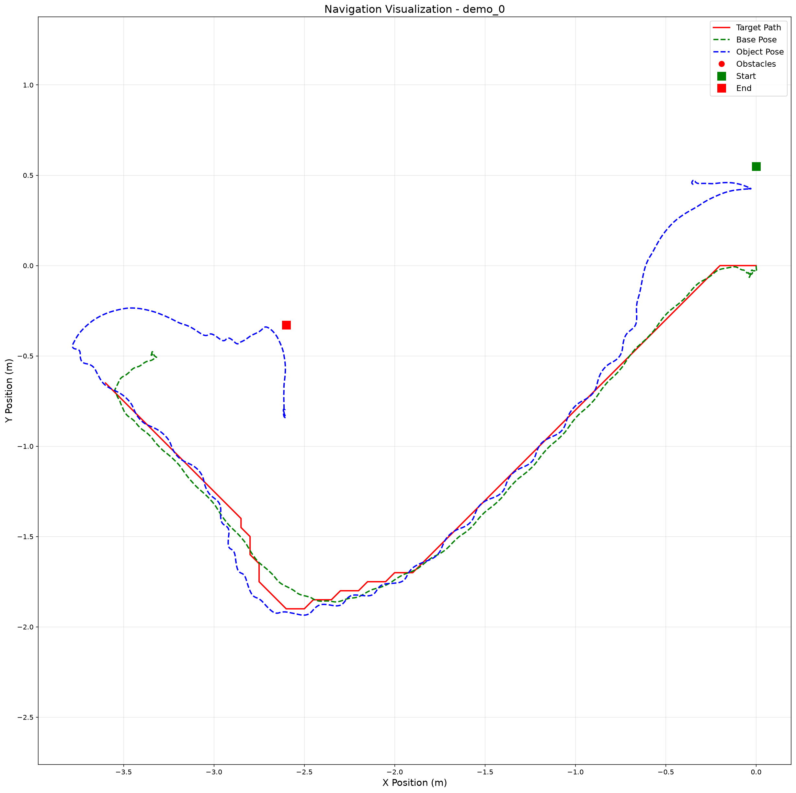
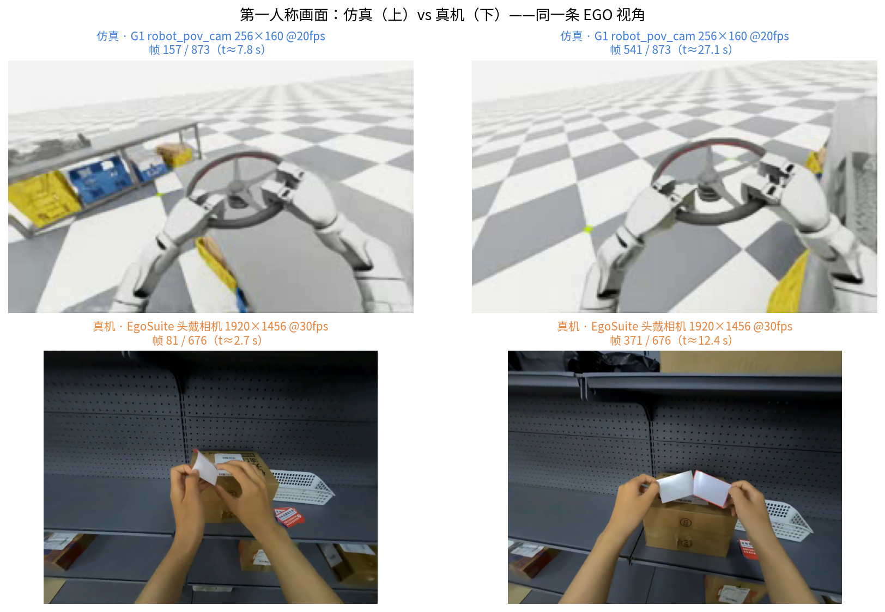
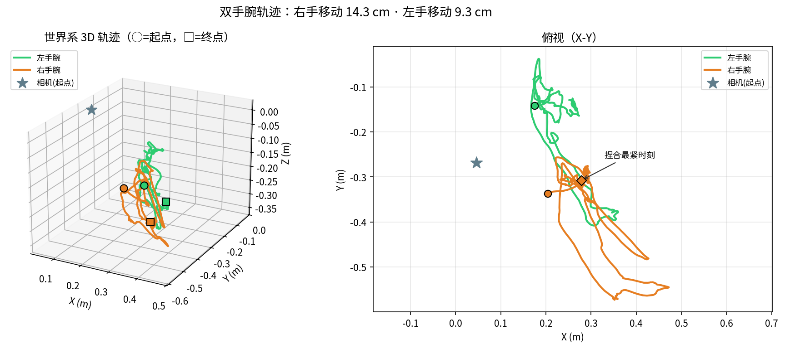
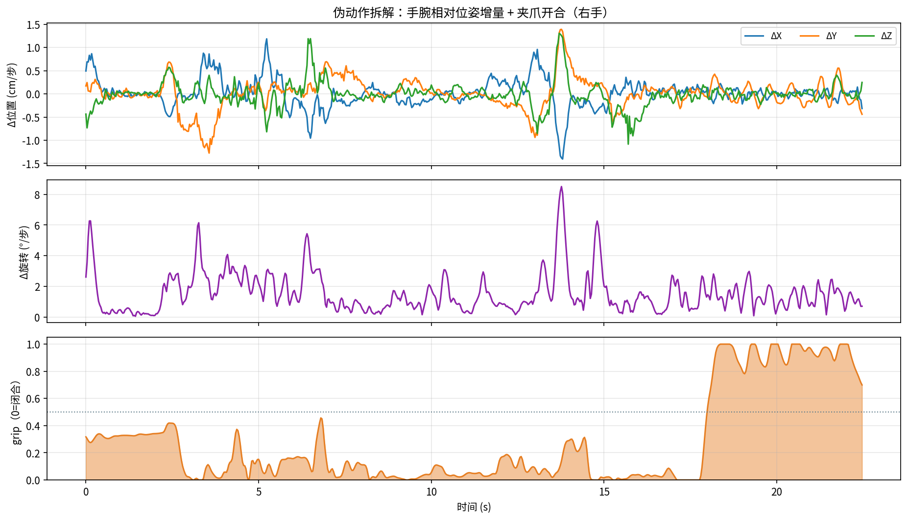

# EGO 式数据工作流：仿真采集 → 公开数据集处理 → 重定向示范（六）

这是系列的**第六篇**。前五篇里我们覆盖了采集方法全景（一）、遥操作实操（二）、仿真与真机对比（三）、HDF5 格式（四）与 UMI 式工作流（五）。这一篇轮到近几年最出圈的方向之一——**EGO（第一人称/自我中心视角）数据**：让人戴着相机"用自己的眼睛"演示操作，再把"人眼里的动作"翻译给机器人。

与第五篇最大的不同是：这次**两条腿都落地实测**——先在 Isaac Lab 里用 G1 人形机器人生成第一人称数据（Mimic 种子扩充 + 移动操作 SDG），再从 Hugging Face 上把真实世界的公开 EGO 数据集 **EgoSuite-Open100K**（49 TB 级）下载下来，跑通"MCAP 解析 → 骨架投影验证 → 伪动作构建"的完整处理链路。两边的数据形态、字段和坑，都有一手数字。

> **配套资源**：本系列的全部文章、配套脚本与图表源码已开源：[github.com/huangqiulong/IsaacDataCollection](https://github.com/huangqiulong/IsaacDataCollection) 。本篇新增脚本：`scripts/egosuite_download.sh`（Bucket 下载助手）、`egosuite_mcap_inspect.py` / `egosuite_mcap_extract.py` / `egosuite_demo_figures.py`（MCAP 处理链）、`isaac_sim_06_figures.py`（配图）。

## 0. 一分钟速览

| 问题 | 答案 |
| --- | --- |
| EGO 数据是什么 | 头戴设备录制的"人眼看着手做事"第一人称数据；转成机器人动作要经过 **视频 → 手部姿态估计 → 重定向** 四级流水 |
| 仿真侧怎么生成 | Isaac Lab · G1 locomanipulation：Mimic 生成 **20 条（4,790 帧）** → SDG 生成 **1 集 873 帧**（含 `robot_pov_cam` 第一人称 160×256） |
| 真机侧数据从哪来 | **EgoSuite-Open100K**（Lightwheel）：HF **Bucket** 分发（实测 49.26 TB / 327,656 文件），演示下载 3 集共 61 MB |
| 单集数据长什么样 | 1 个 MCAP 文件、14 个频道：双目 H.264 + 双手 21 关节姿态 + 头/眼位姿 + 内参外参 + 事件级语义分段 + 会话元数据 |
| 怎么验证真伪 | 把世界系手部骨架**投影回第一人称画面**——逐指对齐（本篇最亮的验证图） |
| 怎么变成动作 | 伪动作构建：手腕 Δpose(6) + 捏合开度 grip(1)，得到 (675, 7) 动作序列 |
| 两个最大的坑 | ① Bucket 下载需 `socksio`（PySocks 不够）+ hf-mirror 不支持 Bucket；② PyAV 对 raw-h264 的 demux 包 `dts=None`，**不能流拷贝封装**，需解码转码 |

## 1. EGO 是什么 → Isaac 里的对应物

### 1.1 真机 EGO 的完整链路

EGO 数据的采集门槛很低：**戴个眼镜录就行**（Project Aria、GoPro、头显都算）。但要把它变成机器人可训练的数据，录制只是起点，真正的功夫在离线后处理——**"视频 → 手部姿态估计 → 重定向"**四级流水：

| 环节 | 做什么 | 代表方案 |
| --- | --- | --- |
| A. 设备轨迹（SLAM） | 恢复头戴设备的逐帧位姿，给"手的位置"提供固定参考系 | Aria 配套 MPS；GoPro 素材用 ORB-SLAM3 / VINS-Mono |
| B. 手部姿态估计 | 从画面重建双手 21 关节（手腕 6DoF + 手指） | 纯视觉：MediaPipe → MANO 拟合（HaMeR/WiLoR）；动捕硬件：DexCap 的 EMF 手套 |
| C. 坐标变换 | `T_world_hand = T_world_cam · T_cam_hand`，把"相机系的手"挂回世界系 | 乘一次坐标链，注意时钟同步 |
| D. 重定向 | 人手映射到机器人：平行夹爪（手腕+捏合距离）或灵巧手（指尖 IK） | DexPilot / dex-retargeting 一脉 |



*图 1：EGO 数据的真机采集与 Isaac 仿真生成——从相机、轨迹、手部姿态到任务信息，逐项一一对应。*

### 1.2 为什么值得做：两个硬事实

- **scaling 有证据**：EgoMimic 的实验结论是"**2 小时机器人数据 + 1 小时人手数据 > 3 小时纯机器人数据**"——人手数据的边际价值显著高于机器人数据（前提是动作语义与观测都对齐）；
- **行业在押注**：EgoSuite-Open100K 这类十万小时级数据集开始公开；更妙的是，它的部分采集明确要求**操作员约束手部动作近似机器人夹爪运动学**（元数据 `paradigm: robot_gripper_mimic`）——从源头就为"人→机器人"迁移做了准备。

## 2. 仿真侧：G1 第一人称数据生成（实测）


*图 2：本篇的两条链路——上面是仿真链（Mimic → SDG → LeRobot），下面是真机链（Bucket → MCAP → 伪动作），最终都汇入训练侧。*

### 2.1 从种子到操作段：Mimic 生成

官方预标注集只有 5 条人类演示（`dataset_annotated_g1_locomanip.hdf5`，5 MB），先用 Mimic 把它扩成小批量：

```bash
./isaaclab.sh -p scripts/imitation_learning/isaaclab_mimic/generate_dataset.py \
  --device cuda --num_envs 8 --generation_num_trials 20 \
  --input_file ~/code/isaac/IsaacDataCollection/datasets/dataset_annotated_g1_locomanip.hdf5 \
  --output_file ~/code/isaac/IsaacDataCollection/datasets/generated_dataset_g1_locomanip.hdf5
```

**实测结果**：产出 **20 条演示（220~259 步/条，共 4,790 帧），文件 1.5 GB**——体积大头是相机图像：每条演示的 `obs/robot_pov_cam` 都是 **(N, 480, 640, 3) 的头部第一人称画面**（Mimic 生成默认带相机）。⚠️ 本机 CUDA 下前两次尝试失败（`_logs/` 有记录），调整参数后成功。

### 2.2 移动 + 操作：SDG 生成（本文主角）

上一批数据只有"操作段"，没有"走过去"的过程。真正带移动操作的是 SDG 脚本：

```bash
./isaaclab.sh -p scripts/imitation_learning/locomanipulation_sdg/generate_data.py \
  --device cuda --kit_args="--enable isaacsim.replicator.experimental.mobility_gen" \
  --task="Isaac-G1-SteeringWheel-Locomanipulation" \
  --dataset ~/code/isaac/IsaacDataCollection/datasets/generated_dataset_g1_locomanip.hdf5 \
  --num_runs 1 --lift_step 60 --navigate_step 130 \
  --output_file ~/code/isaac/IsaacDataCollection/datasets/generated_dataset_g1_locomanipulation_sdg.hdf5 \
  --sensor_camera_view --visualizer kit
```

**实测结果**：1 集、**873 帧（@20Hz ≈ 43.7 秒）**、39 MB；日志以 `successful episodes count 1` 收尾。观测含 14 个键，核心：

| obs 键 | 形状 | 说明 |
| --- | --- | --- |
| `robot_pov_cam` | (873, 160, 256, 3) uint8 | **头部第一人称画面**（SDG 默认 160×256；Mimic 那批是 480×640） |
| `robot_joint_pos` | (873, 43) | G1 全身 43 个自由度位置 |
| `left/right_eef_pos/quat` | (873, 3)/(873, 4) | 双腕末端位姿 |
| `object_pos/rot`、`robot_root_pos/rot` | — | 物体与底盘状态 |

另外 `locomanipulation_sdg_output_data/` 里还有 15 项 SDG 元数据（导航路径 `base_path`、目标位姿 `base_goal_pose`、双腕目标 `*_hand_pose_target` 等）——这些正是后面转 GR00T/LeRobot 时 `state` / `action` 的字段来源。

### 2.3 导出与应用

```bash
# 第一人称视频（注意 --framerate 20：数据是 20Hz，别让它按 30 封装）
.venv/bin/python scripts/tools/hdf5_to_mp4.py --input_file <sdg.hdf5> \
  --output_dir ~/code/isaac/IsaacDataCollection/datasets/ego_videos \
  --input_keys robot_pov_cam --video_width 256 --video_height 160 --framerate 20

# 导航轨迹质检（走位是否合理）
python scripts/imitation_learning/locomanipulation_sdg/plot_navigation_trajectory.py \
  --input_file <sdg.hdf5> --output_dir ~/code/isaac/IsaacDataCollection/datasets/ego_plots
```

视频产物 `demo_0_robot_pov_cam.mp4`（873 帧 @20fps，1.7 MB）；导航质检图如下——目标路径（红）、底盘实际轨迹（绿）、物体轨迹（蓝）三条线全程贴合，没有穿墙抄近路：



*图 3：SDG 演示的导航质检——"先走位、再操作"的移动过程一目了然（图中含障碍物、起终点标记）。*

最后把它变成训练就绪格式（详见第七篇）：

```bash
mkdir locomanip_sdg && ln -s ../generated_dataset_g1_locomanipulation_sdg.hdf5 locomanip_sdg/
python scripts/imitation_learning/locomanipulation_sdg/gr00t/convert_dataset.py \
  ./locomanip_sdg ~/code/isaac/IsaacDataCollection/datasets/lerobot_g1_locomanip
```

**产物**：LeRobot v2.0 数据集（1 集 873 帧 @20fps，`observation.state` 49 维、`action` 32 维、ego_view 视频 160×256，附 `modality.json` 分段语义）。

## 3. 真机侧：EgoSuite-Open100K 实测

### 3.1 数据集与获取

EgoSuite-Open100K 由光轮智能（Lightwheel）发布：10 万小时规划的**全标注第一人称人类数据**（首批公开 1 万小时），手部/全身姿态 + 事件级语义标注，双格式（LeRobot v3 / MCAP）。数据**不在 git 仓库，而在 Hugging Face 的 Bucket 对象存储**里（实测 49.26 TB / 327,656 文件）；git 仓库只是数据卡与申请入口。

访问流程：HF 页面申请（人工审批）→ `hf auth login` → 用自带的下载助手操作：

```bash
# 浏览目录 / 查看某任务全部集与大小 / 下载单集
bash scripts/egosuite_download.sh list
bash scripts/egosuite_download.sh task "Adjust Seal Sticker"
bash scripts/egosuite_download.sh get "EgoStandard/mcap/Adjust Seal Sticker/<uuid>.mcap" <目录>
```

本次下载 3 个小样本集（物流封签调整任务）：

| 文件（UUID） | 大小 | 时长 | 视频帧数 |
| --- | ---: | ---: | ---: |
| `0e589be9-…`（主演示） | 32.1 MB | 22.5 s | 676 |
| `09071527-…` | 19.2 MB | 12.6 s | 316 |
| `0af29495-…` | 10.1 MB | 7.4 s | 223 |

### 3.2 单集结构：14 个频道的 MCAP

| 频道 | 说明 |
| --- | --- |
| `sensor/camera/head_left(video)` / `head_right(video)` | 双目 H.264：1920×1456 @30fps（每帧一条消息） |
| `pose/left_hand` / `pose/right_hand` | **双手 21 关节 pos+quat（世界系）** |
| `pose/head` / `pose/headcam` / `pose/right_eye_cam` | 头部与相机位姿（`headcam` ≡ 左目外参） |
| `sensor/camera/*/intrinsic` / `extrinsic` | 相机内参 K（f=788.8）与 world→cam 外参 |
| `annotation/semantic_segments` | **事件级语义分段**（4 段子任务 + 结束时刻） |
| `annotation/bad_frame/pose/hand` | 手部姿态质量标注（逐帧 is_bad） |
| `session/metadata` | 设备/任务/场景/操作员信息 |

主演示集（22.5 s）的语义分段实测：

| 结束时刻 | 子任务（摘录） |
| ---: | --- |
| 3.0 s | Tear off the red label from the cardboard box |
| 7.0 s | Fold the torn label and put it in the white basket |
| 13.0 s | Take the new label out of the basket and tear it open |
| 22.0 s | Stick the new label on the cardboard box and smooth it |

元数据里还藏着一个关键信息：操作员采集范式为 **`robot_gripper_mimic`**——"以近似机器人夹爪运动学的方式刻意约束手部动作"。这也是为什么这份数据值得研究：**它把 §1.1 里最难的环节 B/D 预先做了一半**。

### 3.3 解析与抽取

```bash
# 结构检查（频道/元数据/分段/质检一览）
python scripts/egosuite_mcap_inspect.py <file.mcap>

# 抽取：MP4 视频 + 姿态 npz + 元数据 json
python scripts/egosuite_mcap_extract.py --mcap <file.mcap> --out <out_dir>
```

**两个实测坑**（都对症修好了）：

1. **Bucket 下载依赖**：`hf buckets` 需要 huggingface_hub ≥1.6；走 socks 代理时 httpx 必须要 `socksio`（PySocks 不够）；**hf-mirror 不支持 Bucket**，得走官方站 + 本地代理；
2. **视频封装**：MCAP 里的 H.264 是裸流分片，PyAV 的 raw-h264 **demux 包 `dts` 全为 None**，直接流拷贝会静默产出 0 包——必须"解码 + libx264 转码"再封装（几百帧秒级完成）。

## 4. 处理与验证



*图 4：上排是仿真 G1 的 robot_pov_cam（第一人称操控方向盘），下排是 EgoSuite 真机头戴相机（调整封签）——"同一条 EGO 视角"，前者的 V 字动作和后者的双手操作在观测维度上完全同类。*

### 4.1 骨架投影验证（本篇最亮的一张图）

数据集给出的手部姿态是**世界系**的，而视频是**相机视角**的。用元数据里的内参与 `headcam` 位姿，把 21 个关键点投影回画面：

```
X_cam = R_cw · X_world + t_cw     （R/t 来自 /pose/headcam，R_cw = R^T，t_cw = -R^T·t）
[u, v] ~ K · X_cam                （K：fx=fy=788.8, cx=960, cy=728）
```

如果数据自洽，骨架应该与画面中的手**逐指对齐**：


*图 5：世界系 21 关节骨架投影到第一人称画面（绿=左手，橙=右手）——6 帧全程逐指对齐，从撕封签、折叠、取新签到贴签，手部姿态与画面完全同步。*

### 4.2 轨迹与捏合开度



*图 6：双手腕世界系轨迹（3D + 俯视）——右手主导操作（移动 14.3 cm），左手扶箱，捏合最紧时刻标在图上。*


*图 7：拇指-食指距离（=夹爪开度代理量）与腕速——紫色虚线是 4 段语义子任务的结束时刻，曲线节奏与"撕签/折叠/取签/贴签"逐段对应：撕下时快速捏合、取新签时张开、贴签时保持。*

## 5. 重定向示范：伪动作构建

把腕部轨迹与捏合信号翻译成"机器人风格动作"（与 Isaac 遥操作数据同构的 `Δpose(6) + grip(1)`）：



*图 8：右手伪动作——Δ位置（cm/步）、Δ旋转（°/步）、grip 归一化开合（0=闭合）；共 (675, 7) 的动作序列保存在 `pseudo_actions_right.npz`。*

**与 §1.1 四级流水的对应关系**：

| 真机链路环节 | 本数据集 / 本次示范 |
| --- | --- |
| A. 设备轨迹（SLAM） | ✅ 数据集直接给（`/pose/headcam` 逐帧位姿） |
| B. 手部姿态估计 | ✅ 数据集直接给（21 关节真值，图 5 可验证） |
| C. 坐标变换 | ✅ 世界系统一坐标系 |
| D. 重定向 | 🔶 做了"简化版"：手腕 6DoF + 捏合开度 → Δpose+grip（平行夹爪路线，**未标定到具体机器人**） |

> ⚠️ 局限说明：`grip` 是捏合几何的代理量而非真实夹爪指令；腕部动作未做工作空间限幅与机器人 IK 校验。要用于训练/真机，请在 §1.1 的环节 D 上补齐完整重定向。

## 6. 两条链路对照与训练对接

| 维度 | 仿真链（G1 SDG） | 真机链（EgoSuite） |
| --- | --- | --- |
| 视角 | robot_pov_cam 160×256（头部固定） | 头戴双目 1920×1456（随头晃动） |
| 姿态 | 全量真值（43 关节 + 物体） | 双手 21 关节世界系真值 |
| 语义 | SDG 元数据（路径/目标） | 事件级分段 + 质量标注 |
| 动作风格 | 脚本生成（导航+操作） | `robot_gripper_mimic`（人为约束） |
| 出口 | LeRobot v2.0（已转换） | MCAP（可转 LeRobot；官方样本含 v3） |
| 采集成本 | GPU 时间（本机无头约分钟级） | 戴眼镜即可；但访问受门控 |

两条链最终都汇到**训练就绪的数据格式**上：仿真侧已经产出 LeRobot v2.0（`observation.state` 49 维 / `action` 32 维 / ego_view 视频）；真机侧官方同时发布 LeRobot v3 版本。这两种格式长什么样、怎么读写——就是下一篇的主题。

## 7. 局限与注意

- **仿真**：场景多样性靠随机化补；头部相机刚性固定，比真机"稳"但不"野"；
- **真机**：访问需申请（人工审批）；单集是短片段（7~22 s），整任务需批量下载（`Adjust Seal Sticker` 一个任务 244 集）；无标定到具体机器人前，动作只能算"伪动作"；
- **共性**：人（或机器人）手部动作风格、遮挡、快速运动段仍是数据质量的主要风险点——这也是 `bad_frame` 标注存在的原因。

## 小结与系列导航

三句话记住这篇：

- **EGO 数据的本质**："视频 + 手部姿态 + 设备轨迹"，真机要经过 SLAM → 手部估计 → 坐标变换 → 重定向四级流水；仿真里前三步全部免掉（直接给真值）；
- **两条链路都实测**：仿真侧 G1 Mimic（20 条 / 4,790 帧）→ SDG（1 集 / 873 帧 / robot_pov_cam）；真机侧 EgoSuite-Open100K 下载 3 集 61 MB，骨架投影逐指对齐的验证图值得收藏；
- **最容易踩的坑**：Bucket 要 `socksio` + 官方站代理；raw-h264 不能流拷贝要转码。

**系列导航**：

- **（一）数据采集方法总览**：五类采集方式（遥操作、动捕、UMI、EGO、仿真生成）；
- **（二）遥操作实操手册**：在 Isaac Lab 里完成一次完整的遥操作采数；
- **（三）仿真遥操采集与真机采集对比**：两条数据路线逐项对照 + Mimic 规模化实测；
- **（四）HDF5 格式详解**：数据集结构、时间对齐、处理配方与坑；
- **（五）UMI 式数据工作流**：双相机 + 视觉 BC 全链路；
- **（六）EGO 式数据工作流**：即本文；
- **（七）LeRobot 数据格式详解**：结构、公开数据集下载与实操（下一篇）。

**项目仓库（开源）**：[github.com/huangqiulong/IsaacDataCollection](https://github.com/huangqiulong/IsaacDataCollection) —— 全部文章、配套脚本与图表源码。

## 参考资料

- [EgoSuite-Open100K（Hugging Face Collection）](https://huggingface.co/collections/LightwheelAI/egosuite-open100k)——10 万小时级 EGO 数据集；另有 [EgoDemo 50 小时样本](https://huggingface.co/datasets/LightwheelAI/EgoDemo)
- [EgoMimic](https://egomimic.github.io/)——手部数据与机器人数据联合训练的代表工作（"2h+1h > 3h"）
- [DexCap](https://dex-cap.github.io/)——EMF 手套 + 指尖 IK 的便携动捕路线
- [Project Aria](https://www.projectaria.com/)——带 SLAM/手部追踪服务的头戴设备（配合 MPS）
- [Isaac Lab 官方文档](https://isaac-sim.github.io/IsaacLab/)——G1 locomanipulation SDG 与 Mimic 流水线

---

*本文全部结论基于实测：仿真侧为 G1 locomanipulation（Mimic 20 条 / SDG 1 集 873 帧）；真机侧为 EgoSuite-Open100K 快照（3 集 / 61 MB）。环境：Isaac Sim 6.1 + Isaac Lab 3.0（RTX 4070 Laptop 8GB）。配图由 `scripts/isaac_sim_06_figures.py` 生成，可复现。*
