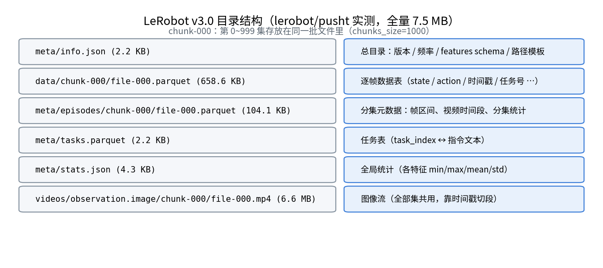
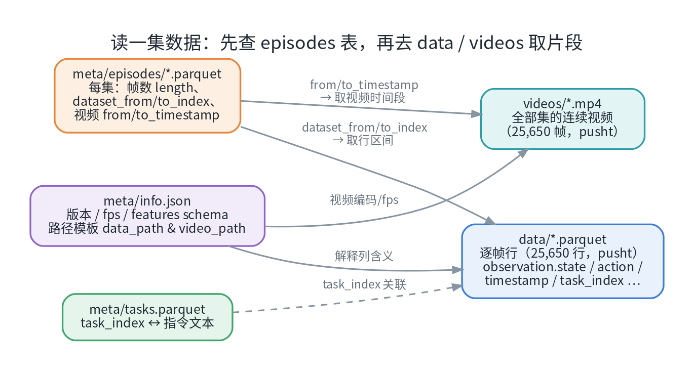
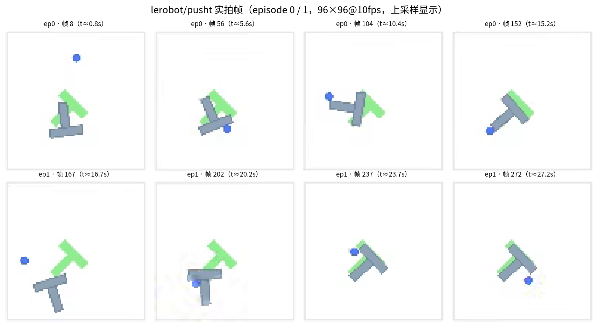
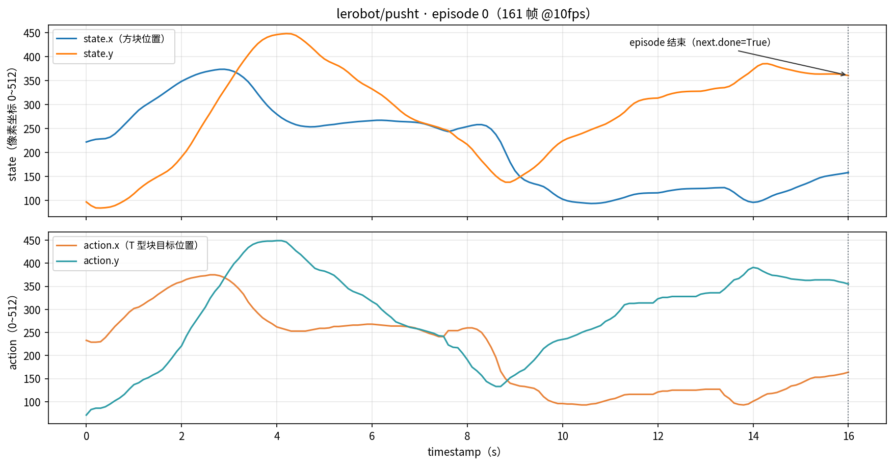
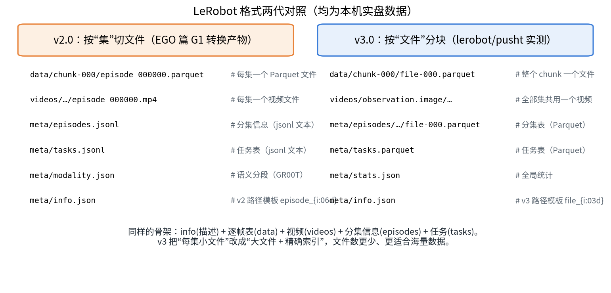
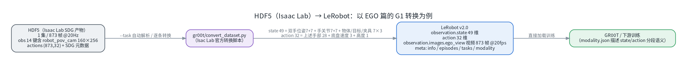

# LeRobot 数据格式详解：结构、下载与实操（七）

这是系列的**第七篇**。前六篇里我们反复和一种格式打交道：转完 EGO 仿真数据（第六篇）导出的 **LeRobot v2.0**、EgoSuite-Open100K 官方同步发布的 **LeRobot v3**、以及 Hugging Face 上近 10 万个数据集在用的同一种"训练就绪"结构。这一篇就把它彻底讲清楚：**目录结构的每个文件是什么、字段怎么读、版本之间差在哪**——并配一套完整可实操的流程：下载公开数据集（`lerobot/pusht`，全量只要 7.5 MB）、用三种方式打开它（含 VS Code 插件直接点着看）、跑通读取与可视化。

> **配套资源**：本系列的全部文章、配套脚本与图表源码已开源：[github.com/huangqiulong/IsaacDataCollection](https://github.com/huangqiulong/IsaacDataCollection) 。本篇配套：`scripts/egosuite_download.sh`（HF 下载助手，第六篇）。

## 0. 一分钟速览

| 问题             | 答案                                                                                                                   |
| ---------------- | ---------------------------------------------------------------------------------------------------------------------- |
| LeRobot 是什么   | Hugging Face 生态的**机器人数据标准 + 训练框架**；数据集"训练就绪"（不用自己写解析器），Hub 上可直接流式加载     |
| 格式长什么样     | 五件套：`info`（描述）+ `data`（逐帧表）+ `videos`（图像流）+ `episodes`（分集索引）+ `tasks`（任务表）      |
| 版本差异         | v2.0 按"集"切文件（`episode_000000.parquet`）；v3.0 按"文件"分块（`file-000.parquet` + 精确索引），文件数更少      |
| 用什么实操       | 公开数据集 **`lerobot/pusht`**（PushT 推块任务，206 集 / 25,650 帧，**全量 7.5 MB**）                    |
| 怎么打开         | ① **VS Code 插件**（Data Wrangler 直接看 Parquet，推荐）② pandas + OpenCV 手工读 ③ `lerobot` 官方库一行加载 |
| 怎么和 HDF5 衔接 | Isaac Lab 官方 `convert_dataset.py` 把 HDF5（第四篇格式）转成 LeRobot；本仓库第六篇的 G1 转换产物即是实例            |

## 1. LeRobot 是什么

LeRobot 是 Hugging Face 的机器人学习开源项目（数据标准 + 模型 + 训练工具），它的数据集格式已经成为事实标准之一：

- **训练就绪**：官方训练脚本、ACT/Diffusion Policy 等策略实现直接消费，不需要你写任何解析代码；
- **生态齐全**：Hub 上近 10 万个 LeRobot 格式数据集；`lerobot` 库提供 `LeRobotDataset`、可视化、上传/下载工具；
- **上下游都认**：Isaac Lab 官方提供 **HDF5 → LeRobot 转换脚本**（第六篇的 EGO 数据就是这么出的）；EgoSuite-Open100K 这类万小时级公开集也同时发 LeRobot 与 MCAP 双格式；GR00T 等 VLA 训练栈在 LeRobot 之上补充语义分段（`modality.json`）。

**版本演进**（本机实测过 v2 与 v3 两代）：

| 版本           | 组织方式                                                                | 特点                                       |
| -------------- | ----------------------------------------------------------------------- | ------------------------------------------ |
| v1.x           | 早期形态                                                                | 已被取代                                   |
| **v2.0** | 按"集"切文件：`episode_000000.parquet` / `episode_000000.mp4`       | 直观、一集一文件；集数多了文件数爆炸       |
| **v3.0** | 按"文件"分块：`file-000.parquet` / `file-000.mp4`（chunk 内合文件） | 文件数少、适合海量数据；用精确索引定位每集 |

## 2. 格式详解（以 v3.0 为例）

### 2.1 目录结构五件套

以实测数据集 `lerobot/pusht` 为例（全量 7.5 MB，206 集）：



*图 1：v3.0 目录结构——六个文件各司其职，括号内为本机实测大小。*

### 2.2 `meta/info.json`：数据集的"身份证"

几个关键字段（pusht 实测）：

```json
{
  "codebase_version": "v3.0",          // 格式版本（决定用什么库版本读）
  "robot_type": "unknown",
  "fps": 10,                            // 数据频率
  "total_episodes": 206, "total_frames": 25650,
  "data_path":  "data/chunk-{chunk_index:03d}/file-{file_index:03d}.parquet",
  "video_path": "videos/{video_key}/chunk-{chunk_index:03d}/file-{file_index:03d}.mp4",
  "features": {
    "observation.image": { "dtype": "video", "shape": [96, 96, 3], "video_info": {"video.fps": 10, "video.codec": "h264"} },
    "observation.state": { "dtype": "float32", "shape": [2] },
    "action":            { "dtype": "float32", "shape": [2] }
  }
}
```

- **`features` 定义了所有字段的 dtype/shape**——图像是 `"video"` 类型（存 mp4），其余是标量/向量（存 parquet）；这也是加载时自动建 tensor 的依据；
- `data_path` / `video_path` 是**路径模板**：`chunk` 与 `file` 从下面要讲的 episodes 表里查；
- v2 的模板则是 `episode_{episode_index:06d}` 形式（一集一文件）。

### 2.3 `data/*.parquet`：逐帧数据表

整个数据集的"主表"，一行 = 一帧（pusht 实测 25,650 行 × 10 列）：

| 列                                                 | 含义                                            |
| -------------------------------------------------- | ----------------------------------------------- |
| `observation.state`                              | 观测（如 pusht：2 维方块位置）                  |
| `action`                                         | 动作（pusht：2 维目标位置）                     |
| `timestamp`                                      | 该帧在**本集内**的时间戳（s）             |
| `episode_index` / `frame_index`                | 第几集 / 集内第几帧                             |
| `index`                                          | 全数据集连续帧号                                |
| `task_index`                                     | 指向任务表                                      |
| `next.reward` / `next.done` / `next.success` | 下一帧奖励 / 终止 / 成功标记（RL 训练可选消费） |

前 3 行长这样（真实数据）：

```
observation.state      action   episode_index  frame_index  timestamp  next.done  next.success  index  task_index
[222.0, 97.0]          [233.0, 71.0]  0       0   0.0        False      False          0      0
[225.25, 89.31]        [229.0, 83.0]  0       1   0.1        False      False          1      0
```

### 2.4 `videos/*.mp4`：图像流

- 图像特征（`observation.image` 等）统一编码为 **H.264 / yuv420p** 的 mp4；
- **v3 中一个 chunk 的所有集合用一个视频文件**（pusht：单文件 25,650 帧）；哪一集对应哪个时间段，由 episodes 表精确给出——所以**不要**按帧数硬算偏移（编码可能有 B 帧）；
- v2 则是一集一个视频文件。

### 2.5 `meta/episodes/…`：分集索引（读数据的关键）

pusht 的 episodes 表实测 206 行 × 68 列，三类关键列：

| 列族 | 示例                                                                                      | 作用                                                   |
| ---- | ----------------------------------------------------------------------------------------- | ------------------------------------------------------ |
| 定位 | `data/chunk_index`、`data/file_index`、`dataset_from_index`、`dataset_to_index`   | 该集在 data 表中的**行区间**                     |
| 视频 | `videos/observation.image/chunk_index/file_index`、`from_timestamp`、`to_timestamp` | 该集在视频里的**时间段**                         |
| 描述 | `length`、`tasks`、`stats/action/{min,max,mean,std}` …                             | 集长、任务、**逐集统计**（每集每个特征的统计量） |

另外 `meta/tasks.parquet`（任务表，`task_index` ↔ 指令文本，pusht 只有 1 条："Push the T-shaped block onto the T-shaped target."）与 `meta/stats.json`（全局统计）。

> **读一集数据的口诀**：先查 episodes 表 → 拿**行区间**去 data 取帧、拿**时间段**去视频取图 → 靠共同的时间戳对齐。

### 2.6 读取链路总览



*图 2：五个文件的关系——info 解释一切、episodes 负责"定位"、data/videos 存实际数据、tasks 提供指令文本。*

### 2.7 `meta/modality.json`：GR00T 的"语义分段"（可选附加）

核心 LeRobot 格式并没有 `modality.json`；它是 **GR00T 训练栈**在 LeRobot 之上加的分段语义文件——把长长的 `state` / `action` 向量切成有名字的段。第六篇转换 G1 数据时自动生成，例如：

```
state（49 维）  = left_hand_pose(0:7) + right_hand_pose(7:14) + left/right_hand_joint_positions(14:28)
                + object_pose(28:35) + goal_pose(35:42) + end_fixture_pose(42:49)
action（32 维） = 上述手部 28 维 + base_velocity(28:31) + base_height(31:32)
```

有了它，"49 维 state"不再是黑盒——每个下标都有物理含义，VLA 训练直接消费。

## 3. 实操 A：下载公开数据集（lerobot/pusht）

选它作为上手样本的理由：经典 PushT 任务、**全量只有 7.5 MB**、同时含视频 + 状态 + 成功标记。

```bash
# 直连慢的话可以走国内镜像（本机实测直连 https://hf-mirror.com 即可）
pip install -U huggingface_hub      # 或用 lerobot 自带的 hf 命令
hf download lerobot/pusht --repo-type dataset --local-dir ./lerobot_pusht
```

**实测**：8 个文件、7.5 MB，两秒级完成——然后就能看到图 1 的目录结构。

## 4. 实操 B：三种打开方式

### 4.1 VS Code 直接点开看（推荐日常使用）⭐

本机 VS Code 已装 **Data Wrangler**（`ms-toolsai.datawrangler`）插件——**Parquet 文件可以直接在编辑器里以表格形式打开**，不用写一行代码：

1. 在资源管理器里**右键** `data/chunk-000/file-000.parquet`（或 `meta/episodes/.../*.parquet`、`meta/tasks.parquet`）；
2. 选择 **Open with…（打开方式）→ Data Wrangler**；
3. 左侧是列清单与统计（min/max/唯一值分布），右侧是表格，支持排序、筛选、搜索、看单行的完整向量值。

几个好用的场景：

- 打开 `meta/tasks.parquet` 一秒确认任务文本；打开 `episodes` 表检查某一集的 `length` 与时间段；
- 打开 `data/*.parquet` 时，列表列（`observation.state` / `action`）会在单元格里展开——比 `head()` 更适合"找异常帧"；
- `meta/info.json`、`meta/stats.json` 直接用 VS Code 自带的 JSON 查看器；v2 的 `meta/episodes.jsonl` / `tasks.jsonl` 会由 **JSONL Pretty Editor**（`jasonheld.jsonl-pretty-editor`）插件自动美化。

> 建议把浏览 Parquet 的默认打开方式设为 Data Wrangler；需要看原始二进制再选其他方式。

### 4.2 pandas + OpenCV 手工读（最通用，不依赖 `lerobot` 库）

```python
import json, pandas as pd, cv2

base = "./lerobot_pusht"
info = json.load(open(f"{base}/meta/info.json"))
fps = info["fps"]

# ① 查分集表：定位第 0 集的帧区间与视频时间段
ep = pd.read_parquet(f"{base}/meta/episodes/chunk-000/file-000.parquet")
row = ep.iloc[0]
print(row["length"], row["videos/observation.image/from_timestamp"],
      row["videos/observation.image/to_timestamp"])

# ② 行区间 → data 表切片
df = pd.read_parquet(f"{base}/data/chunk-000/file-000.parquet")
frames_of_ep0 = df[df["episode_index"] == 0]

# ③ 时间段 → 视频抽帧（frame = timestamp × fps）
cap = cv2.VideoCapture(f"{base}/videos/observation.image/chunk-000/file-000.mp4")
base_frame = int(row["videos/observation.image/from_timestamp"] * fps)
cap.set(cv2.CAP_PROP_POS_FRAMES, base_frame + 50)
ok, img = cap.read()          # 96×96 BGR
```

按这个方法从两集里各抽 4 帧，可以看到完整的推块过程：



*图 3：episode 0 / 1 的帧序列（96×96 上采样显示）——蓝色圆点是机械臂，要把 T 型块推到绿色目标区域。*

状态与动作曲线（一集 161 帧 @10fps）：



*图 4：episode 0 的观测（方块位置）与动作（目标位置）曲线——两条动作曲线在 10 s 后重新拉升，对应"发现没对准、再推一次"的修正过程（真实示教数据的价值所在）。*

### 4.3 `lerobot` 官方库（一行加载，训练同款）

```python
from lerobot.datasets.lerobot_dataset import LeRobotDataset

ds = LeRobotDataset("lerobot/pusht", root="./lerobot_pusht")
print(len(ds))            # 25650
sample = ds[0]
# {'observation.image': Tensor[3,96,96], 'observation.state': Tensor[2],
#  'action': Tensor[2], 'timestamp': ..., 'task': 'Push the T-shaped block ...'}
```

**实测**：`lerobot 0.5.1` 直接加载成功，返回的是 **torch 张量**（图像已解码、归一化 pipeline 可用），`task` 字段直接给指令文本——这就是"训练就绪"的含义。

> ⚠️ 版本兼容：库会校验 `codebase_version`。用旧库读 v3 数据集会直接报错；反之新库读 v2 一般兼容。建议按数据集版本对齐 `lerobot` 库版本。

## 5. 与"近亲格式"的关系

### 5.1 v2.0 vs v3.0 两代对照

本机刚好有两代真实样本：第六篇转换的 G1 数据（v2.0，一集一文件）与 pusht（v3.0，合文件分块）：



*图 5：v2.0 与 v3.0 的目录对照——骨架相同（info/data/videos/episodes/tasks），v3 把"每集小文件"改成"大文件 + 精确索引"。*

### 5.2 HDF5（Isaac Lab）vs LeRobot：各有主场

| 维度     | HDF5（第四篇）                   | LeRobot                                 |
| -------- | -------------------------------- | --------------------------------------- |
| 定位     | 仿真录制"原生仓"、robomimic 生态 | **训练消费"标准仓"**、HF 生态     |
| 组织     | 单文件、`data/demo_i/…` 层级  | 目录 + Parquet + 视频                   |
| 图像     | 原始 uint8 数组（可压缩）        | H.264 视频编码                          |
| 读取     | `h5py`（脚本）/ H5Web 插件     | pandas / Data Wrangler / `lerobot` 库 |
| 典型动作 | 录制、Mimic 增广、发布数据集     | 训练、上传 Hub、跨项目复用              |

**两者之间的桥梁**就是我们第六篇用过的 Isaac Lab 官方转换脚本：



*图 6：以 EGO 篇的 G1 转换为例——SDG 的 HDF5（873 帧、obs 14 键）经 `convert_dataset.py` 变成 LeRobot v2.0（state 49 / action 32 / ego_view 视频），并附带 `modality.json` 语义分段。*

## 6. 常见坑速查

| 现象                                                | 原因 / 解决                                                                                                       |
| --------------------------------------------------- | ----------------------------------------------------------------------------------------------------------------- |
| 加载报"version mismatch"                            | 库与数据集的 `codebase_version` 代际不符 → 升级 `lerobot`（或找对应版本的数据）                              |
| 下载极慢 / 超时                                     | 直连 HF 慢时用镜像：`HF_ENDPOINT=https://hf-mirror.com`（本机实测直连可用）；gated 数据集还需 `hf auth login` |
| 视频帧与 parquet 对不上                             | 用 episodes 表的 `from/to_timestamp` 换算帧号，不要按帧数硬算                                                   |
| chunk 路径猜错                                      | `chunk_index = 全集索引 // chunks_size`（pusht：`chunks_size=1000`）；直接查 episodes 表最稳                  |
| pandas 读不出向量列                                 | 列表列是 pyarrow 类型：`.to_list()` 后再 `np.stack`，或直接用 `lerobot` 库/Data Wrangler                    |
| `meta/episodes` 里的 stats 与 `stats.json` 不同 | 前者是**逐集**统计，后者是**全局**统计，用途不同                                                      |

## 小结与系列导航

- **格式口诀**：`info` 描述一切、`data` 逐帧、`videos` 图像流、`episodes` 定位、`tasks` 指令；读一集 = "查表 → 行区间 + 时间段"；
- **版本选择**：v2 一集一文件、v3 大文件分块；本机两种都实测可读，注意库与数据的代际匹配；
- **上手路径**：`lerobot/pusht` 全量 7.5 MB → **VS Code Data Wrangler 点开看** → pandas 手工读 → `lerobot` 库训练同款加载——三档任选，今天就能跑。

**系列导航**：

- **（一）数据采集方法总览** · **（二）遥操作实操手册** · **（三）仿真与真机采集对比** · **（四）HDF5 格式详解** · **（五）UMI 式数据工作流** · **（六）EGO 式数据工作流** · **（七）LeRobot 数据格式详解**（本文）

**项目仓库（开源）**：[github.com/huangqiulong/IsaacDataCollection](https://github.com/huangqiulong/IsaacDataCollection) —— 全部文章、配套脚本与图表源码。

## 参考资料

- [LeRobot（GitHub）](https://github.com/huggingface/lerobot)——官方库、训练脚本与数据工具
- [lerobot/pusht 数据集](https://huggingface.co/datasets/lerobot/pusht)——本篇实操样本（PushT 推块任务）
- [huggingface_hub 下载文档](https://huggingface.co/docs/huggingface_hub/guides/download)——`hf download` 的过滤、缓存与镜像用法
- [Isaac Lab 模仿学习文档](https://isaac-sim.github.io/IsaacLab/)——HDF5 → LeRobot 转换脚本与 Mimic 流水线	
- 本系列第四篇《HDF5 格式详解》、第六篇《EGO 式数据工作流》——对照阅读更佳

---

*本文全部命令与数字基于实测：`lerobot/pusht`（v3.0，206 集 / 25,650 帧 / 7.5 MB）与 G1 转换产物（v2.0，873 帧）均在本机加载成功（lerobot 0.5.1）。配图存于 `docs/images/isaac-sim-07/`。*
