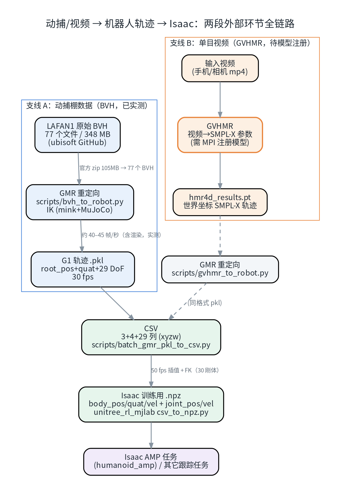
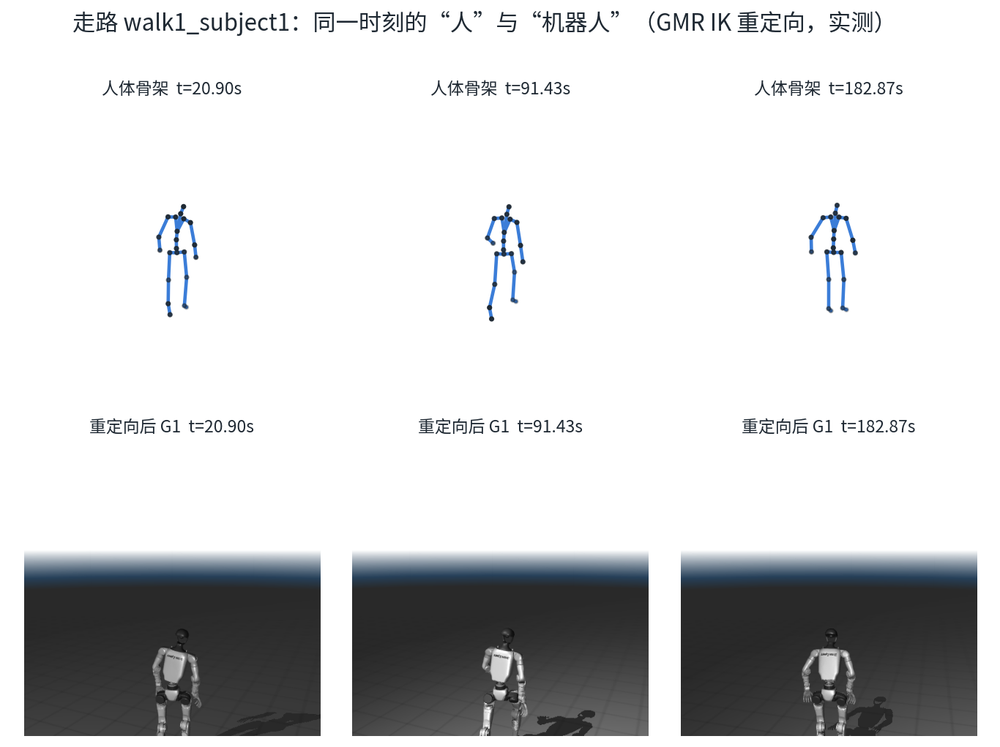
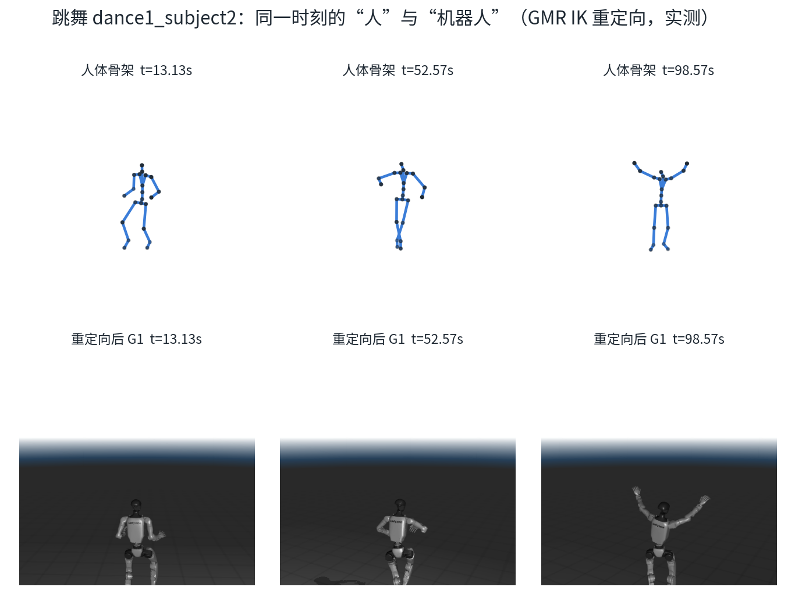
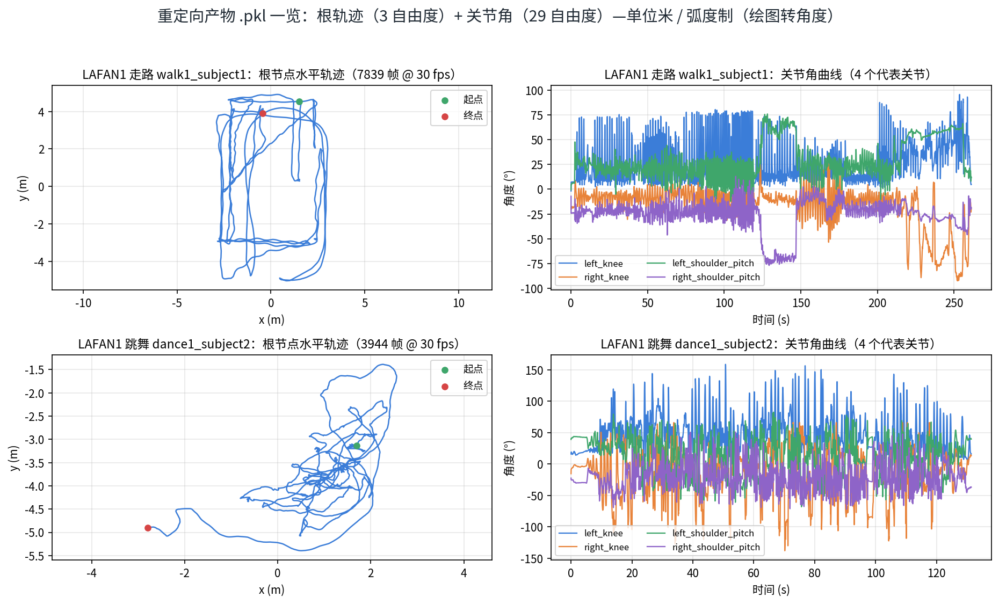
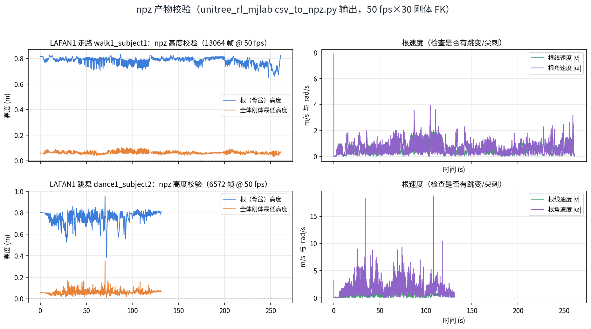
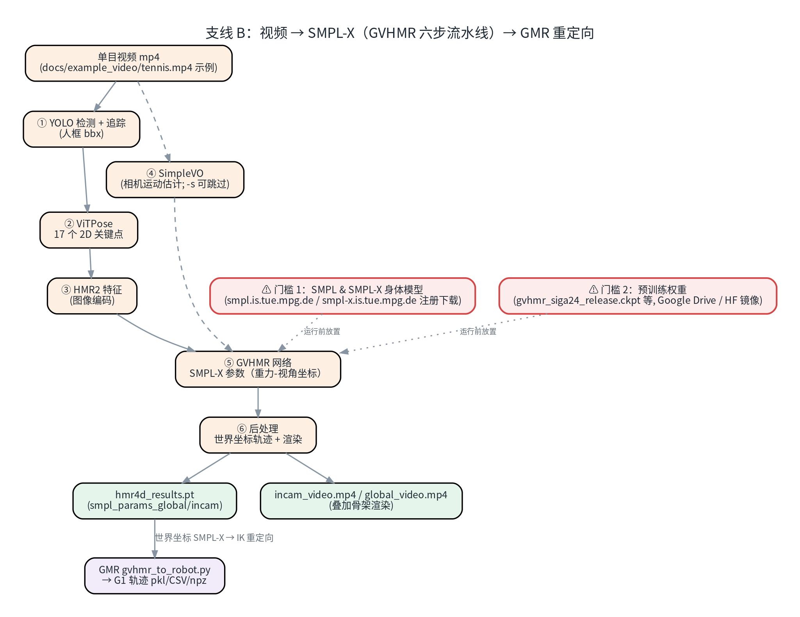
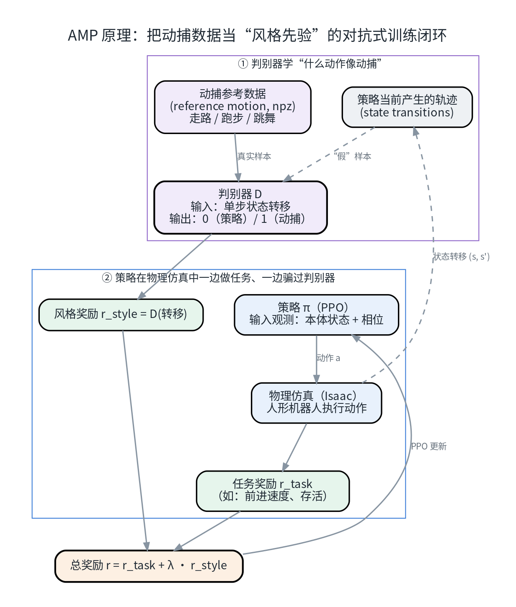
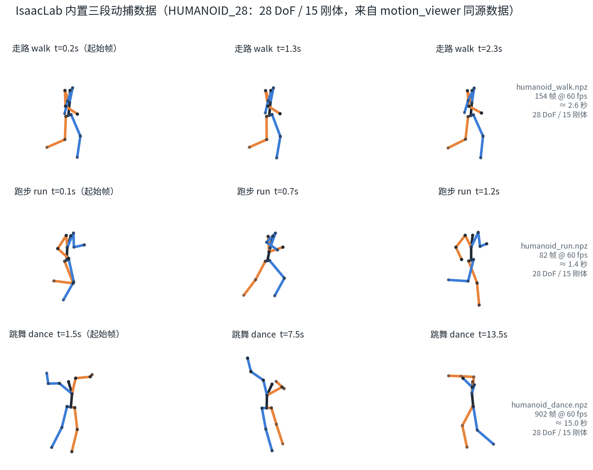

# 动捕数据完整工作流：从公开动捕 / 单目视频到机器人训练数据（八）

这是系列的**第八篇**。前面几篇里，"动捕数据"一直是个"只进不出"的配角：我们看过仓库里三段已经重定向好的 `humanoid_*.npz`（第一篇、第四篇），但**从来没有回答两个最关键的问题**——这些数字是怎么从"人"变成"机器人"的？只有一段手机视频时，又该怎么办？

这一篇把这两个"黑盒"打开，并全部落到可复现的实测上：

1. **没有动捕棚也能开工**：用公开动捕数据集 **LAFAN1**（77 条 BVH）+ 开源重定向工具 **GMR**，把真人动作"翻译"成 Unitree G1 的关节轨迹——实测两条动作，全程给命令、给数字、给踩坑；
2. **只有单目视频也行**：**GVHMR**（视频 → 世界坐标 SMPL-X）+ GMR（SMPL-X → G1）的两段式流程，写明它的完整链路与两道"注册门槛"；
3. **闭环回到 Isaac**：重定向产物怎么转成训练格式（pkl → CSV → npz），以及 Amp（Adversarial Motion Priors）任务"消费"动捕数据的原理与数据契约。

> **配套资源**：本系列的全部文章、配套脚本与图表源码已开源：[github.com/huangqiulong/IsaacDataCollection](https://github.com/huangqiulong/IsaacDataCollection) 。本篇配套：配图 1-8 见 `docs/images/isaac-sim-08/`。

## 0. 一分钟速览

| 问题 | 答案 |
| --- | --- |
| 人体动作为什么不能直接"套"到机器人上 | 人机骨骼零位/轴向/连杆长度全不同：直接套关节角立即穿地抽搐；直接套关键点位置会逼出够不到的极端姿态 |
| 正确做法 | **逐帧 IK 重定向**：把人体各部位当作"目标位姿"，在机器人模型上求关节角（GMR = mink + MuJoCo，纯几何优化，不需要训练） |
| 用什么数据实测 | 公开动捕 **[LAFAN1](https://github.com/ubisoft/ubisoft-laforge-animation-dataset)**：zip 约 100MB → **77 条 BVH / 349MB**（走路、跳舞、aiming 等） |
| 用什么工具 | **[GMR](https://github.com/YanjieZe/GMR)**（含 G1 在内的 19 种机器人，MIT 协议）；本机实测 **45 帧/秒**重定向速度 |
| 只有视频怎么办 | **[GVHMR](https://github.com/zju3dv/GVHMR)**（SIGGRAPH Asia 2024）先把视频变成世界坐标 SMPL-X，再用 GMR 转 G1——需要官网注册的 SMPL/SMPL-X 模型 |
| 产物怎么给训练用 | GMR `pkl` → 官方脚本转 `CSV` → `unitree_rl_mjlab` 的 `csv_to_npz.py` 转 **npz（joint/body 全量轨迹，50fps）** |
| Isaac 里谁在"消费"它 | **AMP 任务**（对抗式运动先验）：判别器学"什么动作像动捕"，策略拿风格奖励模仿；本文把闭环原理与数据契约讲清楚 |

## 1. 全景：一段动作的"两段旅行"

人类动作要变成机器人能学的东西，中间隔着**两次翻译**（对应图 1）：

```
动捕棚录制 / 视频         重定向（retargeting）          机器人侧数据
(Vicon/Xsens BVH,      →  (人体骨骼 ≠ 机器人骨骼，    →   .npz 关节/刚体轨迹
 或视频 → SMPL 参数)       需映射 + 物理可行性处理)         (仿真可消费)
```



*图 1：支线 A（BVH 动捕，本文全流程实测）与支线 B（单目视频，流程与门槛见 §4）最终都变成同一种训练格式。*

- **支线 A（动捕数据）**：光学/惯性动捕直接产出 **BVH** 骨架动画；这是最省事的路线——**不需要** SMPL 系列模型；
- **支线 B（单目视频）**：先用 GVHMR 做"视频 → SMPL-X 参数"，再进入同一套重定向；
- **汇合点**：无论哪条线，重定向输出的都是"机器人 qpos 序列"，随后统一转成训练格式（pkl/CSV/npz）。

## 2. 重定向：为什么不能"直接套"?

两个"想当然"都会失败：

1. **直接套关节角**（把人的髋/膝/肘角给机器人）：人机零位、轴向、活动范围全不同，套上去立即穿地/抽搐；
2. **直接套关键点位置**（让机器人手脚去够人的手脚点）：人机连杆长度不同（本例人体假设 ≈1.75m、G1 实际 ≈1.3m），够不到的目标会逼出极端姿态。

GMR 的解法（源码 `motion_retarget.py` 核对）：

- **逐帧 IK 优化**：把人体各部位（髋/膝/脚/肩/肘…）当作"目标位姿"，在机器人 MuJoCo 模型上用 [mink](https://github.com/kevinzakka/mink) 解 QP（默认 `daqp` 求解器）；
- **权重与对齐**：每个部位的"位置权重/朝向权重/位置偏移/旋转对齐"在一条 JSON 配置里预先调好（`ik_configs/bvh_lafan1_to_g1.json`；字段含义见 GMR 仓库 `DOC.md`）→ **换机器人 = 换一个 JSON**；
- **比例缩放**：`human_scale_table × (真实身高 / 假设身高)`，把"人的部位目标"缩成"机器人尺寸的目标"；
- **约束**：关节限位 + 可选速度限幅（默认关闭，开启为 3π rad/s）；
- **输出**：每帧机器人 qpos（= 根位置 3 + 根四元数 4 + N 个关节角）。

> 关键心法：重定向输出的是**参考轨迹**（几何可行），不保证接触摩擦层面完全物理可行——
> 训练侧（AMP / 运动跟踪）对这种误差有容忍度，但"穿地 / 滑步"仍需在 §3.6 的校验图里过一遍。

## 3. 实战 A：LAFAN1 动捕 → Unitree G1（GMR，全流程实测）

> 实测环境：Ubuntu 22.04 + RTX 4070 Laptop（8GB）；数据放在 `~/datasets/mocap/`（示例路径，可自定义）。

### 3.1 环境准备（conda + pip）

```bash
# ① 拉取 GMR（GitHub；完整工作树约 1.5GB，含 19 种机器人网格）
cd ~/code
git clone https://github.com/YanjieZe/GMR.git
cd GMR
# 磁盘吃紧可只保留 G1 相关资源：
# git sparse-checkout set --cone scripts general_motion_retargeting third_party assets/unitree_g1

# ② 建独立环境（Python 3.10）
conda create -n gmr python=3.10 -y && conda activate gmr

# ③ 装依赖（国内推荐清华源）
pip install -i https://pypi.tuna.tsinghua.edu.cn/simple \
    loop_rate_limiters mink mujoco numpy scipy "qpsolvers[proxqp]" rich tqdm \
    opencv-python natsort psutil protobuf "redis[hiredis]" "imageio[ffmpeg]"

# ④ 装本体（--no-deps：跳过 setup.py 里的 smplx git 依赖——BVH 路线不需要它）
pip install -e . --no-deps

# ⑤ PyTorch（仅做四元数数学，装 CPU 版就够；示例用阿里云镜像的 CPU wheel）
curl -L -C - -o /tmp/torch-2.6.0+cpu-cp310-cp310-linux_x86_64.whl \
  "https://mirrors.aliyun.com/pytorch-wheels/cpu/torch-2.6.0%2Bcpu-cp310-cp310-linux_x86_64.whl"
pip install /tmp/torch-2.6.0+cpu-cp310-cp310-linux_x86_64.whl -i https://pypi.tuna.tsinghua.edu.cn/simple
```

**实测坑清单**（都是这次踩过的）：

| 坑 | 现象 | 解决 |
| --- | --- | --- |
| 终端里残留 socks 代理环境变量 | `pip` 报 `Missing dependencies for SOCKS support` | `unset ALL_PROXY HTTPS_PROXY http_proxy ...`（pip 走清华源直连即可；GitHub 才需要代理） |
| pip 长连接下载劣化 | 某个 wheel 下到几十 MB 后速度掉到 ~0，一停十几分钟 | 杀掉 pip，用 `curl -C -` 断点续传该 wheel 再本地 `pip install <whl>` |
| `git sparse-checkout` 瘦身后 | 根目录 `setup.py/README.md` 一并被删，`git checkout` 提示"未匹配任何 git 已知文件" | `git show HEAD:setup.py > setup.py`（同理 README.md） |
| 导入缺 torch | `kinematics_model.py` 在 import 阶段就需要 torch（即使走 BVH 路线） | 按 ⑤ 装 CPU 版即可 |
| smplx 未装警告 | pip 报 `general-motion-retargeting requires smplx @ git+...` | BVH 路线忽略即可；视频路线（§4）才需要 |
| 无显示器环境 | `bvh_to_robot.py` 会弹 mujoco 窗口 | 有桌面的机器直接可用；纯无头需改写为不启动 viewer 的循环（IK 本体不依赖显示） |

### 3.2 下载 LAFAN1 原始动捕

[LAFAN1](https://github.com/ubisoft/ubisoft-laforge-animation-dataset)（Ubisoft La Forge Animation Dataset）是动捕重定向社区最常用的公开集之一：

```bash
mkdir -p ~/datasets/mocap/lafan1 && cd $_
curl -L -o lafan1.zip \
  "https://github.com/ubisoft/ubisoft-laforge-animation-dataset/raw/master/lafan1/lafan1.zip"
unzip -q -o lafan1.zip -d bvh
ls bvh | head    # aiming1_subject1.bvh  dance1_subject1.bvh  walk1_subject1.bvh ...
```

实测：zip 约 **100MB** → 解压出 **77 个 BVH / 约 349MB**（走路 walk1–4、跳舞 dance1–3、aiming 等，30fps）。
数据格式无需任何转换，GMR 直接读。

> 其它数据源：Nokov BVH（`--format nokov`）、Xsens BVH（`scripts/xsens_bvh_to_robot.py`，另有一套 offset.json 标定流程）、
> OptiTrack FBX（需装 `fbx_sdk`）、AMASS/OMOMO 的 SMPL-X 动作（需要 SMPL-X 官方模型，见 §4.3）。

### 3.3 跑重定向

```bash
conda activate gmr && cd ~/code/GMR
BVH=~/datasets/mocap/lafan1/bvh
OUT=~/datasets/mocap/lafan1/retarget_g1
mkdir -p $OUT/videos

# 走路（--record_video：开窗口实时展示 + 离屏录制 mp4；不加则只开窗口）
python scripts/bvh_to_robot.py \
  --bvh_file $BVH/walk1_subject1.bvh \
  --robot unitree_g1 \
  --save_path $OUT/walk1_subject1.pkl \
  --record_video --video_path $OUT/videos/walk1_subject1.mp4

# 跳舞（换文件即可；--format 缺省 lafan1）
python scripts/bvh_to_robot.py \
  --bvh_file $BVH/dance1_subject2.bvh \
  --robot unitree_g1 \
  --save_path $OUT/dance1_subject2.pkl \
  --record_video --video_path $OUT/videos/dance1_subject2.mp4
```

**实测结果**（CPU 侧 IK + mujoco 窗口渲染 + mp4 录制同开）：

| 动作 | 源帧数 | pkl 产物帧数 | 总耗时 | 平均速度 | 录制视频 |
| --- | --- | --- | --- | --- | --- |
| walk1_subject1（走路 ≈4.3 分钟） | 7840 | 7839 | **2 分 51 秒** | 45.6 帧/秒（渲染 FPS 41.7） | 15.3MB mp4 |
| dance1_subject2（跳舞 ≈2.2 分钟） | 3945 | 3944 | **1 分 30 秒** | 43.8 帧/秒 | 8.8MB mp4 |

要点：

- 不加 `--rate_limit` 时**全速处理**（比真人动作快几十倍）；加 `--rate_limit` 则按原速播放便于观察；
- 末帧会被丢弃（脚本循环写法所致，7839/7840），无碍；
- pkl 结构（`fps=30`）：`root_pos (T,3)`、`root_rot (T,4)`（**xyzw** 四元数）、`dof_pos (T,29)`；
- 退出时若打印 `GLFWError: library is not initialized` 属窗口关闭时的良性提示，不影响产物；
- 批量处理：写个 `for f in ...; do python scripts/bvh_to_robot.py ...; done` 即可；
  ⚠️ 仓库自带的 `scripts/bvh_to_robot_dataset.py` 引用了已不存在的加载函数，直接跑会报错，别踩。

### 3.4 先"看一眼"结果：人 vs 机器人（图 2、图 3）

重定向质量如何，最直观的判断就是**把同一时刻的人体骨架与机器人渲染并排放**：



*图 2：走路 walk1_subject1 的三个关键时刻。上排是 BVH 前向运动学得到的人体骨架；下排是把对应帧的 qpos 喂给 G1 模型的渲染结果（相机按朝向自动对准正面）。*



*图 3：跳舞 dance1_subject2。第三帧"双手举过头"这类大幅动作也能正确映射——这正是 GMR 逐帧 IK + 权重调参的价值。*

### 3.5 数据长什么样：轨迹与关节曲线（图 4）



*图 4：走路是一个带转弯的绕圈路线（左列，起点绿点/终点红点）；关节角曲线（右列）连续无跳变。跳舞有大幅的肩/膝运动——单条动作就能覆盖不少风格。*

### 3.6 工程化转格式：pkl → CSV → npz（实测）

重定向产物要进训练框架，还需要两次格式转换：

```bash
# ① GMR pkl → CSV（GMR 官方脚本，秒级；输出 $OUT/csv/*.csv）
cd ~/code/GMR
python scripts/batch_gmr_pkl_to_csv.py --folder $OUT
# CSV 列 = 3 位置 + 4 四元数(xyzw) + 29 关节 = 36 列

# ② CSV → npz（unitree_rl_mjlab 的转换工具；需含 mjlab 依赖的 Python 环境）
git clone https://github.com/unitreerobotics/unitree_rl_mjlab.git ~/code/unitree_rl_mjlab
cd ~/code/unitree_rl_mjlab
python scripts/csv_to_npz.py --robot g1 \
  --input-file $OUT/csv/walk1_subject1.csv \
  --output-name walk1_subject1 --input-fps 30 --output-fps 50
python scripts/csv_to_npz.py --robot g1 \
  --input-file $OUT/csv/dance1_subject2.csv \
  --output-name dance1_subject2 --input-fps 30 --output-fps 50
# 产物：src/assets/motions/g1/<name>.npz
```

**为什么两套工具能无缝对接**：GMR 输出的 29 个关节顺序与 unitree_rl_mjlab 的 CSV 约定**逐一比对一致**
（实测：`robot_dof_names` 排序后与 `csv_to_npz.py` 的 `joint_names` 列表完全相等），根旋转统一 xyzw。

**实测转换耗时与产物**：

| 步骤 | walk1_subject1 | dance1_subject2 |
| --- | --- | --- |
| pkl → CSV（36 列） | 秒级（7.2MB） | 秒级（3.6MB） |
| CSV → npz（50fps 插值 + 30 刚体 FK） | 约 20 秒（13064 帧） | 约 10 秒（6572 帧，656 帧/秒） |
| npz 大小 | 23.4MB | 11.8MB |

npz 字段（标准训练格式）：

| 键 | 形状 | 含义 |
| --- | --- | --- |
| `fps` | (1,) | 50（输出帧率） |
| `joint_pos` / `joint_vel` | (T, 29) | 关节位置/速度 |
| `body_pos_w` | (T, 30, 3) | 30 个刚体世界位置（MuJoCo Warp 前向运动学得到） |
| `body_quat_w` | (T, 30, 4) | 刚体旋转（**wxyz**） |
| `body_lin_vel_w` / `body_ang_vel_w` | (T, 30, 3) | 刚体线/角速度 |

### 3.7 产物校验：用数据说话（图 5）

生成数据后别急着开训，先做三件套校验（图 5）：



*图 5：两条动作的骨盆高度稳定在 ≈0.8m；**全体刚体最低高度 ≥≈0.05m（无穿地）**；速度曲线的首帧尖刺是数值求导的起点效应，可忽略。*

1. **最低刚体高度**：训练前确认脚没有穿进地面（<0 就是穿地征兆）；
2. **速度尖刺**：除起点效应外的孤立尖刺往往对应 IK 抖动，检查该时刻的关节角；
3. **根轨迹**：与原始动作的直观印象是否一致（走路该绕圈就绕圈）。

若发现问题：检查 IK 配置中的脚部权重与 `ground_height`，或对动作做裁剪/平滑。

产物目录一览（完整链路）：

```
~/datasets/mocap/lafan1/
├── bvh/                    # 原始 77 个 BVH
└── retarget_g1/
    ├── walk1_subject1.pkl  dance1_subject2.pkl
    ├── csv/*.csv           # 36 列
    ├── npz/*.npz           # 训练格式
    └── videos/*.mp4        # 重定向录像（15.3MB / 8.8MB）
```

## 4. 实战 B：只有手机视频？——"视频 → SMPL-X"（GVHMR）

### 4.1 完整链路

没有动捕设备、只有一段手机/相机视频时，业界标准做法是两步拼接：

```
单目视频 ──GVHMR──▶ 世界坐标 SMPL-X 人体轨迹(hmr4d_results.pt) ──GMR gvhmr_to_robot.py──▶ G1 轨迹 pkl/CSV/npz
```

即：**GVHMR 负责"视频→人"，GMR 负责"人→机器人"**，下游与 §3.6 完全同构。

### 4.2 GVHMR 六步流水线（图 6）

[GVHMR](https://github.com/zju3dv/GVHMR)（SIGGRAPH Asia 2024，论文 [arXiv:2409.06662](https://arxiv.org/abs/2409.06662)）从单目视频恢复**世界坐标**人体运动（"重力-视角坐标系"设计，解决了相机运动与人体运动的解耦）：



*图 6：YOLO 追踪 → ViTPose 2D 关键点 → HMR2 特征 → SimpleVO 相机运动 → GVHMR 网络 → 后处理渲染。红色节点是两个必须提前准备、且无法自动获取的"门槛"（见 §4.3）。*

### 4.3 两道"人工门槛"（本机也卡在这里，如实记录）

| # | 门槛 | 说明 |
| --- | --- | --- |
| 1 | **SMPL & SMPL-X 身体模型** | 需在官网注册（学术许可）后下载：[smpl.is.tue.mpg.de](https://smpl.is.tue.mpg.de/) / [smpl-x.is.tue.mpg.de](https://smpl-x.is.tue.mpg.de/)；README 要求放置为 `inputs/checkpoints/body_models/{smplx/SMPLX_{GENDER}.npz, smpl/SMPL_{GENDER}.pkl}`——**无法自动获取，需用户操作** |
| 2 | **预训练权重** | `gvhmr_siga24_release.ckpt`、HMR2 权重、ViTPose 权重、YOLO 权重（官方 Google Drive 提供，Hugging Face 亦有社区镜像），放入 `inputs/checkpoints/` 对应子目录 |

环境（官方流程；注意这里 torch 是 **GPU 版**，属深度学习推理，与 §3.1 的 CPU 版定位不同）：

```bash
git clone https://github.com/zju3dv/GVHMR.git && cd GVHMR
conda create -y -n gvhmr python=3.10 && conda activate gvhmr
pip install -r requirements.txt && pip install -e .
mkdir -p inputs outputs   # 再按上表放置模型与权重
```

> 本文的诚实边界：这两道门（尤其是需要人工注册的 SMPL 系列模型）没有绕过方式，
> 因此"完整跑通视频支线"留给你补上模型后按下面命令直接执行。

### 4.4 跑通后的两条命令（= §3 的"视频版"）

```bash
# ① 视频 → SMPL-X（示例是仓库自带的网球视频；-s 表示固定机位、跳过相机估计）
python tools/demo/demo.py --video=docs/example_video/tennis.mp4 -s
# 产物：outputs/demo/tennis/hmr4d_results.pt（+ 两段叠加渲染 mp4）

# ② SMPL-X → G1（GMR；需把同一批 SMPL-X 模型放到 GMR/assets/body_models/smplx/）
cd ~/code/GMR && conda activate gmr
python scripts/gvhmr_to_robot.py \
  --gvhmr_pred_file ~/code/GVHMR/outputs/demo/tennis/hmr4d_results.pt \
  --robot unitree_g1 --record_video --save_path $OUT/tennis_g1.pkl
# 之后接 §3.6 的 pkl → CSV → npz，完全一致
```

### 4.5 其它真实数据源速览

| 设备/数据 | 接入方式 | 状态（本文实测） |
| --- | --- | --- |
| 光学动捕（Vicon 等，直出 BVH） | 走 §3（`--format lafan1/nokov` 或按骨架改 loader） | ✅ 流程实测（用 LAFAN1 代） |
| Xsens 惯性套装 | `scripts/xsens_bvh_to_robot.py`（先跑 PyQt 查看器生成 `offset.json` 标定） | ⚠️ 未实测（需套装数据） |
| OptiTrack（FBX 导出） | `third_party/poselib/fbx_importer.py` → `scripts/fbx_offline_to_robot.py`（需 fbx_sdk） | ⚠️ 未实测 |
| AMASS/OMOMO（SMPL-X 学术数据） | `scripts/smplx_to_robot.py`（同样需要 SMPL-X 官方模型） | ⚠️ 未实测 |
| PICO 头显实时流（TWIST2） | `scripts/xsens_live_streaming.py` 同类实时脚本 + XRoboToolkit SDK | ⚠️ 未实测（需头显） |

## 5. 回到 Isaac：训练侧怎么"消费"这些数据

### 5.1 数据契约：Isaac 侧要的不只是一串关节角

Isaac Lab 的运动先验任务（如内置 AMP）要求 npz 满足一份**数据契约**（字段字典）：

| 键 | 类型 | 形状 | 含义 |
| --- | --- | --- | --- |
| `fps` | int64 | () | 采样帧率 |
| `dof_names` | 字符串 | (D,) | 关节名 |
| `dof_positions` / `dof_velocities` | float32 | (N, D) | 关节位置/速度 |
| `body_names` | 字符串 | (B,) | 刚体名 |
| `body_positions` | float32 | (N, B, 3) | 刚体位置 |
| `body_rotations` | float32 | (N, B, 4) | 刚体旋转（**wxyz**） |
| `body_linear_velocities` / `body_angular_velocities` | float32 | (N, B, 3) | 刚体线/角速度 |

**处理要点**：四元数顺序（该契约是 `wxyz`，而我们链路里的 pkl/CSV 是 `xyzw`，转换时注意）；位置单位米；
**DOF/body 名称必须与目标机器人匹配**——这是重定向数据的最终"验收线"。

### 5.2 AMP：把动捕当"风格先验"（图 7）

AMP（Adversarial Motion Priors，[论文](https://arxiv.org/abs/2104.02180)）不把动捕当"逐帧目标"，而是训练一个**判别器**来判断"这段动作像不像数据里的风格"：



*图 7：判别器 D 同时看"动捕参考"与"策略轨迹"；策略的总奖励 = 任务奖励 + λ×风格奖励（D 给打的分）。策略于是"一边完成任务、一边学着像数据里的人"。*

### 5.3 内置三段数据到底长什么样（图 8）

Isaac Lab 仓库内置了三段可直接训练的动作（走路 / 跑步 / 跳舞）。很多人（包括最初的我们）以为它们是 G1 数据——**实际上它们是 IsaacLab 的通用人形资产 `HUMANOID_28`（28 DoF / 15 刚体）**：



*图 8：`humanoid_walk.npz`（154 帧 @60fps）、`humanoid_run.npz`（82 帧）、`humanoid_dance.npz`（902 帧 ≈ 15 秒）。这是"已重定向好的成品"——本文 §3 教你的正是怎么自己产这一份。*

想把**自己重定向的 G1 数据**送进各式训练框架，有两条路：

1. **unitree_rl_mjlab 运动跟踪训练**：直接用 §3.6 产出的 npz（就是为该仓库准备的格式）；
2. **Isaac 内置 AMP 任务**：需要把字段改名并补上 `dof_names`/`body_names`（顺序与数据一致、且与目标 Isaac 环境的机器人命名匹配）：

| AMP 契约字段（§5.1） | unitree npz 对应字段 | 备注 |
| --- | --- | --- |
| `fps` | `fps` | ✓ |
| `dof_positions` / `dof_velocities` | `joint_pos` / `joint_vel` | 29 关节 |
| `body_positions` | `body_pos_w` | 30 刚体 |
| `body_rotations` | `body_quat_w` | 均为 wxyz ✓ |
| `body_linear_velocities` / `body_angular_velocities` | `body_lin_vel_w` / `body_ang_vel_w` | |
| `dof_names` / `body_names` | （需补） | 从机器人资产常量取，逐一核对 |

> ⚠️ 两条重要提醒：① 内置 AMP 任务是 **HUMANOID_28** 的，把 G1 数据塞进去会因名字对不上而失败（要么按上表换成 HUMANOID_28 的骨架，要么用 G1 自己的跟踪训练）；② "改名 + 补名称"本身是 `np.savez` 级别的操作，但本文未实测（已验证边界到 npz 为止）。

### 5.4 训练与回放要点（内置任务）

```bash
cd ~/code/isaac/isaaclab && source .venv/bin/activate

# 训练（8GB 显存建议 512 环境；skrl 后端）
./isaaclab.sh train --task IsaacContrib-Humanoid-AMP-Dance-Direct --num_envs 512
# 跑步 / 走路：换 --task IsaacContrib-Humanoid-AMP-Run-Direct / ...-Walk-Direct

# 回放（对比 §3 的动捕视频，看"风格"学没学会）
./isaaclab.sh play --task IsaacContrib-Humanoid-AMP-Dance-Direct \
  --checkpoint logs/skrl/humanoid_amp_dance/<时间戳>/checkpoints/last.pt
```

配置文件要点（`skrl_dance_amp_cfg.yaml`）：rollouts / mini_batches = 16 / 2；learning_rate = 5e-5；
总训练量 80000 timesteps（预计小时级，建议后台跑）。训练纪律：开训前确认 GPU 空闲，同机别叠加其它仿真。

## 6. 局限与经验教训

- **重定向只保证"几何上像"**：快速动作可能出现脚部滑移/贴地不严——训练前用 §3.7 的校验图过一遍；
- **参考轨迹的物理可行性**决定数据上限：AMP 对误差有容忍（学风格而非复刻），逐帧跟踪类任务更敏感；
- **多样性靠数量**：三段内置动作 vs 真机数百段演示差距明显——好在有了 §3 的流水线，"多产几段"的成本只是一条命令；
- **视频路线的门槛不在代码而在许可**：SMPL 系列模型需要注册，这是学术工具链的常态，提前安排；
- **小心"看起来对"的坑**：我们最初以为内置 npz 是 G1 数据（图 8 揭示了真相是 HUMANOID_28）——**名字对齐是跨工具链转换时最容易翻车的环节**。

## 7. 附录

### 7.1 命令速查

```bash
# ---- 重定向链（gmr 环境）----
conda activate gmr && cd ~/code/GMR
BVH=~/datasets/mocap/lafan1/bvh
OUT=~/datasets/mocap/lafan1/retarget_g1
python scripts/bvh_to_robot.py --bvh_file $BVH/walk1_subject1.bvh --robot unitree_g1 \
  --save_path $OUT/walk1_subject1.pkl --record_video --video_path $OUT/videos/walk1_subject1.mp4
python scripts/batch_gmr_pkl_to_csv.py --folder $OUT

# ---- CSV → npz（unitree_rl_mjlab 环境）----
cd ~/code/unitree_rl_mjlab
python scripts/csv_to_npz.py --robot g1 \
  --input-file $OUT/csv/walk1_subject1.csv --output-name walk1_subject1 --input-fps 30 --output-fps 50
```

### 7.2 FAQ

| 现象 | 原因 / 解决 |
| --- | --- |
| GMR `pip install` 报 `Missing dependencies for SOCKS support` | 终端残留 socks 代理变量——`unset ALL_PROXY HTTPS_PROXY http_proxy ...` 后重试 |
| GMR 导入报 `No module named 'torch'` | `kinematics_model` 在 import 时就需要 torch；装 **CPU 版**即可 |
| GMR pip 警告 `smplx @ git+... not installed` | BVH 路线不需要 smplx；用 `--no-deps` 安装本体即可忽略 |
| pip 装大 wheel 卡住（速度掉到 0） | 长连接劣化；杀掉 pip 后用 `curl -C -` 断点续传，再本地安装 |
| `bvh_to_robot.py` 需要图形界面 | 脚本会开 mujoco 窗口；纯无头环境需改写为不启动 viewer 的循环 |
| 视频路线报缺少 body model | SMPL/SMPL-X 需官网注册后下载（学术用途），无法自动获取 |
| 自制 npz 送进 AMP 报名称不匹配 | 记住"内置任务 = HUMANOID_28"——要么换骨架要么换任务（§5.3） |

### 7.3 参考链接

- GMR：<https://github.com/YanjieZe/GMR>（ICRA 2026"Retargeting Matters"，MIT）
- LAFAN1：<https://github.com/ubisoft/ubisoft-laforge-animation-dataset>
- GVHMR：<https://github.com/zju3dv/GVHMR>（SIGGRAPH Asia 2024）
- unitree_rl_mjlab：<https://github.com/unitreerobotics/unitree_rl_mjlab>
- AMP 论文：<https://arxiv.org/abs/2104.02180>
- 本系列仓库（脚本与配图源码）：<https://github.com/huangqiulong/IsaacDataCollection>

---

## 小结与系列导航

- **重定向没那么神秘**：LAFAN1 → GMR → G1，两条动作 3 分钟内跑完；pkl → CSV → npz 各一条命令；
- **校验先行**：先看"人机对比图"（图 2/3）再开训，穿地/滑步就回炉调参；
- **视频支线先备料**：SMPL/SMPL-X 模型与 GVHMR 权重需要注册下载，提前安排不误工；
- **警惕名字陷阱**：跨工具链转换时，"名称对齐"（关节/刚体名）是最容易翻车也最值得先核对的一步。

**系列导航**：

- **（一）数据采集方法总览** · **（二）遥操作实操手册** · **（三）仿真与真机采集对比** · **（四）HDF5 格式详解** · **（五）UMI 式数据工作流** · **（六）EGO 式数据工作流** · **（七）LeRobot 数据格式详解** · **（八）动捕数据完整工作流**（本文） · **（九）RLDS 数据格式详解**

**项目仓库（开源）**：[github.com/huangqiulong/IsaacDataCollection](https://github.com/huangqiulong/IsaacDataCollection) —— 全部文章、配套脚本与图表源码。

---

*本文全部命令与数字基于实测：GMR v0.2.0 在 RTX 4070 Laptop / Ubuntu 22.04 上把 LAFAN1 走/跳两条 BVH（7840/3945 帧）重定向为 G1 轨迹（45.6/43.8 帧每秒，均含窗口渲染与录像），并转出 50fps 的 npz；GVHMR 支线的流程与条件已如实注明。配图存于 `docs/images/isaac-sim-08/`。*
