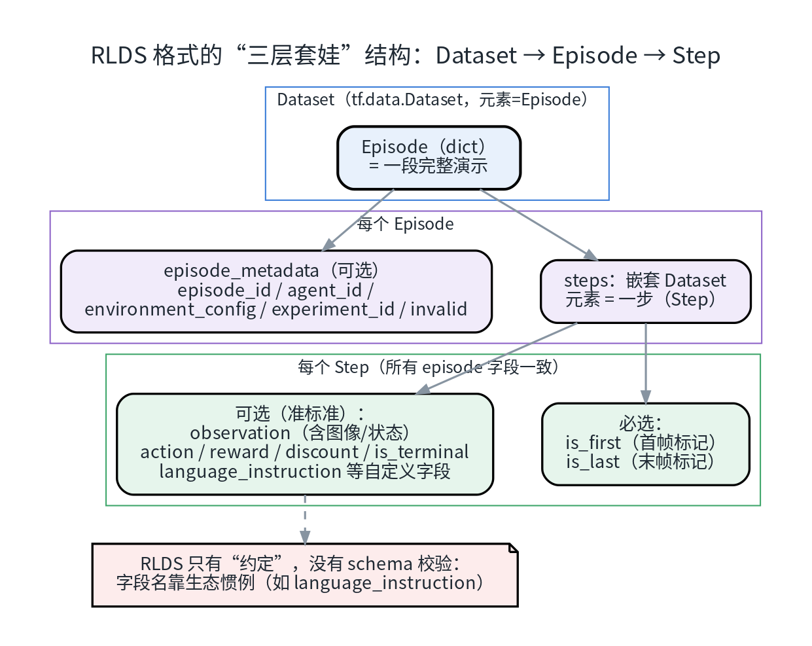
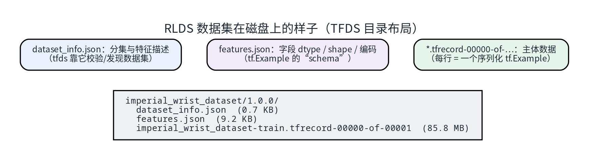
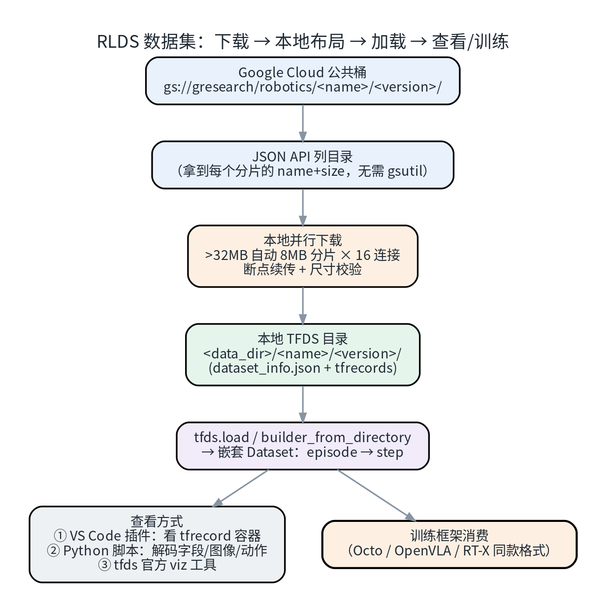
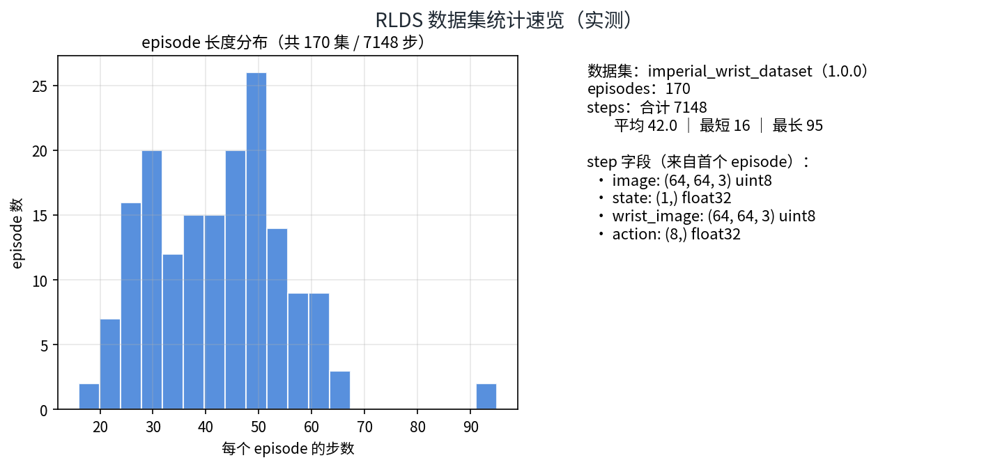
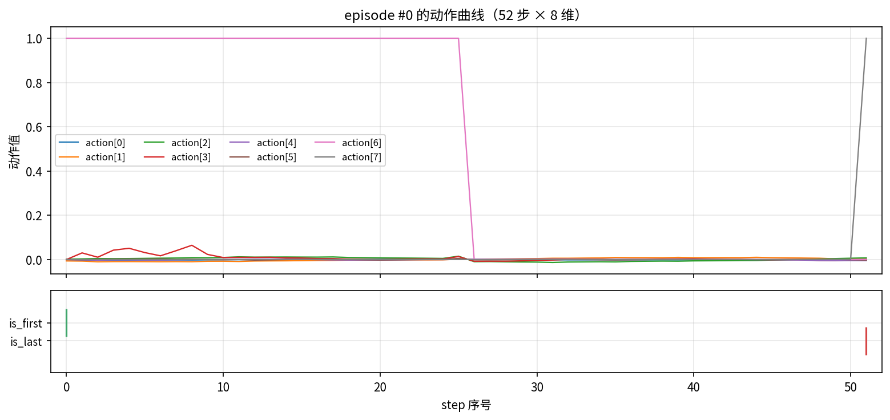
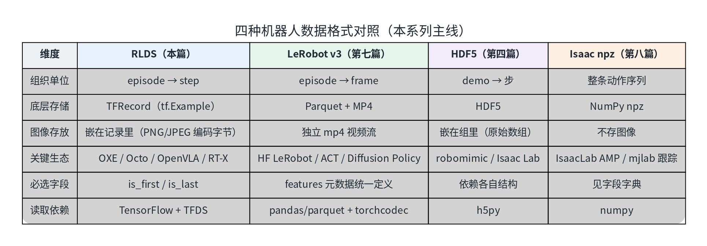

# RLDS 数据格式详解：结构、下载与实操（九）

这是系列的**第九篇**。第八篇处理的是人形机器人的全身动作（动捕/重定向），这一篇换一个视角——认识机器人学习圈**被引用最多的公开数据格式之一：RLDS**。你可能已经间接用过它：**Open X-Embodiment（OXE）**——世界最大的开源真机数据协作计划（60 个数据集、22 种机器人、100 万+ 轨迹）——以及 Octo、OpenVLA、RT-1-X / RT-2-X 等模型的训练数据，全部统一在 RLDS 格式下。

这一篇把它彻底讲清楚：**三层结构怎么读、磁盘上长什么样、公开数据集怎么下载（含一个 86MB 的完整实操）、以及 VS Code 里怎么看**——和第七篇（LeRobot）、第四篇（HDF5）组成"机器人数据格式三件套"。

> **配套资源**：本系列的全部文章、配套脚本与图表源码已开源：[github.com/huangqiulong/IsaacDataCollection](https://github.com/huangqiulong/IsaacDataCollection) 。本篇配套：`scripts/rlds_download.py`（免 gsutil 的并行下载助手）、`scripts/rlds_demo.py`（读取/解码/可视化示范）。

## 0. 一分钟速览

| 问题 | 答案 |
| --- | --- |
| RLDS 是什么 | Google 2021 年提出的**序列决策数据生态**（Reinforcement Learning Datasets）：核心是一层**约定**——数据集 = episode 序列，episode = step 序列；配 EnvLogger（录数据）与 RLDS 工具库 |
| 谁在用它 | Open X-Embodiment、Octo、OpenVLA、RT-1-X / RT-2-X、D4RL、RL Unplugged 等 |
| 磁盘上是什么 | TFDS 目录：`dataset_info.json` + `features.json` + **TFRecord**（一条记录 = 一个 episode；记录内部是序列化的 tf.Example） |
| 必选字段 | **只有两个**：`is_first` / `is_last`；`observation` / `action` / `reward` / `language_instruction` 等都是"生态惯用"的可选字段 |
| 怎么下载 | 官方三条路：gsutil / TFDS 自动下载 / 手动拷贝到 TFDS 目录；本文的脚本直连 GCS 公共桶**并行下载**（86MB 样本实测约 10 分钟） |
| 实操样本 | `imperial_wrist_dataset`：**170 集 / 7148 步 / 8 维动作 / 双 64×64 相机 / 语言指令**（全量 86MB） |
| 怎么打开（日常） | ① **Python + TFDS**（推荐，直接解码出图像/动作）② **VS Code 插件**（Parquet Lens，看 TFRecord 容器）③ TFDS 官方 viz |
| 拿它怎么训练 | Octo / OpenVLA / RT-X 同款 `tf.data` 管线直接读；跨格式（→ LeRobot / 其它）思路见 §6 |

## 1. RLDS 到底是什么

RLDS（[google-research/rlds](https://github.com/google-research/rlds)）不是一种"文件后缀"，而是一套**把序列决策数据统一成 `tf.data` 管线的约定**：

- **数据模型**：数据集 → episode（一段完整演示）→ step（一步转移）；整个数据集就是"episode 的 `tf.data.Dataset`"，episode 内部又是"step 的嵌套 `tf.data.Dataset`"；
- **落地存储**：借道 **TFDS**（TensorFlow Datasets）——所以你在磁盘上看到的是 TFDS 的目录布局（`dataset_info.json` + TFRecord 分片）；
- **两条生产工具链**：EnvLogger（程序化录制）与 RLDS Creator（人机交互录制）负责"造"数据；RLDS 库（`pip install rlds`）与 TFDS 负责"读"数据；
- **生态现状（如实说）**：Google 的 rlds 主仓库已进入只读归档（2025-11），但**格式本身恰恰因为被 TFDS / OXE 吸收而活得很好**——这正说明它成功变成了"公共约定"。

**它和 TFDS 是什么关系？** 简单说：TFDS 是"容器框架"，RLDS 是"内容约定"。TFDS 里也有一堆非 RL 的监督学习数据集；而 RLDS 格式的数据集**必须**放进 TFDS 才能被 `tfds.load` 一键加载。OXE 的全部数据集在 TFDS 中是**原生支持**的（模块 `tensorflow_datasets.robotics.rtx`，实测 `tfds.builder('imperial_wrist_dataset')` 直接识别）。

## 2. 格式详解：三层套娃

### 2.1 Dataset → Episode → Step



*图 1：RLDS 的"三层套娃"。Episode 里除了 steps 还能带一份可选的 episode_metadata；Step 里只有 is_first/is_last 是"必选"。*

```python
import tensorflow_datasets as tfds

ds = tfds.builder("imperial_wrist_dataset", data_dir=DATA_DIR).as_dataset(split="all")

for episode in ds.take(1):
    print(episode.keys())            # dict_keys(['episode_metadata', 'steps'])
    steps = episode["steps"]         # 嵌套的 tf.data.Dataset
    for step in steps.take(1):
        print(step.keys())           # is_first / is_last / observation / action / reward / ...
```

读数据的心智模型就一句话：**"外循环遍历 episode，内循环遍历 step"**。

### 2.2 Step：必选只有两个，其余全是约定

| 字段 | 必选? | 含义（以本文样本实测为准） |
| --- | --- | --- |
| `is_first` | ✅ | 是否为该 episode 首帧（含初始状态） |
| `is_last` | ✅ | 是否为末帧（其后没有有效 action） |
| `observation` | 惯用 | 观测：本文样本含 `image` 与 `wrist_image`（64×64×3 uint8）+ `state (1,)` |
| `action` | 惯用 | 动作向量（本文样本 8 维，float32） |
| `reward` / `discount` / `is_terminal` | 惯用 | RL 侧字段；模仿学习任务多为占位 |
| `language_instruction` | 惯用 | 语言指令（本文样本是纯文本，如 "put apple in pot"） |
| `language_embedding` | 惯用 | 指令的预计算嵌入（512 维；不想要可丢弃） |
| 自定义字段 | 自由 | 比如 quadruped 数据里的 `desired_pattern`（四足步态模式）、`proj_grav_vec`（重力投影向量）等 |

两个容易忽略的语义细节：

1. **`is_last=True` 时后续字段无效**：末帧的 `action/reward/discount` 没有意义（envlogger 约定）；
2. **截断与终止的区别**：episode 结尾 `is_terminal=False` 表示"被截断"（比如时间上限），而不是任务完成。

> ⚠️ **RLDS 没有 schema 校验器**：字段名靠生态惯例（`observation`、`action`、`language_instruction`……），
> 所以不同数据集之间"看起来同构、细节不同"是常态——读取时先 `print(step.keys())` 永远是好习惯。

### 2.3 Episode 元数据（可选但建议）

`episode_metadata` 里没有强制字段，官方给了一组"建议字段"：`episode_id`（全局唯一，方便多数据集合并）、`agent_id`、`environment_config`（环境配置）、`experiment_id`、`invalid`（标记采集中断/无效的 episode，读取时应丢弃）。本文样本只带了一个 `file_path`（转换器保留的溯源信息）。

### 2.4 底牌：TFRecord 里是一条条 tf.Example

把文件拆开看（实测命令）：

```python
import tensorflow as tf
n = sum(1 for _ in tf.data.TFRecordDataset([f"{DATA_DIR}/imperial_wrist_dataset/1.0.0/imperial_wrist_dataset-train.tfrecord-00000-of-00001"]))
print(n)   # 170 —— 与 episode 数完全一致
```

**一条 TFRecord 记录 = 一个 episode**；记录内部是序列化的 `tf.Example`，其中 steps 是以 `tf.train.SequenceExample` 风格的嵌套特征（TFDS 的 `Dataset` feature）存储的。图像并不是独立文件，而是**以 PNG/JPEG 字节流嵌在记录里**（`features.json` 里标注 `png` 编码）——这也是 RLDS 数据集"单文件、易分片、易流式"的原因。

**命名惯例**：OXE 里大量数据集叫 `xxx_converted_externally_to_rlds`——表示"外部团队用自己的格式生产，由转换器统一转来的"；原始 OXE 数据还带一系列**标准化字段约定**（如统一 7 维末端执行器动作、`image` 为第三人称、`wrist_image` 为手眼相机）。

## 3. 磁盘布局：三个文件撑起一个数据集



*图 2：数据集目录极小干净——`dataset_info.json`（分集/描述，0.7KB）+ `features.json`（字段 schema，9.2KB）+ TFRecord 分片（85.8MB 单分片装 170 集）。*

- **`dataset_info.json`**：分集定义（train/test 各几个分片、每分片几条记录）、版本号、citation、description——`tfds.builder_from_directory()` 和 `tfds.load()` 都靠它"发现"数据集；
- **`features.json`**：每个字段的 dtype / shape / 编码，等效于"tf.Example 的 schema"；它由转换器生成，也是跨语言工具（比如一些非 TF 读取器）解析数据的依据；
- **`*.tfrecord-XXXXX-of-YYYYY`**：数据本体，支持多分片并行读——大规模数据集动辄几百个分片。

（顺带记录一个"生态松弛感"：本文样本的 description 居然还是脚手架模板 `TODO(example_dataset): ...`——**RLDS 生态允许这种"先跑起来、文档后补"的务实做法**，也让不同数据集质量参差不齐，用之前多看一眼元数据没坏处。）

## 4. 实操 A：下载一个公开数据集（实测）

### 4.1 OXE 数据的托管位置与三种下载方式

OXE 数据在 Google Cloud 公共桶上，官方给了三条路：

```bash
# ① 官方推荐：gsutil（需安装 Google Cloud SDK）
gsutil -m cp -r gs://gresearch/robotics/imperial_wrist_dataset/1.0.0 ~/tensorflow_datasets/imperial_wrist_dataset/

# ② 让 TFDS 自己下载（首次 tfds.load 时从官方桶拉取；网络受限时不推荐）

# ③ 官方 FAQ 的"手动拷贝"路线（TFDS 发现本地文件就不会再下载）
```

本机没有 gsutil，而且 GCS 直连速度一般（单连接 ~150KB/s 上下波动）——所以写了个**纯标准库的并行下载助手**（`scripts/rlds_download.py`），原理见图 6：用 GCS JSON API 列目录拿到每个分片的大小，然后 16 路并行；**超过 32MB 的单个文件自动切 8MB 分片并行**（实测这是突破 GCS 单连接限速的关键），带断点续传与尺寸校验：



*图 6：从公共桶到训练管线的完整链路；文末脚本把这中间三步全自动化了。*

```bash
# 下载本文样本（86MB）：约 10 分钟（16 路并行 + 自动重试）
python3 scripts/rlds_download.py imperial_wrist_dataset --version 1.0.0 \
    --dest /你的数据盘/tfds

# 顺手套一个更小的（6MB 级）
python3 scripts/rlds_download.py nyu_rot_dataset_converted_externally_to_rlds \
    --dest /你的数据盘/tfds
```

### 4.2 从哪开始？"最小数据集"清单（实测扫描 OXE 全目录）

OXE 全量非常大，好在有一批**百 MB 级以下的小数据集**适合上手（体积/集数来自实测扫描）：

| 数据集 | 大小 | 集数 | 任务简介 |
| --- | --- | --- | --- |
| `nyu_rot_dataset_converted_externally_to_rlds` | **5.6 MB** | 14 | xArm 桌面粉块（NYU ROT） |
| `utokyo_saytap_converted_externally_to_rlds` | 58 MB | 20 | 四足步态（SayTap） |
| **`imperial_wrist_dataset`（本文样本）** | **86 MB** | **170** | 臂+腕部相机抓放（含语言指令） |
| `imperialcollege_sawyer_wrist_cam` | 86 MB | — | Sawyer 腕部相机 |
| `utokyo_xarm_bimanual_converted_externally_to_rlds` | 145 MB | — | 双臂 xArm 长时程任务 |
| `tokyo_u_lsmo_converted_externally_to_rlds` | 352 MB | — | 多模态长时程操作 |

> 挑数据集的小技巧：先看 `dataset_info.json` 里的分片大小，再决定下不下——本文样本"单分片 85.8MB / 170 集"就是很友好的比例。

## 5. 实操 B：三种打开方式

### 5.1 Python + TFDS（推荐，一次到位）⭐

```bash
python scripts/rlds_demo.py imperial_wrist_dataset --version 1.0.0 \
    --data-dir /你的数据盘/tfds --episodes 3
```

脚本做的事：加载 → 打印结构摘要 → 抽取 3 个 episode → 导出"双相机帧拼图 + 动作曲线 + summary.json"。

**实测输出**（这就是 RLDS 里一段真机数据的全貌）：

```
[加载] tfds 识别成功：imperial_wrist_dataset
[顶层字段] ['episode_metadata', 'steps']
[step 字段] action(8) / discount / is_first / is_last / is_terminal /
            language_embedding(512) / language_instruction(文本) /
            observation{image 64×64×3, state(1,), wrist_image 64×64×3} / reward
[splits] {'train': 170}

episode/step 概况:
  #0: 52 步 | action 8D | "put apple in pot"
  #1: 48 步 | action 8D | "grasp can"
  #2: 37 步 | action 8D | "insert cap in bottle"
```

整个数据集的统计速览（脚本扫描全部 170 集）：



*图 3：170 集 / 7148 步；每集长度 16~95 步（平均 42）——典型的短程抓放数据分布。*

从 episode #0 抽出的双相机画面（"把苹果放进锅里"全过程）：


*图 4：`image` 与 `wrist_image` 两路 64×64 相机（本集中两路视角接近，都俯视工作台）；step 34 时苹果已被放入锅中，step 51 是收尾帧。*

动作曲线与首末帧标记——**8 维动作里的 action[6] 在 step 25 从 1 掉到 0**（吸盘/夹爪开合的典型形态）：



*图 5：上=动作曲线，下=is_first/is_last 标记——RLDS 的 episode 边界就藏在这两个布尔值里。（读数据时按它们切集，是最不容易出错的做法。）*

### 5.2 VS Code 插件：直接点开 TFRecord 文件 ⭐（本机已装）

本机 VS Code 已装 **Parquet Lens**（`twilightventures.parquet-lens-viewer`）——一个支持 **Parquet / Avro / TFRecord / Arrow** 的本地数据查看器：

1. 在资源管理器里**右键** TFRecord 文件 → **打开方式（Open With…）→ Parquet Lens**；
2. 它会按 **TFRecord 帧容器**解析，逐条列出记录（条数、大小、二进制预览）——对应 RLDS 就是"一条记录 = 一个 episode"；
3. Parquet 文件（比如隔壁 LeRobot 数据集）它也管——**一个插件管两种格式**，日常够用。

> ⚠️ 两个实测注意点：
> ① OXE 的分片文件名是 `...tfrecord-00000-of-00001`（**不以 `.tfrecord` 结尾**），插件靠后缀关联识别不了——
> 复制/软链一份改成 `.tfrecord` 结尾即可打开：`cp xxx.tfrecord-00000-of-00001 /tmp/view.tfrecord`；
> ② 插件看的是**容器与二进制**，把 `tf.Example` 解码成"图像 + 动作数组"这类语义信息，仍然推荐走 §5.1 的 Python 路线。
> 插件主页：<https://marketplace.visualstudio.com/items?itemName=twilightventures.parquet-lens-viewer>

### 5.3 其它顺手工具

- **TFDS 官方可视化**：`tfds.show_examples` 等（需要图形界面）；`builder.info` 打印全量结构；
- **RLDS 工具库**：`pip install rlds`（本机实测需补一个 `dm-reverb` 依赖），提供 episode 级变换（拼接、批化、长度计算等，见官方 transformations 文档）——做**多数据集混合**（OXE 训练常见需求）时用得上。

## 6. 与"近亲格式"的关系



*图 7：本系列涉及过的四种格式对照——各有主场，不是替代关系。*

**什么时候用哪个**（一句话版）：

- **RLDS**：要**大规模聚合异构真机数据**（OXE 生态）、或复现 Octo/OpenVLA 类工作 → 它是事实标准；
- **LeRobot**（第七篇）：单机小团队"训练就绪"，Hub 分发，PyTorch 生态；
- **HDF5**（第四篇）：仿真录制的"原生仓"（Isaac Lab / robomimic）；
- **Isaac npz**（第八篇）：IsaacLab 内运动先验/跟踪训练的紧凑格式。

RLDS ↔ 其它格式的转换在社区里已相当成熟（OXE 官方转换器能把数十种原始格式转成 RLDS；反向也有 OpenVLA / Octo 系代码库的加载器）。**转换时的第一原则**和第八篇学到的完全一致：**先对齐字段语义与名称**（相机谁是第三人称、动作是什么坐标系），再谈速度。

## 7. 常见坑速查

| 现象 | 原因 / 解决 |
| --- | --- |
| 下载只有 ~150KB/s（或更慢） | GCS 单连接限速：用多连接；**大文件必须切分片**（本文脚本 >32MB 自动 8MB×16 并行） |
| 某个分片反复卡住 | 断点续传 + 重试（脚本内置）；实在不行重跑脚本会自动跳过已完成分片 |
| `tfds.builder` 报 `ImportError: cannot import name 'runtime_version'` | 依赖版本冲突：`tensorflow-metadata` 装回 1.14.x（与 tf 2.15 时代配套），避免 protobuf 5.x 代际混搭 |
| VS Code 插件打不开分片文件 | OXE 文件名不带 `.tfrecord` 后缀 → 改名/复制后再打开（§5.2） |
| 首次 `tfds.load` 很慢 | 在"自动下载"模式下 TFDS 从官方桶拉取；用 §4.1 的预下载或 `data_dir` 指向本地 |
| 内存爆掉 | 别把大 episode 全 `list()` 进内存；用 `tf.data` 逐 step 流式处理；大 episode 数据可参考 RLDS FAQ 的 `read_config` 与 SkipDecoding |
| "字段怎么和文档不一样" | RLDS 靠约定不靠 schema：先打印结构、对照各数据集 README（`language_instruction` 在 OXE 系里也有细微差异） |

## 小结与系列导航

- **格式口诀**：Dataset → Episode → Step 三层套娃；**必选只有 `is_first`/`is_last`**；磁盘上就是 TFDS 三件套（dataset_info + features + TFRecord）；
- **上手路径**：挑百 MB 级小数据集 → `rlds_download.py` 并行拉取 → `rlds_demo.py` 解码看图像/动作 → 需要批量训练时交给 TFDS/`tf.data` 流式管线；
- **日常查看**：Python 脚本看"语义"，VS Code 插件看"容器"，两者互补；
- **生态判断**：RLDS 的价值不在"文件多优雅"，而在**世界上最大的一批真机数据都按它对齐**——这是比格式本身更稀缺的资产。

**系列导航**：

- **（一）数据采集方法总览** · **（二）遥操作实操手册** · **（三）仿真与真机采集对比** · **（四）HDF5 格式详解** · **（五）UMI 式数据工作流** · **（六）EGO 式数据工作流** · **（七）LeRobot 数据格式详解** · **（八）动捕数据完整工作流** · **（九）RLDS 数据格式详解**（本文）

**项目仓库（开源）**：[github.com/huangqiulong/IsaacDataCollection](https://github.com/huangqiulong/IsaacDataCollection) —— 全部文章、配套脚本与图表源码。

## 参考资料

- [RLDS 官方仓库（归档只读）](https://github.com/google-research/rlds)——格式约定、EnvLogger/RLDS Creator 与 FAQ
- [Open X-Embodiment 项目页](https://robotics-transformer-x.github.io/)/ [数据浏览器](https://github.com/google-deepmind/open_x_embodiment)——60 数据集总览与下载入口
- [TFDS 文档](https://www.tensorflow.org/datasets)——`tfds.load`、社区数据集与性能指南
- [OpenVLA](https://github.com/openvla/openvla) / [Octo](https://github.com/octo-models/octo)——RLDS 加载与训练实现
- 本系列第四篇《HDF5 格式详解》、第七篇《LeRobot 数据格式详解》、第八篇《动捕数据完整工作流》——对照阅读更佳

---

*本文全部命令与数字基于实测：`imperial_wrist_dataset`（86MB / 170 集 / 7148 步）与 `nyu_rot`（5.6MB / 14 集）在本机经自研脚本从 GCS 公共桶下载，用 tensorflow-cpu 2.15.1 + TFDS 4.9.2 加载成功（含逐 episode 的图像/动作解码与统计）；TFRecord 记录数（170）与 episode 数的一致性已逐条验证。配图存于 `docs/images/isaac-sim-09/`。*
