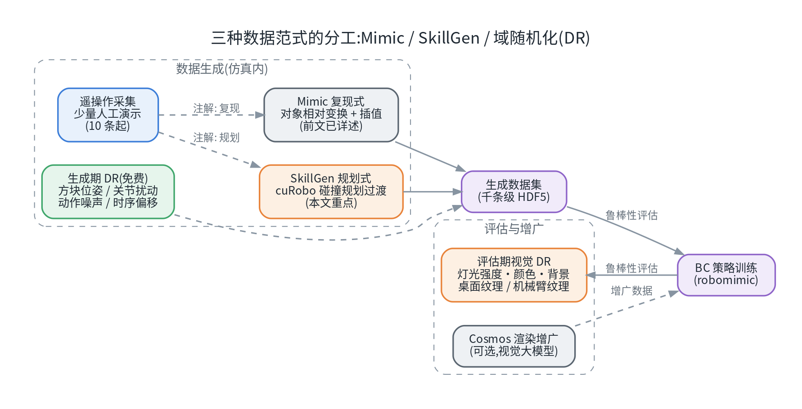
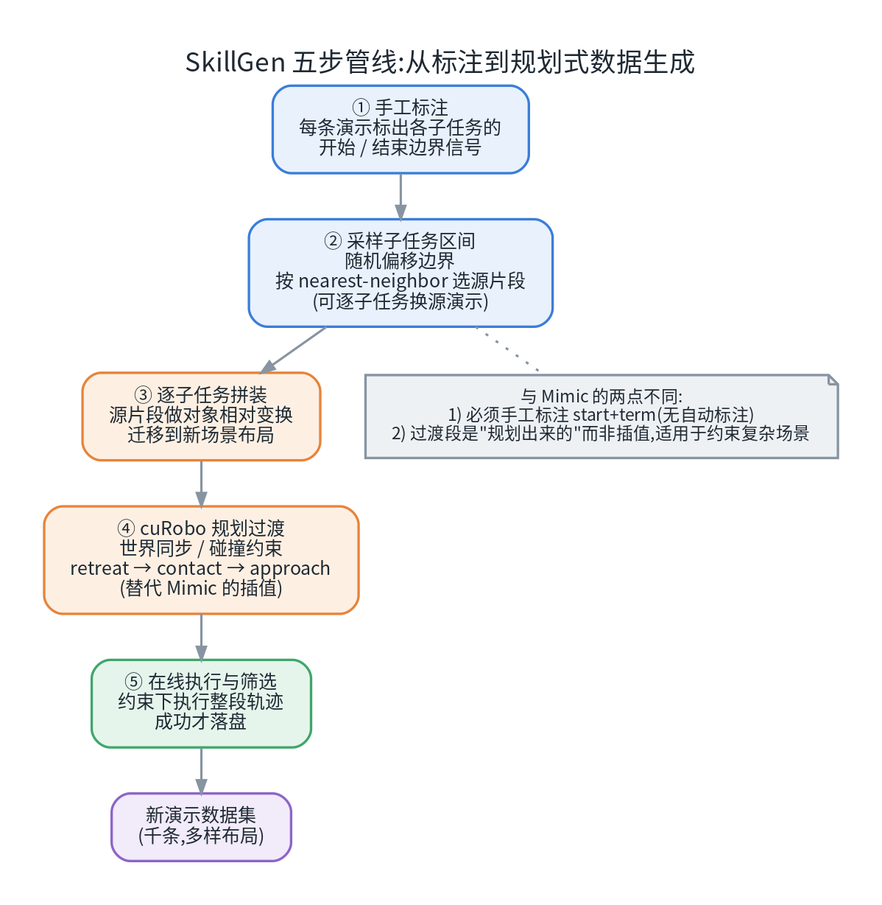
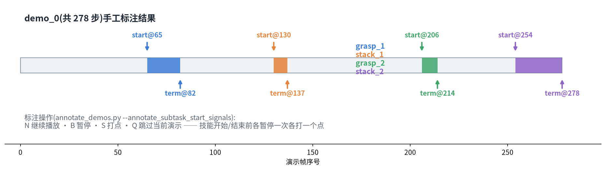
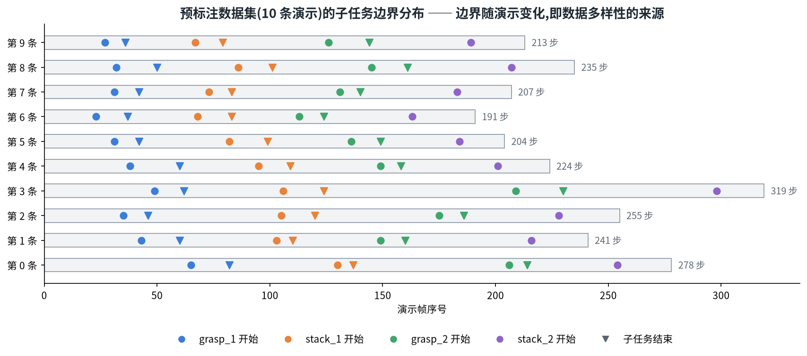
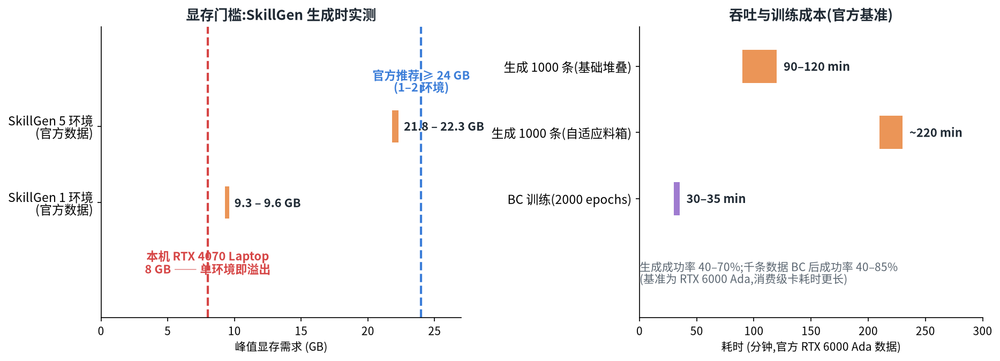
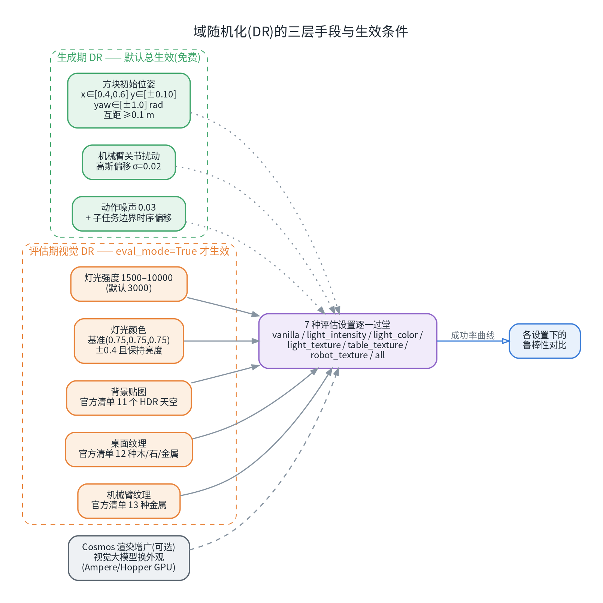
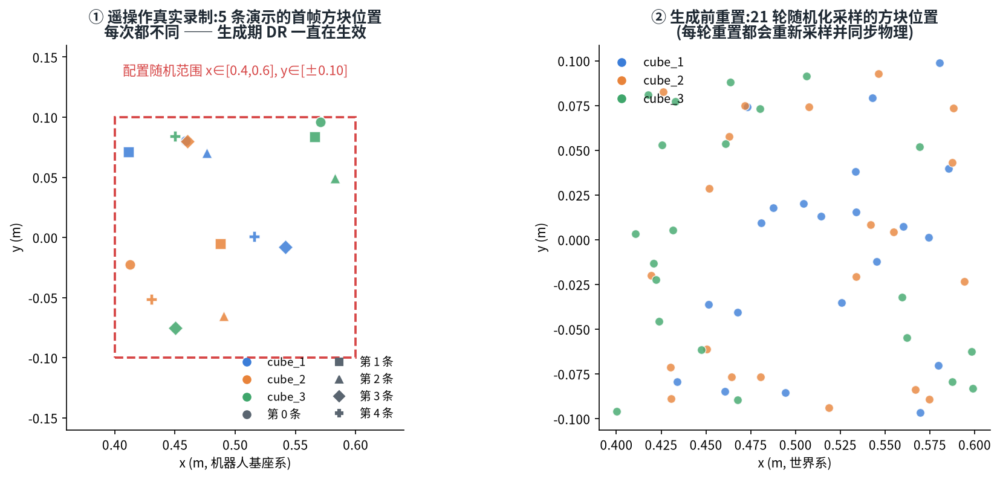
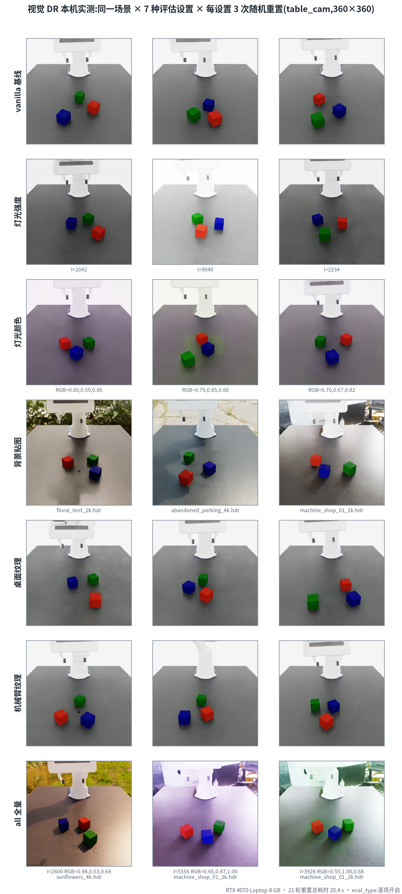

# SkillGen 与域随机化解析：Isaac Lab 规划式数据生成进阶（十）

这是系列的**第十篇**。前九篇从"数据从哪来"一路讲到"格式怎么读"：第二篇跑通了遥操作与 Mimic→BC 全闭环，第三篇做过 Mimic 规模化实测，第八篇把真实动捕"搬"进了仿真，第九篇拆解了 RLDS。这一篇回到**仿真数据生成**主线，补齐 Mimic 之外的两块拼图：

1. **SkillGen**——复现式生成之上的"**规划式**"生成：子任务之间的过渡段不再靠插值缝合，而是交给 GPU 运动规划器 cuRobo 在碰撞约束下现场规划；
2. **域随机化（Domain Randomization, DR）**——数据多样性的另一半：哪些随机化一直在悄悄生效、哪些需要专门的开关、效果长什么样（附实测）。

如果一句话概括两者的分工：**SkillGen 让数据"更多"，DR 让数据"更广"**。

与前面"操作手册"式篇目不同，**本篇是介绍性文章**：讲清楚 SkillGen 是什么、怎么工作、门槛在哪、什么时候值得用；不包含逐步操作教程——真正的上手步骤官方文档已写得很全，本文把"地图"和易错点一次给全。

> **配套资源**：本系列的全部文章、配套脚本与图表源码已开源：[github.com/huangqiulong/IsaacDataCollection](https://github.com/huangqiulong/IsaacDataCollection)。本篇配套：`scripts/simulation_data_dr_demo.py`（§6 的 DR 抓拍演示）。

## 0. 一分钟速览

| 问题 | 答案 |
| --- | --- |
| SkillGen 是什么 | Mimic 的"规划式"升级：保留人类演示中的子任务技能段，段与段之间的过渡由 cuRobo 在碰撞约束下现场规划 |
| 与 Mimic 的两个硬区别 | ① **必须手工标注** start + term 边界（无自动标注，缺 start 直接失败）；② 过渡段是"规划"而非"插值" |
| 最大隐藏价值 | 子任务技能段可**跨任务复用**：同一份标注数据同时喂养"基础堆叠"与"自适应料箱"两个任务 |
| 依赖与门槛 | 需按官方步骤编译 cuRobo（**CUDA 13 工具链**）；单环境显存约 **9.3–9.6 GB**，官方建议 **≥24 GB**（1–2 环境） |
| 生成成本（官方基准） | 1000 条：基础堆叠 **90–120 分钟**、料箱任务 ~220 分钟（RTX 6000 Ada）；生成成功率 **40–70%** |
| 训练侧（官方） | 1000 条数据 BC 训练 30–35 分钟（2000 epochs），成功率 40–85% |
| 8 GB 消费级显卡能做什么 | 生成跑不动（单环境即超显存）；Mimic 生成 / BC 训练 / DR 评估不受影响 |
| DR 是什么 | 数据多样性底座：**生成期**（位姿/关节/动作/时序，默认一直生效）+ **评估期视觉**（灯光/材质，`eval_mode` 门控） |

## 1. 从 Mimic 说起：为什么还需要 SkillGen

Mimic 的故事大家已经熟（第二篇全流程、第三篇规模化实测）：把一条人类演示按子任务"切段"（grasp / stack），生成时把物体位姿随机重采样，再把各段**搬运 + 拼接**成新的完整演示，成功才落盘。它用一条清晰的假设换来了极低的成本：**段与段之间的过渡，用插值缝上就行**。

这个假设在两种情况下会失效：

- **过渡路径本身有约束**：新布局下，抓手从放下位置移动到下一个抓取位置，直线/插值路径可能穿过障碍物或超出可达空间——"缝"不上，生成成功率骤降；
- **想要"一份数据喂多个任务"**：Mimic 的段重组围绕单个任务的结构做变换，跨任务通吃不现实。

SkillGen 正是冲着这两点来的。三种手段的关系如下图：

| 维度 | Mimic 复现式 | SkillGen 规划式 |
| --- | --- | --- |
| 过渡段怎么来 | 源段插值 + 固定步 | **cuRobo 碰撞约束下规划** |
| 标注要求 | term 信号即可（支持自动标注） | **start + term 双信号，必须手工** |
| 多样性来源 | 物体位姿重采样 + 片段重组 | 同上 + 规划采样与参数 |
| 显存门槛 | 低（8 GB 级可跑） | 高（单环境 ~9.5 GB） |
| 适合场景 | 结构简单的操作任务 | 约束复杂、需要跨任务复用 |

> 一句话：**Mimic 教你怎么做，SkillGen 还会替你"绕路"**。

## 2. SkillGen 是什么

官方对它的描述可以浓缩为一句：**从手工标注的人类演示中提取"局部化的子任务技能"，再用 cuRobo 在机器人运动学与碰撞约束下，规划出技能段之间的可行运动**（plan feasible motions between skill segments while respecting robot kinematics and collision constraints）。

拆开看只有两个角色：

- **人类演示 = 教材**：技能本身（怎么抓、怎么放、什么姿态）仍然"从人身上学"，这一点与 Mimic 一脉相承；
- **cuRobo = 衔接器**：NVIDIA 的 GPU 加速运动规划库。SkillGen 用它做三件事——世界状态同步（把场景里所有物体同步给规划器）、物体附加/脱离（抓取中的物体视为机器人一部分）、过渡运动规划（典型三段式：**退避 → 接触 → 接近**）。

官方给的两个设计目标也很直白：

- **Diversity（多样性）**：通过可配置的采样与规划参数，把每条种子演示"变"出大量不同走向的版本；
- **Adaptability（适应性）**：生成时适配新的物体摆放与场景配置——同一份标注数据，换个任务也能用。

规划器这一层还是**可扩展**的：Isaac Lab 把接口留在 `base_motion_planner.py`（源码位置：`isaaclab_mimic/motion_planners/`），想接自己的规划器可以从这里下手。

## 3. 它是怎么工作的：五步管线

| 步骤 | 做什么 | 细节 |
| --- | --- | --- |
| ① 读标注 | 读取每条演示中各子任务的 start / term 索引 | 全部来自 §4 的手工标注 |
| ② 采样子任务区间 | 随机偏移子任务边界；按"最近邻"策略挑选源片段 | `generation_select_src_per_subtask=True`：每个子任务可换不同源演示；策略如 `nearest_neighbor_object`（nn_k=3），也支持按机器人距离 |
| ③ 技能段迁移 | 源片段做**对象相对变换**，搬到新场景布局 | 与 Mimic 相同的"搬运"步骤 |
| ④ 过渡规划 | cuRobo 现场规划段间运动（替代插值） | 世界同步、附加/脱附物体、退避→接触→接近；过渡质量由规划器保证 |
| ⑤ 执行与筛选 | 约束下执行完整轨迹，成功才收录 | 失败轨迹自动丢弃，与 Mimic 一致 |

落到配置层面，它与 Mimic 的差异也有明显"指纹"（源码核对）：

- 过渡不再插值：`num_interpolation_steps=0`；
- 终止边界不再随机偏移：`subtask_term_offset_range=(0, 0)`；SkillGen 场景下改用"起点偏移"机制（`subtask_start_offset_range`，仅 `use_skillgen=True` 时生效）；
- 配置注释里还藏着一句关键提醒："最后一个子任务的结束信号，对 Mimic 可以省、对 SkillGen 必须被检测"——这也是它被单独列为一个 subtask 的原因；
- 过渡段的几何可行性由规划器负责，因此**生成成功率的下限被抬高**，代价是算力开销显著上升（见 §5）。

## 4. 数据契约：手工标注是必选项

SkillGen 与 Mimic 最大的操作差异在标注（官方原文）：

> "SkillGen requires manual annotation of both subtask start and termination boundaries (**no auto-annotation**)."
> "Start boundary signals are mandatory for SkillGen; use `--annotate_subtask_start_signals` during annotation or **data generation will fail**."

也就是说：**没有自动标注兜底，start 信号不标，生成直接失败**。操作本身不复杂——在 `annotate_demos.py` 回放演示时用键盘打点：

| 键 | 作用 |
| --- | --- |
| `N` | 继续播放 |
| `B` | 暂停（在技能开始/结束前几步按下） |
| `S` | 打点（标记子任务边界） |
| `Q` | 跳过当前演示 |

节奏是：技能动作开始前暂停、`S` 打一个 **start**；技能完成后暂停、`S` 打一个 **term**。以官方预标注数据集（约 2.6 MB，10 条演示）的第 0 条为例，实际标注结果如下：

*图 3：`grasp_1`：start@65 → term@82；`stack_1`：@130 → @137；`grasp_2`：@206 → @214；`stack_2`：@254 → 演示结束。*

这些信号在数据里的形态很朴素：`obs/datagen_info` 下的 `subtask_start_signals` / `subtask_term_signals`，每一条都是**单帧触发的 0→1 跳变**。10 条演示的边界分布各不相同——它们正是"重组出新数据"的原材料：

*图 4：10 条演示长度 191–319 步（均值 236.7），四条子任务的边界逐条变化。*

> 一个隐藏福利：**同一份标注数据可以跨任务复用**。官方教程里，"基础堆叠"和"自适应料箱"两个任务共用同一份标注数据集——录一次、标一次，两个任务一起吃。

## 5. 硬件门槛与成本：SkillGen 的"入场券"

SkillGen 的代价几乎全部集中在算力与工具链上（官方数据）：

| 指标 | 官方数据（RTX 6000 Ada） |
| --- | --- |
| 峰值显存（1 环境） | **9.3–9.6 GB** |
| 峰值显存（5 环境） | 21.8–22.3 GB |
| 官方推荐 | **≥24 GB**（1–2 环境） |
| 生成 1000 条（基础堆叠） | 90–120 分钟 |
| 生成 1000 条（自适应料箱） | ~220 分钟 |
| 生成成功率 | 40–70% |
| 之后 BC 训练（2000 epochs） | 30–35 分钟 → 成功率 40–85% |

结论也很清楚：

- **工具链侧**：cuRobo 需要按官方步骤从源码编译（CUDA 13.0 工具链），这是"跑通"的第一道门；
- **硬件侧**：单环境就要约 9.5 GB 显存——**8 GB 级消费显卡（如本机 RTX 4070 Laptop）无法运行生成**；官方建议 24 GB 起步不是"留余量"，是刚需；
- **折算**：1000 条数据 ≈ 2 小时生成 + 半小时训练；换成人工遥操作录 1000 条，是几十小时级别的工程——这就是"规划式生成"值回票价的地方。

**什么时候值得上 SkillGen？**

| 你的情况 | 建议 |
| --- | --- |
| 结构简单的堆叠/抓放，单卡 | Mimic 足够（第二、三篇已跑通） |
| 过渡路径有约束（障碍/窄缝/绕行） | SkillGen 的主场 |
| 想用一份演示覆盖多个任务变体 | SkillGen 的跨任务复用省下重复录制 |
| 只有 8 GB 消费卡 | 先理解管线与契约（本文），生成留给 24 GB+ 的环境 |

## 6. 域随机化（DR）：多样性的另一半

如果 SkillGen 解决"数据怎么来"，DR 解决的是"数据见过多少世面"。没有 DR，策略只会记住"这一套灯光、这一个桌面、这几个固定位置"；有 DR，每次重置都是一个新世界。

DR 其实分三层，而且**生效条件完全不同**——很多教程没讲清，这正是"明明配了随机化，却看不到效果"的根源：

### 6.1 生成期 DR：默认一直生效（免费）

以 Stack-Cube Visuomotor 环境为例，环境配置里挂着 5 个随机化事件（EventTerm），再加上生成器层面的动作噪声（0.03）与子任务边界时序偏移——这些都**默认开启，不需要任何开关**（源码核对）：

| 事件 | 参数范围 | 生效条件 |
| --- | --- | --- |
| 机械臂关节扰动 | 高斯偏移 σ=0.02 | 默认一直生效 |
| 方块初始位姿 | x∈[0.4, 0.6]，y∈[±0.10]，yaw∈[±1.0] rad，方块互距 ≥0.1 m | 默认一直生效 |
| 灯光 | 强度 [1500, 10000]、颜色 ±0.4、11 个 HDR 天空 | `eval_mode` 下按 `eval_type` 采样 |
| 桌面纹理 | 12 种木/石/金属纹理 | 同上 |
| 机械臂纹理 | 13 种金属纹理 | 同上 |

"一直生效"是什么意思？我们翻出此前遥操作实测录制的 5 条演示，读每条**首帧的方块位置**——5 条各不相同，且全部落在配置范围之内：

*图 7：左为真实录制的 5 条演示首帧（x 覆盖 0.41–0.57）；右为同环境 21 轮随机重置的采样分布。录制 10 条 ≠ 同一条录 10 遍——位姿随机化在你录制的每一刻都在工作。*

### 6.2 评估期视觉 DR：一个 `eval_mode` 开关的秘密

那为什么录制过程的**画面**看起来没什么变化（同一灯光、同一桌面）？因为视觉随机化事件在源码里有前置判断：

- `eval_mode` 未开启 → 事件仅把灯光/材质**复位到默认值**，不做任何采样；
- `eval_mode=True` → 按 `eval_type` 逐项采样：`light_intensity` / `light_color` / `light_texture` / `table_texture` / `robot_texture` / `all`。

也就是说：**视觉 DR 是"评估工具"，不是"生成工具"**。正确用法是把训练好的策略放进七种视觉设置里测成功率（官方评估脚本原生支持这种七设置矩阵），看它在哪种扰动下"掉链子"，再决定补什么数据。

为了直观展示"七设置各开一路"的效果，我们对七种设置各做 3 次重置并抓拍桌面相机（脚本 `scripts/simulation_data_dr_demo.py`），灯光参数直接从 USD 属性读回：

*图 8：21 轮重置中，灯光强度抽到 2042 / 9040 / 2234；颜色采样出紫/绿等偏色；背景在 floral_tent、abandoned_parking、machine_shop 等 HDR 间切换——每一格都是一次独立采样。*

**资产小贴士**：视觉 DR 的"选项池"来自三组硬编码清单（11 个 HDR 天空 / 12 种桌面纹理 / 13 种金属），离线或素材不全时，可以用同类 HDR/纹理文件替换清单——机制只认"文件列表"，不认来源；直连官方资产库较慢时也可用镜像或代理加速。

## 7. 常见问题速查

| 问题 | 解答 |
| --- | --- |
| SkillGen 能自动标注吗？ | 不能。start + term 都要手工；缺 start 信号时生成**直接失败** |
| 没有 24 GB 显卡还能用 SkillGen 吗？ | 生成不能跑；但管线思想（技能段复用 + 规划器衔接）在任何有算力的环境都能直接用，配置与任务名本文已给全 |
| 为什么录制时看不到灯光/材质变化？ | 视觉 DR 被 `eval_mode` 门控；录制/生成期只有"生成期 DR"（位姿/关节等）生效——这是设计，不是 bug |
| 视觉 DR 需要下载很多资产吗？ | 三组清单共 36 个文件；最少各备 2–3 个即可演示，离线也可用同类素材替换 |
| SkillGen 的产物和 Mimic 一样吗？ | 一样是标准演示数据集（成功条才落盘），下游训练/评估/转换流程不变 |
| 七设置评估要跑多久？ | 成本约等于 7 倍 rollout；先跑 `vanilla` + `all` 两档摸底，再决定是否全量 |

## 小结与系列导航

- **SkillGen 的公式**：人类技能段（来自演示）+ cuRobo 规划器（负责衔接）= 规划式生成；价值在**约束复杂的过渡**与**跨任务复用**；
- **两个必知契约**：手工标注 start + term；信号是单帧 0→1 的跳变（存在 `obs/datagen_info` 里）；
- **门槛算清楚**：单环境 ~9.5 GB 显存、CUDA 13 工具链、官方建议 ≥24 GB；8 GB 级消费卡无法生成，但理解与应用思想不受限；
- **DR 一直免费**：生成期随机化默认生效；视觉 DR 只在 `eval_mode` 下开启——它是**评估工具**，七设置矩阵是评估标配；
- **选型一句话**：结构简单先 Mimic；需要"绕行规划"或跨任务复用，再上 SkillGen。

**系列导航**：

- **（一）数据采集方法总览** · **（二）遥操作实操手册** · **（三）仿真与真机采集对比** · **（四）HDF5 格式详解** · **（五）UMI 式数据工作流** · **（六）EGO 式数据工作流** · **（七）LeRobot 数据格式详解** · **（八）动捕数据完整工作流** · **（九）RLDS 数据格式详解** · **（十）SkillGen 与域随机化解析**（本文）

**项目仓库（开源）**：[github.com/huangqiulong/IsaacDataCollection](https://github.com/huangqiulong/IsaacDataCollection) —— 全部文章、配套脚本与图表源码。

## 参考资料

- [Isaac Lab 官方文档（模仿学习章节）](https://isaac-sim.github.io/IsaacLab/)——SkillGen 的流水线、安装步骤与性能数据出处
- [cuRobo（GitHub）](https://github.com/NVlabs/curobo)——SkillGen 背后的 GPU 运动规划库
- [官方预标注数据集](https://omniverse-content-production.s3-us-west-2.amazonaws.com/Assets/Isaac/6.1/Isaac/IsaacLab/Mimic/franka_stack_datasets/annotated_dataset_skillgen.hdf5)——SkillGen 教程用的 10 条标注演示
- 本系列第二篇《遥操作实操手册》、第三篇《仿真与真机采集对比》——Mimic 全流程与规模化实测；第八篇《动捕数据完整工作流》——另一条"外部动作 → 仿真格式"的路线

---

*本文为介绍性文章：SkillGen 的管线、数据契约与性能数字来自 Isaac Lab 官方文档与源码核对（并逐条核读了官方预标注数据集）；DR 部分包含本机实测（七种评估设置 ×3 次重置抓拍、灯光参数从 USD 属性直读）。配图存于 `docs/images/isaac-sim-10/`。*
