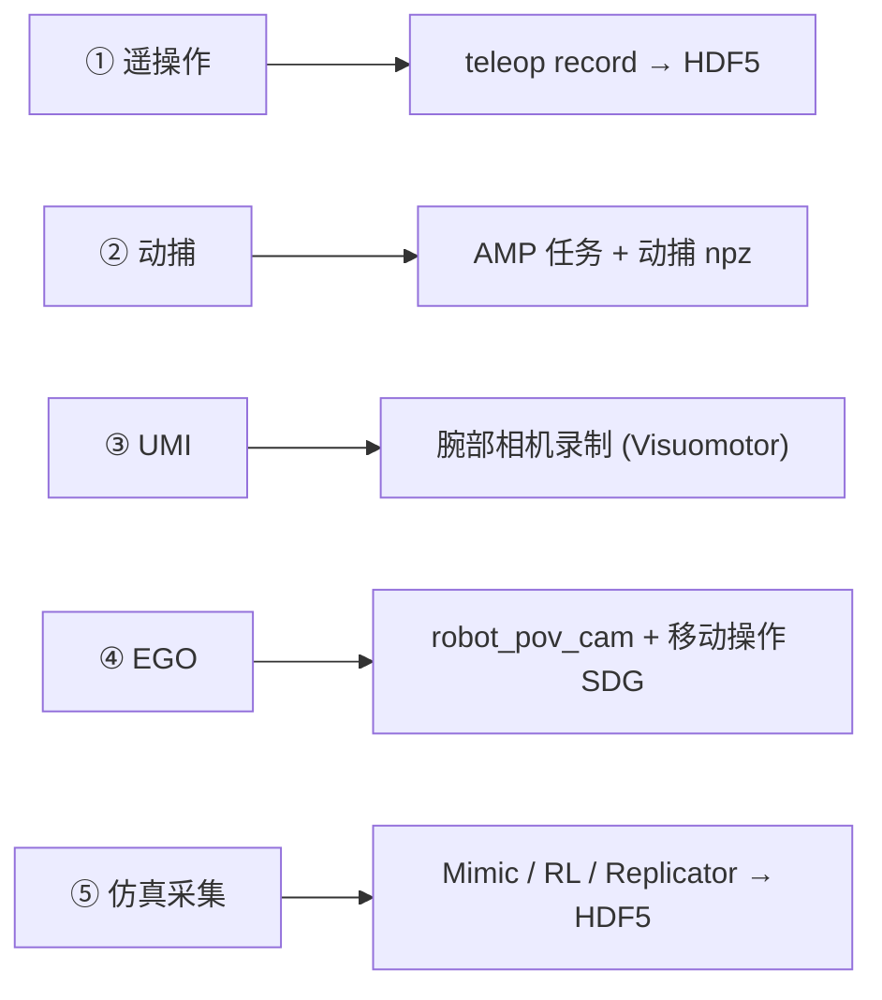

# 机器人数据采集：真机方法 → Isaac 仿真模拟实践手册

> **组织方式**：以真机采集方式为标尺，逐一说明【真机原理 → 数据格式 → Isaac 中如何模拟采集 → 一套简单可行的本机学习操作】。
> **五大类型**：遥操作（Teleoperation）、动捕（Motion Capture）、UMI（手持夹爪）、EGO（第一人称）、仿真采集（Simulation-first）。
> **环境**：Isaac Sim 6.1 + Isaac Lab 3.0.0（`~/code/isaac/isaaclab`），本机实测，2026-10-09。
> 相关：安装记录见 `ops/docs/isaac-install-record-2026-09-21.md`。
>
> **分册导航（按数据类型）**：[遥操作实操（种子数据）](./teleoperation-hands-on-franka-stack-cube.md) · [UMI（腕部视觉）](./umi-in-isaac-workflow.md) · [EGO（第一人称）](./ego-in-isaac-workflow.md) · [动捕（AMP）](./mocap-in-isaac-workflow.md) · [仿真数据（Mimic 管线）](./simulation-data-in-isaac-workflow.md) · [真机遥操作对比](./real-robot-teleop-and-sim-comparison.md) · [HDF5 格式详解](./hdf5-format-guide.md)

---

## 0. 环境准备（先读这节）

### 0.1 本机现状（2026-10-09 核实）

- ⚠️ `isaaclab/.venv` 目前是**空壳**（约 108K，无任何安装包）——运行任何 Isaac Lab 命令前，必须先重建环境。
  （原先可用的 8.5G 环境已不在；重建后功能即恢复。）
- 根分区剩余空间约 17G，重建需 ~8.5G，建议先确认空间充足。

### 0.2 一次性重建（下载版 Isaac Sim + 基于其自带 Python 的 venv）

```bash
cd ~/code/isaac/isaaclab
rm -rf .venv
uv venv --python "$PWD/_isaac_sim/kit/python/bin/python3" .venv   # 关键：必须基于自带 Python
source .venv/bin/activate
export UV_INDEX_URL=https://pypi.tuna.tsinghua.edu.cn/simple      # 国内镜像，否则 pypi 极慢
./isaaclab.sh -i        # 安装：核心 + mimic/teleop 子模块 + RL/可视化依赖（约 8.5GB）
```

> 为什么必须"基于 Isaac Sim 自带 Python"：下载版 Isaac Sim 与 uv/conda 自带的解释器混用会被拒绝，
> 报错 `Downloaded Isaac Sim packages cannot be combined with a Python virtual environment`
> （校验逻辑在 `source/isaaclab/isaaclab/cli/utils.py::run_python_command`：解释器必须解析进 `_isaac_sim`）。

### 0.3 日常运行姿势（下文所有命令默认已完成这两行）

```bash
cd ~/code/isaac/isaaclab && source .venv/bin/activate
mkdir -p datasets        # 所有演示数据集默认落在 ./datasets/
```

- 子命令形式：`./isaaclab.sh teleop run/record/replay ...`（需先激活 venv）
- 直跑脚本：`./isaaclab.sh -p scripts/xxx.py ...`（可自动解析 `.venv`）
- 附加小依赖（动捕可视化用）：`uv pip install matplotlib`

---

## 1. 总览：五类采集方式对照表

| # | 类型               | 真机代表系统                                     | 真机数据形态                           | Isaac 中的模拟入口                                       | 本机难度        |
| - | ------------------ | ------------------------------------------------ | -------------------------------------- | -------------------------------------------------------- | --------------- |
| 1 | **遥操作**   | 主从臂（ALOHA）、VR（Open-TeleVision）、动捕手套 | 机器人状态+动作+相机 → ROS bag / HDF5 | Isaac Lab Teleop 栈（键盘/SpaceMouse/Gamepad/XR）→ HDF5 | ★ 立即可做     |
| 2 | **动捕**     | Vicon 光学、Xsens 惯性、视频提取（SMPL）         | BVH / SMPL / 骨架轨迹 npz              | 内置 AMP 动捕任务 + MotionLoader；运动跟踪任务           | ★★ 自带数据   |
| 3 | **UMI**      | 手持夹爪+相机（Stanford UMI）                    | 夹爪相机视频 + 6DoF 位姿轨迹           | Visuomotor 任务录"腕部相机+相对位姿"演示                 | ★★ 中等       |
| 4 | **EGO**      | 头戴设备第一人称（Aria/EgoMimic/DexCap）         | 第一人称视频（+手部姿态）              | 人形 G1`robot_pov_cam` + 移动操作 SDG                  | ★★★ 链条较长 |
| 5 | **仿真采集** | （无真机对应）                                   | HDF5 / 图像数据集 / checkpoint         | Isaac Lab Mimic、RL、Replicator SDG                      | ★★ 小规模可行 |

**推荐学习路线**：`遥操作 → 仿真采集（Mimic）→ UMI → EGO → 动捕`（按上手成本递增；动捕可直接跳到"看数据"部分）。



---

## 2. 遥操作（Teleoperation）

### 2.1 真机基本原理

人类操作者通过**控制器（手柄/VR/主从臂）实时操纵机器人**完成任务，同时记录机器人视角的数据。

- 代表：ALOHA（主从臂遥操）、Open-TeleVision（VR 映射双手）、DexCap（动捕手套）、各类 SpaceMouse 桌面遥操。
- 本质：把"人类操作技能"变成"机器人可学习的状态-动作对"。这是模仿学习（IL）数据质量的"金标准"。
- 局限：慢、贵（一台机器人一人采）、场景固定。

### 2.2 数据格式

| 层级     | 形式                                               | 说明                                                                                            |
| -------- | -------------------------------------------------- | ----------------------------------------------------------------------------------------------- |
| 真机原始 | ROS 2 bag / 自定义日志                             | 含关节状态、指令、相机、时间戳                                                                  |
| 训练通用 | **HDF5**（Isaac Lab 数据集 schema）/ LeRobot | 每条演示=demo_N：`obs/*`（观测，含相机）、`actions`（动作）、成功标记；Isaac 全流程主线格式 |
| 附加     | 语言指令/子任务标注                                | 供 VLA、Mimic 使用（见 §6）                                                                    |

### 2.3 在 Isaac 中如何模拟采集

Isaac Lab 提供**两代遥操作栈**，均为"人在环"实时控制 + 自动录制：

| 设备                | 用法                                                 | 适用                                    |
| ------------------- | ---------------------------------------------------- | --------------------------------------- |
| 键盘                | `--teleop_device keyboard`                         | 零外设入门（本机首选）                  |
| SpaceMouse          | `--teleop_device spacemouse`                       | 6DoF 末端位姿，桌面操作（需 udev 权限） |
| Gamepad             | `--teleop_device gamepad`                          | 手柄                                    |
| XR（Vision Pro 等） | `--xr`                                             | 双手灵巧操作/人形全身（需 CloudXR）     |
| 原生 IsaacTeleop 栈 | 不传`--teleop_device`，走 `env_cfg.isaac_teleop` | 新一代统一接口                          |

管线：`teleop run`（热身）→ `teleop record`（录 HDF5）→ `teleop replay`（回放校验）。
录制原理：遥操作指令逐帧写入 recorder → 任务成功判定通过 → 该条演示导出为数据集中的一个 `demo_i`。

**键盘键位**（`Se3Keyboard`，相对位姿增量控制）：

| 键  | 作用        | 键  | 作用               |
| --- | ----------- | --- | ------------------ |
| W/S | 末端 x 前后 | Z/X | 绕 x 旋转（roll）  |
| A/D | 末端 y 左右 | T/G | 绕 y 旋转（pitch） |
| Q/E | 末端 z 上下 | C/V | 绕 z 旋转（yaw）   |
| K   | 开/合夹爪   | L   | 复位（清空增量）   |

### 2.4 本地学习操作方案（推荐：Franka 摞方块）

> 📄 **详细实操手册**（三设备映射、逐条录制流程、HDF5 数据处理、质量评估与 Mimic/BC 闭环）：
> `IsaacDataCollection/docs/teleoperation-hands-on-franka-stack-cube.md`。
> 其中键盘为官方内置；**Xbox 手柄/鼠标录制**由工作区扩展脚本支持
> （`IsaacDataCollection/scripts/isaaclab_teleop_launch.py` + `isaaclab_teleop_extras.py`，不修改上游仓库）。

```bash
cd ~/code/isaac/isaaclab && source .venv/bin/activate && mkdir -p datasets

# ① 热身：实时遥操，熟悉手感（不录制）
./isaaclab.sh teleop run \
  --task IsaacContrib-Stack-Cube-Franka-IK-Rel \
  --visualizer kit --num_envs 1 \
  --sensitivity 4 --teleop_device keyboard

# ② 录制 10 条演示 → ./datasets/dataset.hdf5
./isaaclab.sh teleop record \
  --task IsaacContrib-Stack-Cube-Franka-IK-Rel \
  --visualizer kit \
  --dataset_file ./datasets/dataset.hdf5 \
  --num_demos 10 \
  --teleop_device keyboard

# ③ 回放校验（确认"成功判据"和轨迹复现正常）
./isaaclab.sh teleop replay \
  --task IsaacContrib-Stack-Cube-Franka-IK-Rel \
  --visualizer kit --num_envs 1 \
  --reset_sim_buffer_each_episode \
  --dataset_file ./datasets/dataset.hdf5

# ④ 查看数据文件结构（推荐先做，了解 schema）
python - <<'PY'
import h5py
f = h5py.File("./datasets/dataset.hdf5", "r")
print("top:", list(f.keys()))
d = f["data"]; print("demos:", list(d.keys()))
demo = d["demo_0"]; print("demo keys:", list(demo.keys()))
for k in demo:
    print(" -", k, {kk: demo[k][kk].shape for kk in demo[k]} if hasattr(demo[k], "keys") and not demo[k].shape else demo[k].shape)
PY
```

预期：任务为 IK 相对动作的摞方块（蓝/红/绿三块），一条演示约十几秒；录制时控制台会提示状态，成功即自动保存并重置。

### 2.5 与真机的差异 / 注意

- 仿真里"成功判定"由任务奖励/终止条件自动完成；真机靠人工判定 → 数据标注质量差异。
- 仿真键盘遥操是"相对位姿增量"，与真机多种遥操映射（绝对/相对/力反馈）不是一一对应；但**动作语义（EE 增量）一致**，数据可直接互换使用。
- XR 遥操需要完整 CloudXR 环境，本机未配置，先跳过。

---

## 3. 动捕（Motion Capture）

### 3.1 真机基本原理

用**光学/惯性动捕设备**（Vicon、Xsens）或**单目视频姿态估计**（SMPL 系列）记录人体运动骨架序列，
再通过**重定向（retargeting）**把人体骨骼映射到机器人关节空间，作为机器人运动的"参考轨迹"。

- 用途：人形机器人行走/跑步/舞蹈/武术技能学习（如 AMP、DeepMimic 类方法）。
- 特点：数据维度是"全身运动"，采集不依赖机器人本身；难点在重定向与物理可行性。

### 3.2 数据格式

- 原始：BVH（骨架层级+旋转通道）、SMPL 参数（姿态+形状，npz/pkl）。
- **重定向后的机器人侧格式（本仓库内置格式，推荐了解）**：`.npz`，字段如下（见 `humanoid_amp/motions/README.md`）：

| 键                                                       | 形状                  | 含义                           |
| -------------------------------------------------------- | --------------------- | ------------------------------ |
| `fps`                                                  | 标量                  | 采样帧率                       |
| `dof_names` / `body_names`                           | (D,) / (B,)           | 关节名 / 刚体名                |
| `dof_positions` / `dof_velocities`                   | (N, D)                | 关节位置/速度序列（N=帧数）    |
| `body_positions` / `body_rotations`                  | (N, B, 3) / (N, B, 4) | 刚体位姿（旋转为 wxyz 四元数） |
| `body_linear_velocities` / `body_angular_velocities` | (N, B, 3)             | 刚体速度                       |

### 3.3 在 Isaac 中如何模拟采集

Isaac Lab 把"动捕数据"作为**运动先验/参考轨迹**消费，主要有两个入口：

| 入口                                 | 说明                                                                         | 本机任务                                                                                  |
| ------------------------------------ | ---------------------------------------------------------------------------- | ----------------------------------------------------------------------------------------- |
| **AMP 任务**（对抗式运动先验） | 内置三段动捕数据（跳舞/跑步/走路），策略在物理仿真中学会做出与动捕相似的动作 | `IsaacContrib-Humanoid-AMP-{Dance,Run,Walk}-Direct`                                     |
| **运动跟踪任务**               | 机器人逐帧跟踪参考轨迹（行走速度、移动操作导航）                             | `Isaac-Velocity-Flat-G1`、`IsaacContrib-Tracking-LocoManip-Digit`、G1 移动操作（§5） |

"模拟采集"的含义：**动捕提供人体侧的原始运动 → 仿真提供物理落地**（机器人执行、接触、平衡约束下的轨迹），
并可在仿真中把"参考轨迹+执行结果"录成 HDF5 供下游学习。

### 3.4 本地学习操作方案（推荐：先看数据，再让机器人学跳舞）

```bash
cd ~/code/isaac/isaaclab && source .venv/bin/activate

# ① 可视化动捕数据本身（纯 CPU，不启动 Isaac；首次需装 matplotlib）
cd source/isaaclab_tasks/isaaclab_tasks/contrib/humanoid_amp/motions
UV_INDEX_URL=https://pypi.tuna.tsinghua.edu.cn/simple uv pip install matplotlib
python motion_viewer.py --file humanoid_dance.npz     # 换 humanoid_walk.npz / humanoid_run.npz 看其他动作

# ② 查看数据字段（对应 §3.2 表）
python - <<'PY'
import numpy as np
d = np.load("humanoid_dance.npz", allow_pickle=True)
for k in d.files:
    print(f"{k:28s} {str(d[k].shape):16s} {d[k].dtype}")
PY

# ③（进阶）让仿真人形学会跳舞（AMP；8GB 显存建议 512 环境）
cd ~/code/isaac/isaaclab
./isaaclab.sh train --task IsaacContrib-Humanoid-AMP-Dance-Direct --num_envs 512
# 观察点：训练曲线在 logs/ 下；AMP 的判别器损失/styled reward 可反映"像不像人"；需数千迭代才明显
```

### 3.5 与真机的差异 / 注意

- 真机流程含"动捕棚录制 → 重定向软件"两大外部环节；本仓库内置的 npz 是**已重定向好的成品**，省去这些环节。
- 重定向是动捕数据可用性的最大瓶颈（人体骨骼比例 ≠ 机器人）；仿真里也要检查"轨迹是否物理可行"（穿地/失稳）。
- 若只有视频：需外部工具（GVHMR/GMR 类）先做"视频→SMPL→重定向"，Isaac 不负责这一步，但消费其输出。

---

## 4. UMI（手持夹爪示范，Universal Manipulation Interface）

### 4.1 真机基本原理

操作者**手持一个"带相机的二指夹爪"**（GoPro+反光镜方案）在任意真实场景中演示操作，
事后用 **SLAM 恢复夹爪在场景中的 6DoF 轨迹**，配合夹爪内部相机视频形成训练数据。

- 核心思想：① 不需要机器人即可采数（场景自由、便宜、快）；② 相机与夹爪**同轴**（腕部视角）；③ 恢复出的是**相对轨迹**，天然对齐机器人末端控制。
- 代表：UMI（Stanford）、UMI-on-Legs、Fast-UMI；同类思路：手持机械臂/夹爪采集。

### 4.2 数据格式

- 每条演示 = **夹爪相机视频** + **夹爪位姿序列（6DoF + 开合宽度）**；
- 常见处理后格式：相对动作（Δpose + gripper width）+ 视频，存为 HDF5/LeRobot；
- 训练目标常为 Diffusion Policy 类视觉策略。

### 4.3 在 Isaac 中如何模拟采集

UMI 的本质是"**腕部相机 + 末端相对动作**"的数据，仿真里以 **Visuomotor 任务**直接复刻：

- 任务：`IsaacContrib-Stack-Cube-Franka-IK-Rel-Visuomotor`
  - 已内置 `wrist_cam`（挂在 `Robot/panda_hand/wrist_cam`，腕部视角）+ 桌面相机 `table_cam`；
  - 动作空间即"末端相对位姿增量 + 夹爪"——与 UMI 的动作语义同构。
- 差别：真机 UMI 需要 SLAM 后处理恢复位姿；**仿真直接提供真值位姿**（数据更干净，但没有"野外场景"的多样性）。
- 想丰富化：叠加上域随机化（材质/光照/物位），即获得"多样场景的 UMI 式数据"。

### 4.4 本地学习操作方案（推荐：录 3 条腕部视角演示并导出视频）

```bash
cd ~/code/isaac/isaaclab && source .venv/bin/activate && mkdir -p datasets

# ① 录制 3 条（相机默认渲染；不要加 --disable_external_cameras，否则相机被剥离）
./isaaclab.sh teleop record \
  --task IsaacContrib-Stack-Cube-Franka-IK-Rel-Visuomotor \
  --visualizer kit \
  --teleop_device keyboard \
  --num_demos 3 \
  --dataset_file ./datasets/dataset_umi_like.hdf5

# ② 把腕部相机画面导出成 MP4（默认键位列表已含 wrist_cam）
./isaaclab.sh -p scripts/tools/hdf5_to_mp4.py \
  --input_file ./datasets/dataset_umi_like.hdf5 \
  --output_dir ./datasets/umi_videos \
  --input_keys wrist_cam

# ③ 观看 ./datasets/umi_videos/ 下的视频，对照"这就是 UMI 的同轴视角数据"
```

### 4.5 与真机的差异 / 注意

- 真机 UMI 的"野外多样性"来自人拿着夹爪到处走；仿真多样性来自**场景随机化**，两者互补。
- 仿真数据转真机时，腕部相机安装误差/镜面反射等"真实感噪声"缺失，需要域随机化补偿。
- 只录 3~5 条足够体验；相机渲染较费显存（8GB 下 `--num_demos` 别贪大）。

---

## 5. EGO（第一人称 / 自我中心视角示范）

### 5.1 真机基本原理

用**头戴设备**（Project Aria 眼镜、GoPro、动捕手套+头显）从"操作者第一人称视角"录制人类操作
（EgoMimic、DexCap、Ego4D 等），记录"人眼看着手在做事"的视频（可选+手部姿态）。

- 核心价值：视角 = 操作者的注意力焦点，适合学习"操作过程中的视觉-动作耦合"。
- 常与"从人类视频学习"结合：视频 → 手部姿态估计 → 重定向 → 机器人动作。

### 5.2 数据格式

- 主模态：**第一人称 RGB 视频**（mp4），可附手部/头部姿态、深度（部分设备）；
- 处理后：视频 obs + 重定向动作 → HDF5/LeRobot；也有仅用视频（表征学习）的路线。

### 5.3 在 Isaac 中如何模拟采集

仿真里"第一人称"= **机器人身上的相机**：

- 人形 G1 自带 `robot_pov_cam`：装在 `Robot/torso_link/d435_link/camera`（胸部 D435 位置），
  分辨率 160×256（`--high_res_video` 时 320×512）；
- **移动操作 SDG**（`locomanipulation_sdg`）生成的数据集里就带 `robot_pov_cam` 视频帧——
  这正是"EGO 式数据"的仿真版本；
- GUI 演示：生成脚本带 `--sensor_camera_view` 时，视口会**直接切到机器人的第一人称相机**，所见即数据。

### 5.4 本地学习操作方案（推荐：生成一条带 EGO 相机的移动操作数据）

> 链条较长，但每一步都已验证可行；总共约 30~60 分钟（含下载与两次小规模生成）。
> 全程小规模参数已调好（适配 8GB 显存）。

```bash
cd ~/code/isaac/isaaclab && source .venv/bin/activate && mkdir -p datasets

# ① 下载官方预标注数据集（仅 ~5MB；S3 直连较慢，几分钟）
wget -c -P ./datasets \
  "https://omniverse-content-production.s3-us-west-2.amazonaws.com/Assets/Isaac/6.1/Isaac/IsaacLab/Mimic/pick_place_datasets/dataset_annotated_g1_locomanip.hdf5"

# ② 小规模生成操作数据集（20 条；8GB 显存用小并发）
./isaaclab.sh -p scripts/imitation_learning/isaaclab_mimic/generate_dataset.py \
  --device cpu --num_envs 8 --generation_num_trials 20 \
  --input_file ./datasets/dataset_annotated_g1_locomanip.hdf5 \
  --output_file ./datasets/generated_dataset_g1_locomanip.hdf5

# ③ 生成"移动+操作"数据（含 robot_pov_cam 第一人称帧；--sensor_camera_view 把视口切到机器人 POV）
./isaaclab.sh -p scripts/imitation_learning/locomanipulation_sdg/generate_data.py \
  --device cpu \
  --kit_args="--enable isaacsim.replicator.experimental.mobility_gen" \
  --task="Isaac-G1-SteeringWheel-Locomanipulation" \
  --dataset ./datasets/generated_dataset_g1_locomanip.hdf5 \
  --num_runs 1 --lift_step 60 --navigate_step 130 \
  --output_file ./datasets/generated_dataset_g1_locomanipulation_sdg.hdf5 \
  --sensor_camera_view --visualizer kit
#   想高分辨率（320x512）在命令里再加 --high_res_video

# ④ 导出第一人称视频
./isaaclab.sh -p scripts/tools/hdf5_to_mp4.py \
  --input_file ./datasets/generated_dataset_g1_locomanipulation_sdg.hdf5 \
  --output_dir ./datasets/ego_videos \
  --input_keys robot_pov_cam --video_width 512 --video_height 320

# ⑤ 观看 ./datasets/ego_videos/robot_pov_cam_demo_0.mp4 —— 这就是"机器人版 ego 数据"
```

### 5.5 与真机的差异 / 注意

- 仿真 ego = 机器人胸部相机（高度/视野按机器人设计）；人类 ego = 头戴（更贴近"人的意图视角"）。
- 真机人类视频学操作还要做"人手→机器人手"重定向；仿真里不存在该环节（机器人自己执行）。
- 若只想跳过生成直接看数据形态：官方在 HuggingFace 提供预制 LeRobot 数据集 `nvidia/g1_locomanip_dataset`（需代理，体积较大）。

---

## 6. 仿真采集（Simulation-first）

### 6.1 定位与原理

前四类都在"模拟真机的某一种采集方式"；而**仿真采集**是仿真独有的第五类：
一旦场景建好，数据几乎免费——**并行上万环境、全状态真值、完美标注、无限随机化**。
它是 Isaac 相对真机的最大增量，也是本工作区数据采集方向的核心手段。

| 子模式                              | 一句话                                   | 本机可行性                                    |
| ----------------------------------- | ---------------------------------------- | --------------------------------------------- |
| **① 演示增广 Mimic**（主推） | 少量人类演示作种子 → 自动生成海量新演示 | ✅ 小规模可全程跑通                           |
| ② SkillGen                         | Mimic + 运动规划（cuRobo）生成           | ❌ 单环境 9.3GB 显存 + CUDA13 编译，暂缓      |
| ③ RL 自采集                        | 策略试错，rollout 即数据                 | ✅（Cartpole/G1 已验证）                      |
| ④ Replicator SDG                   | 视觉数据 + 完美标注（分割/深度/位姿）    | ✅ 入门可行                                   |
| ⑤ 脚本化生成                       | 状态机/脚本策略产数据                    | ✅（`scripts/environments/state_machine/`） |

**数据格式**：HDF5（与遥操作同 schema，可混合训练）/ 图像数据集（COCO 等格式）/ checkpoint。

### 6.2 Isaac 实现模式（Mimic 五步管线）

```
（可选）遥操作录少量演示 或 下载预录数据集
   ↓ datasets/dataset.hdf5
annotate_demos.py  —— 子任务标注（--auto 自动 / 手动打边界）
   ↓ annotated_dataset.hdf5
generate_dataset.py —— 随机化场景中自动重拼接生成海量演示（并行环境）
   ↓ generated_dataset.hdf5
robomimic train.py —— 行为克隆（BC / BC-RNN / Diffusion Policy）
   ↓ logs/robomimic/...
robomimic play.py —— 回放评估
```

### 6.3 本地学习操作方案（推荐：30 分钟跑通 Mimic 小规模全流程）

```bash
cd ~/code/isaac/isaaclab && source .venv/bin/activate && mkdir -p datasets

# ①（可选）跳过手动录制：下载官方预录演示集（~3MB）
wget -c -P ./datasets \
  "https://omniverse-content-production.s3-us-west-2.amazonaws.com/Assets/Isaac/6.1/Isaac/IsaacLab/Mimic/franka_stack_datasets/dataset.hdf5"

# ② 自动标注（子任务边界）
./isaaclab.sh -p scripts/imitation_learning/isaaclab_mimic/annotate_demos.py \
  --task Isaac-Stack-Cube-Franka-IK-Rel-Mimic-v0 --visualizer kit --auto \
  --input_file ./datasets/dataset.hdf5 --output_file ./datasets/annotated_dataset.hdf5

# ③ 小规模生成（先 10 条验证；跑通后再放大到 1000，本机建议 --num_envs 32~64）
./isaaclab.sh -p scripts/imitation_learning/isaaclab_mimic/generate_dataset.py \
  --visualizer kit --num_envs 32 --generation_num_trials 10 \
  --input_file ./datasets/annotated_dataset.hdf5 \
  --output_file ./datasets/generated_dataset_small.hdf5

# ④ BC 训练（state 模式，本机可行）
./isaaclab.sh -p scripts/imitation_learning/robomimic/train.py \
  --task IsaacContrib-Stack-Cube-Franka-IK-Rel --algo bc \
  --dataset ./datasets/generated_dataset_small.hdf5

# ⑤ 回放评估（checkpoint 路径见训练日志输出 logs/robomimic/...）
./isaaclab.sh -p scripts/imitation_learning/robomimic/play.py \
  --task IsaacContrib-Stack-Cube-Franka-IK-Rel --visualizer kit --num_rollouts 20 \
  --checkpoint <训练输出目录>/model_xxx.pth

# ⑥（可选）RL 冒烟——确认训练闭环
./isaaclab.sh train --task Isaac-Cartpole --num_envs 64
```

进阶（暂缓项，方案储备）：

- **SkillGen**：`generate_dataset.py --use_skillgen`（需 cuRobo，本机显存不足）；
- **Cosmos 视觉增强**：HDF5↔MP4 转换本机可用，扩散增强需大显存服务器；
- **Replicator SDG**：入口为本机扩展 `isaacsim.replicator.examples` + Isaac Sim "Synthetic Data Generation" 手册；
- **GR00T VLA 微调**：`locomanipulation_sdg/gr00t/convert_dataset.py` 转 LeRobot 格式，训练需 24GB+ 显存。

### 6.4 与真机的差异 / 注意

- 仿真数据自带完美成功标记与状态真值；但**策略要过 Sim2Real**，生成时务必启用随机化（Mimic 自带物位随机化，视觉模型需再加材质/光照随机化）。
- 生成成功率不是 100%（取决于种子演示质量与标注质量）；生成脚本会跳过失败轨迹。

---

## 7. 横向对比与常见坑

### 7.1 选型速查

| 你想要的数据                   | 用哪种采集                     | 入口         |
| ------------------------------ | ------------------------------ | ------------ |
| "状态+动作"策略数据（快）      | 遥操作 或 Mimic 增广           | §2 / §6    |
| 视觉策略数据（腕部视角）       | UMI 模式（Visuomotor 录制）    | §4          |
| 视觉策略数据（第一人称）       | EGO 模式（G1 POV + SDG）       | §5          |
| 感知模块数据（分割/深度/位姿） | Replicator SDG                 | §6 子模式④ |
| 人形运动技能（走跑舞）         | 动捕 + AMP/跟踪任务            | §3          |
| VLA 大模型微调数据             | Mimic/SDG 生成 → LeRobot 转换 | §6 进阶     |

### 7.2 常见坑（本工作区实测）

1. **环境**：下载版 Isaac Sim 必须配"基于自带 Python 的 venv"（或免 venv 直接用自带 Python）；混用其它解释器会被拒（报错见 §0.2）。
2. **命令形式**：`isaaclab.sh` 已标记 deprecated（3.1 移除）但功能完整；子命令形式需先 `source .venv/bin/activate`；`-p` 形式自动解析 `.venv`。
3. **相机参数**：`--enable_cameras` 已移除；录制脚本默认渲染相机；`--disable_external_cameras` 会剥离相机配置（录制视觉数据时不要加）。
4. **显存**（RTX 4070 Laptop 8GB）：Mimic 生成用 `--num_envs 32~64`；SkillGen 单环境 9.3GB 不可行；Cosmos/VLA 训练需服务器。
5. **磁盘**：数据集与视频转换吃空间（根分区当前 ~17G 可用）；大文件下载前先确认剩余空间。
6. **GPU 独占**：一次只跑一个 Isaac 进程；先 `nvidia-smi` 确认空闲（并行会互抢显存）。
7. **网络**：S3 直连 10~40 KB/s（5MB 文件几分钟）；大文件可走 socks 代理（127.0.0.1:9909）；HuggingFace 需代理。
8. **HDF5 查看**：用 h5py 小脚本（见 §2.4 ④）；视频导出用 `hdf5_to_mp4.py`；导出键名与数据集 obs 组名对应（`wrist_cam`/`table_cam`/`robot_pov_cam`）。

---

## 8. 参考

- Isaac Lab 仓库内文档（`isaaclab/docs/source/`）：
  - `features/imitation-learning/teleop_imitation.rst`（遥操作+Mimic 全流程）
  - `features/imitation-learning/humanoids_imitation.rst`（GR-1/G1 人形、G1 移动操作 SDG）
  - `features/imitation-learning/skillgen.rst` / `augmented_imitation.rst`（SkillGen、Cosmos）
  - `setup/installation/index.rst`（下载版 Isaac Sim 安装与 venv 规则）
- 动捕数据格式与可视化：`isaaclab/source/isaaclab_tasks/isaaclab_tasks/contrib/humanoid_amp/motions/README.md`
- 数据集下载（S3，直连较慢）：
  - Franka 摞方块预录：`.../Mimic/franka_stack_datasets/dataset.hdf5`（~3MB）
  - G1 移动操作预标注：`.../Mimic/pick_place_datasets/dataset_annotated_g1_locomanip.hdf5`（~5MB）
- 论文：Isaac Lab Mimic（CoRL 2024）、UMI（RSS 2024）、EgoMimic（2024）、AMP（SIGGRAPH 2021）。
- 相关工作区文档：`ops/docs/isaaclab-tasks-list.md`（140 任务清单）、`ops/docs/isaac-learning-kickoff-plan.md`、`ops/docs/isaacsim_ros_workspaces-setup.md`（ROS 2 部署链路）。

---

*文档生成：2026-10-09 · 本工作区（Isaac Sim 6.1 / Isaac Lab 3.0.0）*
